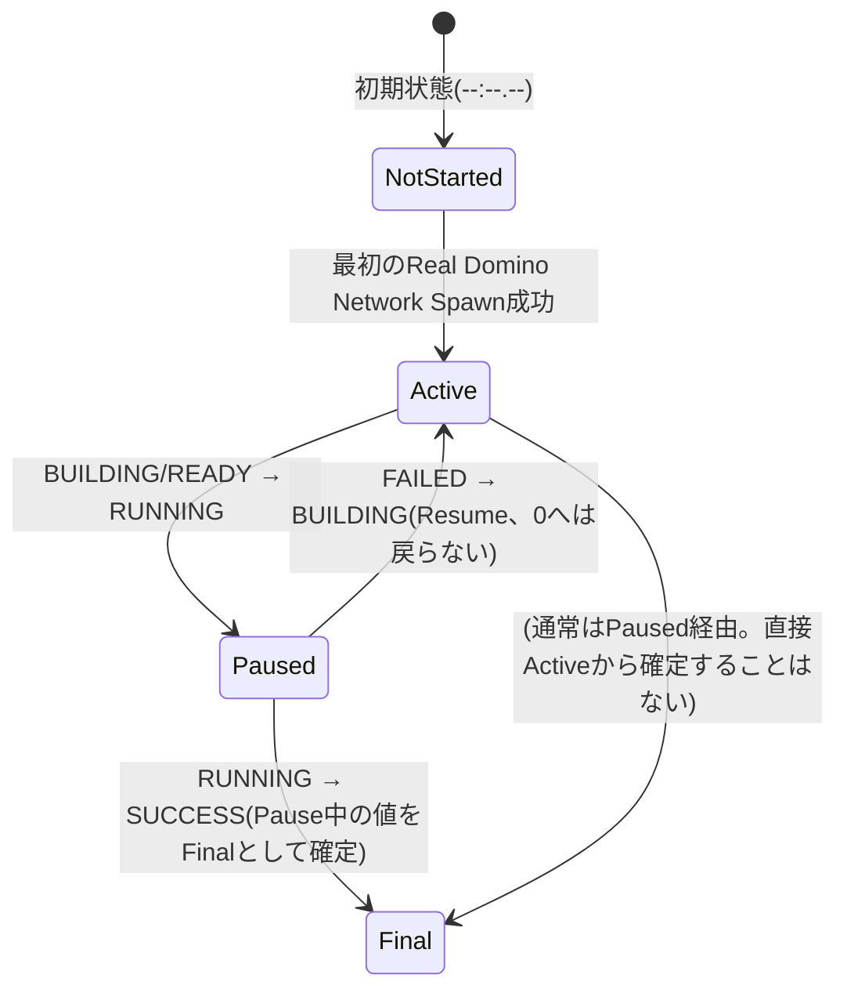

# ChallengeTimer(BUILD TIME計測の仕組み)

Step 8Bで導入したTimerは、当初RUNNING中の経過時間(Time Attack)を計測するものでしたが、Step 8.5で仕様を全面的に変更し、**BUILD TIME**(PlayerたちがDominoをBuildするために実際に使った累計時間)を計測する方式へ置き換えました。本ドキュメントはStep 8.5時点の実装を説明します。対象読者はGameFlow.mdを一通り読んだ開発者を想定しています。

---

## 1. BUILD TIMEとは何か

BUILD TIMEは「RUNNING中の経過時間」ではなく、「**PlayerたちがDominoをBuildするために使用した累計時間**」です。



- **Active**(進行中): `GamePhase`が`BUILDING`または`READY`の間。READYになってもPauseしません(FキーでRUNNINGへ入るまでの待ち時間もBUILD TIMEに含まれます)
- **Paused**(停止中): `GamePhase`が`RUNNING`または`FAILED`の間。Start Dominoを倒す時間・Chainが進む時間・Checkpoint通過・Goalまでの時間・FAILED表示中の時間は一切含まれません
- 複数回Failureしても、Active区間の合計だけが積み上がります(RUNNING/FAILED中の時間は毎回除外)

---

## 2. なぜGameFlowManagerに直接書かなかったか

`ChallengeTimer`は`GameFlowManager`とは別の`NetworkBehaviour`として、同じ`GameFlowManager` GameObject上に追加しています。GameFlowManager.cs自体にTimer用のロジックは書いていません。

`ChallengeTimer`は`Update()`(Server限定)の中で`GameFlowManager.Instance.CurrentPhase`を毎フレーム読み、前回観測した値と比較して変化した瞬間だけ反応する、という**外側からのポーリング**方式を取っています。

```csharp
private void Update()
{
    if (!IsServer) return;
    if (GameFlowManager.Instance == null) return;

    GamePhase phase = GameFlowManager.Instance.CurrentPhase;
    if (phase == _lastObservedPhase) return;

    GamePhase previous = _lastObservedPhase;
    _lastObservedPhase = phase;

    if (_timerStarted.Value)
    {
        bool wasActive = IsActivePhase(previous);
        bool isActive = IsActivePhase(phase);

        if (wasActive && !isActive)
        {
            // Pause: 直前のActive区間をAccumulatedへ畳み込む
            _accumulatedBuildSeconds.Value += NetworkManager.ServerTime.Time - _activeSegmentStartServerTime.Value;
        }
        else if (!wasActive && isActive)
        {
            // Resume: Accumulatedの続きから新しいActive区間を開始(0へは戻さない)
            _activeSegmentStartServerTime.Value = NetworkManager.ServerTime.Time;
        }
    }

    if (phase == GamePhase.SUCCESS)
    {
        _finalBuildSeconds.Value = _accumulatedBuildSeconds.Value;
    }
}
```

唯一の例外として、GameFlowManagerは**Retry時にだけ**`ChallengeTimer.Instance.ResetForRetry()`を直接呼びます(第6章参照)。これはPhase遷移からは検出できない「セッションそのものを完全に終了する」という操作のためです。

---

## 3. 最初のDomino Placementでの開始(PlacementControllerではなくDominoSpawnerから)

BUILD TIMEはGame開始直後には動きません。Marker表示・E押下・Ghost表示・Left Click・ClientがRPC Requestを送っただけでは開始せず、**Host側でPlacement Requestの検証が成功し、Real DominoのNetwork Spawnが実際に成功した瞬間**にのみ開始します。

```csharp
// DominoSpawner.cs: 検証成功後、Spawn直後
ChallengeTimer.Instance?.NotifyDominoPlaced();
```

`PlacementController.cs`は現在完成済みとしてFreeze対象になっているため、Timer開始のための処理は一切追加していません。代わりに、Host-authoritativeな`DominoSpawner.TryPlaceDomino()`が検証を通過してReal DominoをSpawnした直後というタイミングを利用しています。これはHostが最初に置いてもClientが最初に置いても同じ経路を通るため、どちらが最初でも同じBUILD TIMEが開始されます。

```csharp
// ChallengeTimer.cs
public void NotifyDominoPlaced()
{
    if (!IsServer) return;
    if (_timerStarted.Value) return;  // 最初の1回だけ

    _timerStarted.Value = true;
    _accumulatedBuildSeconds.Value = 0.0;
    _activeSegmentStartServerTime.Value = NetworkManager.ServerTime.Time;
}
```

最初に置いたDominoがその後BUILDING中のCleanupで削除されたとしても、BUILD TIME自体は止まりません。一度開始したBuild SessionはRetryが実行されるまで継続します。

---

## 4. Network Time(NGO 2.13.2)

引き続き`NetworkManager.ServerTime.Time`(NGOの同期されたServer時刻)を使用しています。Clientごとの`Time.time`による独立計測は行っていません。

毎Frame同期しているNetworkVariableはありません。表示中の値は各Clientが完全にLocalで計算します。

```csharp
public double GetBuildSeconds()
{
    if (HasFinalTime) return _finalBuildSeconds.Value;
    if (!_timerStarted.Value) return 0.0;
    if (NetworkManager == null) return _accumulatedBuildSeconds.Value;

    bool active = GameFlowManager.Instance != null && IsActivePhase(GameFlowManager.Instance.CurrentPhase);
    if (!active) return _accumulatedBuildSeconds.Value;

    return _accumulatedBuildSeconds.Value + (NetworkManager.ServerTime.Time - _activeSegmentStartServerTime.Value);
}
```

Network同期されるのは以下の4つのNetworkVariableのみで、いずれも状態が変化した瞬間にだけ書き込まれます(Per-frame同期は一切ありません)。

| NetworkVariable | 型 | 書き込まれるタイミング |
|---|---|---|
| `_timerStarted` | `bool` | 最初のDomino Spawn成功時(1回)、Retry時にfalseへ |
| `_accumulatedBuildSeconds` | `double` | Active→Pause遷移時に加算、Retry時に0へ |
| `_activeSegmentStartServerTime` | `double` | Timer開始時・Pause→Active遷移(Resume)時 |
| `_finalBuildSeconds` | `double` | SUCCESS時(1回)、Retry時に未設定へ |

---

## 5. FAILED中の扱いとAccumulate

FAILEDになった場合、そのAttemptの時間がClear Timeとして保存されることはありません(`_finalBuildSeconds`はSUCCESS時にしか書き込まれないため)。FAILED表示中もPausedのままで、`FailureDisplayDuration`の間もBUILD TIMEは進みません。

複数回Failureしても、Active区間(BUILDING/READY)の合計だけが積み上がります。例えば「30秒Build→RUNNING→FAILED→20秒Build→RUNNING→FAILED→15秒Build→RUNNING→SUCCESS」の場合、Final BUILD TIMEは約65秒(RUNNING/FAILED中の時間を含まない)になります。

---

## 6. Retryによる完全Reset

SUCCESS画面のRetry(GameFlow.md「Retry」章参照)が実行されると、GameFlowManagerが`ChallengeTimer.Instance.ResetForRetry()`を直接呼び、今回のBuild Sessionを完全に終了します。

```csharp
public void ResetForRetry()
{
    if (!IsServer) return;

    _timerStarted.Value = false;
    _accumulatedBuildSeconds.Value = 0.0;
    _activeSegmentStartServerTime.Value = NotSet;
    _finalBuildSeconds.Value = NotSet;
}
```

Retry後は表示が`--:--.--`へ戻り、次に置かれる最初のReal Dominoが新しいBUILD TIMEを0から開始します。

---

## 7. HUDとの関係

`GameplayHUD.cs`は`ChallengeTimer.Instance`を直接参照し、`GetBuildSeconds()`(Timer開始前は`HasStarted`を見て`--:--.--`を表示)を`MM:SS.xx`形式へ整形して、Phaseに関わらず常時表示します(Step 8B時点ではRUNNING中とSUCCESS後でのみ表示していましたが、Step 8.5でBUILDING/READY/RUNNING/FAILED/SUCCESSすべてで常時表示するよう変更しました)。`ChallengeTimer`自体はUIについて一切関知しません(責務分離)。

```csharp
private static string FormatTime(double seconds)
{
    if (seconds < 0.0) seconds = 0.0;
    int minutes = (int)(seconds / 60.0);
    double remainder = seconds - minutes * 60.0;
    return $"{minutes:00}:{remainder:00.00}";
}
```

---

## 8. Single Player / Multiplayer両対応

`ChallengeTimer`はConnected Playerの人数を一切参照しません。Host 1人だけの状態でも、最初のDomino Placement→READY→RUNNING→SUCCESSが成立しさえすれば同じロジックで正しく動作します。Step 9で正式なSingle Player Modeが追加されても、Gameplay Scene側の仕組みとしてはこのまま変更なく使えることを想定しています。
