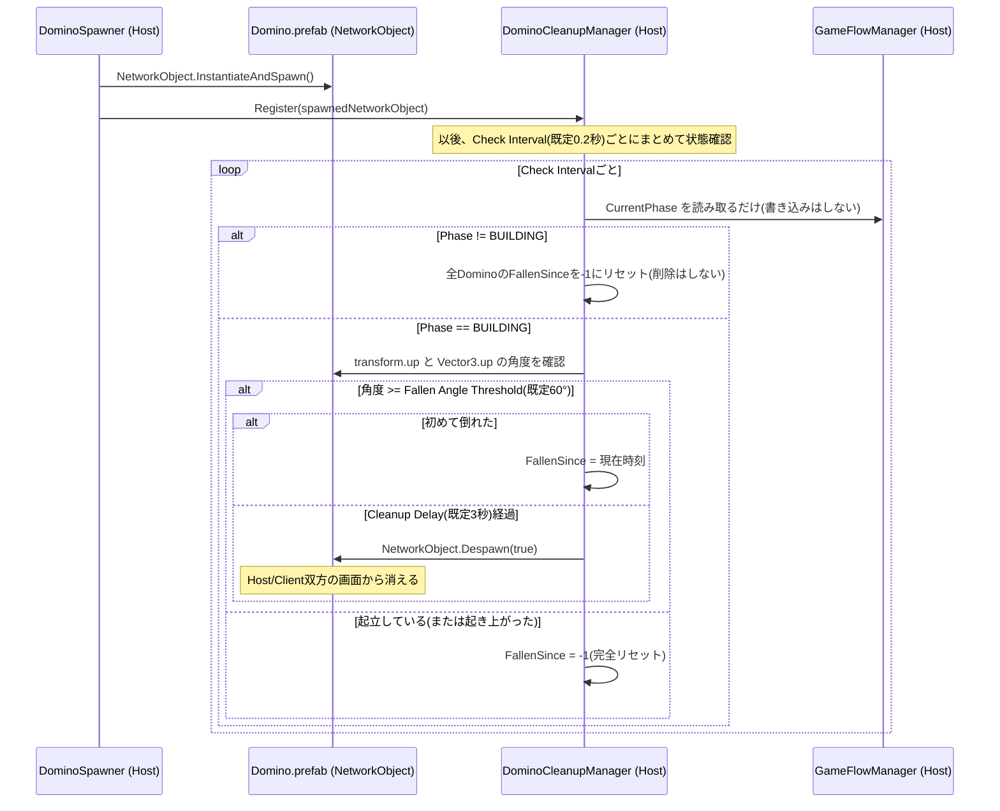

# DominoLifecycle(Domino配置後の生存管理)

このドキュメントは、Step 7で追加した「BUILDING中に倒れたDominoを自動的にNetwork Despawnする」仕組み(`DominoCleanupManager`)について、設計の意図・パラメータ・GameFlowとの関係を説明します。Placement(配置)そのものについては`PlayerSystem.md`の「Placement Mode」章、GameFlow(BUILDING/READY/RUNNING/SUCCESS)については`GameFlow.md`を参照してください。

---

## 1. 何のための仕組みか

BUILDING中(Playerがコースを組み立てている間)、うっかり自分や他のDominoに接触して倒してしまうことは頻繁に起こります。Step 6までは、一度倒れたDominoはずっとその場に残り続け、Playerが再びその場所へ配置しようとしても既存のDominoが邪魔になる、という問題がありました。

Step 7では、**BUILDING中に限り**、倒れたまま一定時間放置されたDominoを自動的に削除(Network Despawn)し、Playerが同じ場所に置き直せるようにしました。

**重要**: この仕組みが働くのはBUILDING中だけです。READY/RUNNING/SUCCESSでは、倒れたDominoはChain Reaction/Clear判定に使われる可能性があるため、**一切削除されません**。

---

## 2. 全体の流れ



---

## 3. Inspectorパラメータ

`DominoCleanupManager`(Scene内`NetworkManager` GameObjectにアタッチ)には3つの調整可能な値があります。

| フィールド | 既定値 | 意味 |
|---|---|---|
| `Fallen Angle Threshold` | 60° | この角度以上傾いたら「倒れた」と判定 |
| `Cleanup Delay` | 3秒 | 倒れた状態がこの秒数**連続**したら削除 |
| `Check Interval` | 0.2秒 | 登録済みDomino全体の状態確認を行う間隔 |

`Fallen Angle Threshold`は、GameFlow側の`CheckpointZone`等が使っている「倒れた」判定(同じく`Vector3.Angle(domino.up, Vector3.up)`ベース、既定60°)と**同じ考え方を流用していますが、別々の設定値**です。将来どちらか一方だけを調整したくなった場合も、もう片方に影響しません。

---

## 4. なぜタイマーを「一時停止」ではなく「リセット」にしたか

Domino が傾いて閾値を超えた瞬間から`Cleanup Delay`のカウントが始まりますが、その途中で起き上がって角度が閾値未満に戻ると、経過時間を保持したまま止める(Pause)のではなく、`FallenSince`を`-1`(未倒壊)へ完全にリセットします。

- **理由**: 「今にも倒れそうでずっとグラグラ揺れているDomino」が、閾値をまたぐたびに時間だけが積み上がっていって、想定より早く削除されてしまう事態を避けるためです。「倒れている状態が本当に連続何秒続いたか」だけを見るシンプルなルールにすることで、挙動が直感的になり、実装も`FallenSince`という1つの`float`だけで完結します。

Phaseが変わった場合(BUILDING → READY等)も同じ「リセット」方式を採用しています。BUILDING中に倒れて数秒経過したDominoがあっても、READYへ遷移した瞬間に`FallenSince`は`-1`に戻り、その後BUILDINGへ戻ったときは(まだ倒れていれば)改めて0秒からカウントが始まります。ユーザー様のご要望通り「一時停止して途中から再開」ではなく「常に0からやり直す」という、より単純な仕様です。

---

## 5. Scene全体検索をしない理由と、登録の仕組み

`DominoCleanupManager`は`FindObjectsByType<Domino>()`のようなScene全体を毎回検索する処理を一切持ちません。代わりに、`DominoSpawner.TryPlaceDomino()`が`NetworkObject.InstantiateAndSpawn()`でDominoを生成した直後に、その`NetworkObject`を`DominoCleanupManager.Instance.Register()`へ明示的に渡す方式です。

```csharp
NetworkObject spawned = NetworkObject.InstantiateAndSpawn(dominoPrefab, ...);

if (DominoCleanupManager.Instance != null)
{
    DominoCleanupManager.Instance.Register(spawned);
}
```

この方式には2つの利点があります。

1. **パフォーマンス**: Scene内のDomino数が増えても、`Update()`のたびに全GameObjectを検索するコストが発生しません
2. **`DominoLine`(Stage-authored)がDespawn対象から自動的に除外される**: `DominoLine`配下のDominoは、Scene上に直接配置された(Editor時点で置かれた)インスタンスであり、`DominoSpawner`経由でSpawnされたものではありません。そのため、これらは`Register()`が一度も呼ばれず、Despawn対象(`_tracked`)には構造的に一切含まれません。再配置する手段がないStage geometryのため、BUILDING Cleanup・FAILED Fallen-only Cleanup・Retry全削除のいずれによっても**絶対に削除されません**(下記「Step 8.6: Stage-authored DominoのActivity可視化」参照。Despawn対象外である点はStep 8.6でも変更していません)

---

## 6. Host専用であること

`DominoCleanupManager`は`NetworkBehaviour`ではなく通常の`MonoBehaviour`です(`DominoSpawner`と同じパターン)。`Update()`の先頭で次のガードを行っています。

```csharp
if (NetworkManager.Singleton == null || !NetworkManager.Singleton.IsServer) return;
```

これにより、Client上でも`DominoCleanupManager`のGameObject/コンポーネント自体は存在しますが、実際の判定・削除処理は一切走りません。**Despawnの判定と実行は常にHostのみが行い、Clientが独自にタイマーを持つことはありません。** 削除の結果(Dominoが消えること)は、NGOの標準的なDespawn同期の仕組みによってHost/Client双方の画面に反映されます。

---

## 7. GameFlowとの責務分離

`DominoCleanupManager`が`GameFlowManager`について知っているのは`CurrentPhase`を読み取ることだけです。`GamePhase`・`StartTriggered`・`CheckpointProgress`のいずれも書き込みません。逆に`GameFlowManager`側にもCleanup関連のコードは一切追加していません。この分離により、「Cleanupの都合でClear判定が狂う」「Clear判定の都合でCleanupが誤作動する」といった相互干渉が構造的に起こり得ないようになっています。

---

## 7.5. Zone内でDespawnされたDominoに関する既知の不具合と修正(Step 7.1)

上記の「責務分離」は**GameFlow側の状態(NetworkVariable)を直接書き換えない**という意味では正しく機能していましたが、Step 7.1で、Cleanupが**Start/Checkpoint/Goal Areaの内部トリガーリストを間接的に壊してしまう**不具合が見つかりました。

Start/Checkpoint/Goal Areaの各Zone(`DominoFallenZone`)は、`OnTriggerEnter`/`OnTriggerExit`で「今Zone内にいるDomino」のTransform参照を`_dominoesInside`というリストに保持しています。BUILDING中にZone内で倒れたDominoが`DominoCleanupManager`によってDespawnされると、UnityはColliderが破棄される際に`OnTriggerExit`を確実には発火させないため、このリストに**破棄済みのTransform参照**が残ってしまうことがありました。この状態でRUNNINGが開始されると、Zone側の`OnRunStart()`がこの破棄済み参照へアクセスして例外を投げ、`GameFlowManager.BeginRun()`が`SetPhase(RUNNING)`に到達する前に処理が中断する、という形で症状が現れました(詳細と修正内容は`GameFlow.md`の第4章を参照)。

修正は`DominoFallenZone.cs`側(Zoneの内部リストを破棄済み参照に対して安全にする)のみで行い、`DominoCleanupManager`のコード自体は一切変更していません。Cleanupは今回も「BUILDING中に倒れたDominoをDespawnする」以上のことは行っておらず、GameFlow側のNetworkVariableにも触れていません。今回の教訓は、**「別のシステムの状態を直接書き換えていなくても、それが管理しているオブジェクトを削除すること自体が、そのシステム内部のキャッシュされた参照を壊しうる」**という点です。DominoのDespawn/Destroyを行う可能性のある将来の機能(例えばStage ResetによるDomino一括削除)を追加する際は、Zone側の`_dominoesInside`のような「Transform参照をキャッシュしている箇所」に同種の注意が必要です。

---

## 7.6. Failure Reset / Retryとの関係、および3種類のDespawnの使い分け(Step 7.5、Step 8.6で改訂)

`GameFlowManager`は、状況に応じて3種類の異なるDespawn操作を使い分けます。本ドキュメントで説明してきた「BUILDING中に倒れたDominoを個別に3秒後削除する」通常のCleanupとは、いずれも**目的もタイミングも別物**です。

| | BUILDING Cleanup(Step 7) | FAILED Reset(Step 8.6で改訂) | Retry(Step 8.5) |
|---|---|---|---|
| 発生Phase | BUILDING中のみ | FAILED到達時のみ | SUCCESS中のRetry要求時のみ |
| 対象 | 倒れたまま`Cleanup Delay`秒経過したDominoだけ | **Fallen Dominoのみ**(`fallenAngleThreshold`以上傾いたもの) | 登録済みDomino**全部**(倒れているか起立しているかを問わない) |
| Standing Dominoへの影響 | 触れない | **維持する**(次Attemptで再利用可能) | 全削除 |
| 判定主体 | `DominoCleanupManager.Update()`(角度+タイマー) | `GameFlowManager`(順序違反 or Chain Stop Failure) | `GameFlowManager`(Retry Request) |
| 実行API | `NetworkObject.Despawn(true)`を個別に呼ぶ | `DominoCleanupManager.DespawnFallenRegistered(Action)` | `DominoCleanupManager.DespawnAllRegistered(Action)` |

**なぜFAILEDとRetryでAPIを分けたか(Step 8.6)**: 「失敗した部分だけ置き直して再挑戦したい」というFAILEDの用途と、「コースを完全に作り直す」というRetry(SUCCESS後)の用途は、意図が全く異なります。両者が同じ`DespawnAllRegistered()`を共有していると、将来どちらかの挙動だけを変えたくなった時に互いへ影響してしまうため、`DespawnFallenRegistered()`という別APIとして分離しました。

```csharp
// DominoCleanupManager.cs - 内部実装は共通のDespawnRoutine()を allowStanding フラグで使い分けるだけ
public void DespawnAllRegistered(Action onComplete)
    => StartCoroutine(DespawnRoutine(_tracked, allowStanding: true, onComplete));

public void DespawnFallenRegistered(Action onComplete)
    => StartCoroutine(DespawnRoutine(_tracked, allowStanding: false, onComplete));
```

いずれも`_tracked`(Player-placed Domino)だけが対象です。`_sceneAuthored`(Stage-authored、下記参照)はどちらのAPIからも一切触れられません。Batch Despawn(`despawnBatchSize`ごとに1Frame分`yield return null`を挟む)の仕組みは両APIで共通です。

**Standing Dominoが次Attemptで再利用可能な理由**: `DominoFallenZone.OnRunStart()`(`GameFlow.md`第4章)は、その時点で実際に倒れているDominoだけを除外リストへ入れます。FAILED ResetはFallen Dominoを`ResetRunState()`(→各Zoneの`OnRunStart()`)より**前に**削除するため、Reset完了時点でZone内に残っているDominoは必ず「倒れていない」状態です。結果として除外リストは空になり、追加のコード変更なしに、残ったStanding Dominoは新しいAttemptで通常通りFresh Fallen Eventの対象になります。

---

## 8. Meaningful Activity(Chain Stop Failure判定の活動検知、Step 8.6)

### 背景: なぜ`AnyTrackedDominoActive`を`HasMeaningfulActivity`へ改名・拡張したか

実際のプレイで、Domino Chainが明らかに進行中にもかかわらず`FAILED`になってしまう(False FAILED)ことが報告されました。調査の結果、Velocity(速度)閾値だけに頼った瞬間的なActivity判定には、以下のような弱点があることがわかりました。

- **Slowly Tipping Domino**: ゆっくり傾いているDominoは、Poll(既定0.25秒おき)のタイミング次第で瞬間的にVelocityが閾値未満になることがある(Contact Offset、Rigidbodyの一時的なSleep等)。見た目には明らかに倒れている途中でも、Velocityだけを見ると「静止している」と誤判定されうる
- **Stage-authored Dominoが判定対象外だった**: `AnyTrackedDominoActive()`は`_tracked`(Player-placed)しか見ていなかったため、Scene上に直接配置されたDominoが実際に激しく動いていても、Failure Monitorには一切見えていなかった
- **Fresh Fallen Event自体がFailure Timerをリセットしていなかった**: Checkpoint等が正しい順序で倒れても、それ以前から続いていた「静止判定」のカウントダウンには一切影響しなかった

### 対策1: Tilt Angle変化量による判定

Velocity閾値に加えて、**前回Poll時からのTilt Angle変化量**も見るようにしました。

```csharp
// DominoCleanupManager.cs
float tilt = Vector3.Angle(tracked.Transform.up, Vector3.up);
float previousTilt = tracked.PreviousTiltAngle;
tracked.PreviousTiltAngle = tilt;

if (tracked.Rigidbody.linearVelocity.sqrMagnitude > linSq) { any = true; continue; }
if (tracked.Rigidbody.angularVelocity.sqrMagnitude > angSq) { any = true; continue; }
if (previousTilt >= 0f && Mathf.Abs(tilt - previousTilt) > meaningfulTiltDelta) { any = true; }
```

`meaningfulTiltDelta`(既定2°)を超える角度変化があれば、Velocityが閾値未満でも「Activity中」とみなします。**Angleそのもの(何度傾いているか)ではなく、Angleの変化量**を見ている点が重要です。30°で完全に静止したDominoを永遠にActive扱いしてしまうと、今度はRUNNINGが永久に終了しなくなるため、「動き続けているかどうか」だけを判定します。`PreviousTiltAngle`は`HasMeaningfulActivity()`が呼ばれるたびに更新されますが、これは`GameFlowManager`のChain Stop Failure監視(`failureCheckInterval`ごと)がこのメソッドの唯一の呼び出し元であるため安全です。

### 対策2: Stage-authored Dominoの活動可視化

`_sceneAuthored`という新しいListを追加し、起動時(Server側、初回`Update()`)に1回だけ`GameObject.FindGameObjectsWithTag("Domino")`でScene上の全Domino-tagged NetworkObjectを走査し、`_tracked`にまだ入っていないもの(= `DominoSpawner`を経由していない、Stage-authoredなもの)を登録します。**この一度きりの走査だけがScene全体検索であり、`Update()`のたびに走査するわけではありません。**

```csharp
private void ScanSceneAuthoredDominoes()
{
    var dominoObjects = GameObject.FindGameObjectsWithTag("Domino");
    for (int i = 0; i < dominoObjects.Length; i++)
    {
        NetworkObject no = dominoObjects[i].GetComponent<NetworkObject>();
        if (no == null) continue;
        _sceneAuthored.Add(new TrackedDomino { NetworkObject = no, Transform = no.transform, Rigidbody = no.GetComponent<Rigidbody>() });
    }
}
```

`HasMeaningfulActivity()`は`_tracked`・`_sceneAuthored`の**両方**をチェックします。ただし`_sceneAuthored`は**Activity検知専用**であり、`DespawnAllRegistered()`/`DespawnFallenRegistered()`/BUILDING Cleanupのいずれからも一切参照されません(前章参照)。Stage-authored Dominoは再配置する手段が無いため、Despawn対象に含めることは決してありません。

### 対策3: Fresh Fallen EventによるFailure Timerのリセット

`GameFlowManager.OnZoneFallen()`が、正しい順序のFresh Fallen Eventを処理する際、`_settledSince`(静止判定の開始時刻)を明示的に`-1`(未開始)へリセットするようにしました。詳細は`GameFlow.md`第8章を参照してください。

### 対策4: Out-of-Bounds安全網(物理的な吹き飛び対策)

調査中、近接した位置へDominoを連続でSpawnした際、Unity Physicsが重なったRigidbody同士を引き離そうとして異常に大きな初速を与えてしまう(いわゆる「Physics Explosion」)現象が実際に再現しました。吹き飛んだDominoは地面をすり抜けて自由落下を続け、速度が際限なく増大し続けるため、`_tracked`に残ったままだと**Failure Monitorの活動判定を永久に汚染**してしまいます。

対策として、`DominoCleanupManager.Update()`の既存ループ(`_tracked`を毎Poll確認する処理)に、Y座標が`outOfBoundsY`(既定-10)を下回ったDominoを**Phaseを問わず即座にDespawn**する安全網を追加しました。Scene全体を検索する処理ではなく、既存の`_tracked`ループに1行追加しただけです。

```csharp
if (tracked.Transform.position.y < outOfBoundsY)
{
    NetworkObject stray = tracked.NetworkObject;
    _tracked.RemoveAt(i);
    stray.Despawn(true);
    continue;
}
```

---

## 9. 既知の制約・今後の検討事項

- **Object Poolingは未導入**: 現時点ではSpawn/Despawnのたびに実際にGameObjectを生成・破棄しています。将来的にDomino数が大幅に増える場合はPoolingの検討余地がありますが、Step 7では通常のNetwork Spawn/Despawn Lifecycleの動作確認を優先しています
- ~~Clear Judgementの「まとめて追いつく」既知の課題~~: **Step 7.5で解消済みです**。`GameFlow.md`の第5章を参照してください
- ~~SUCCESS後のリセットは未実装~~: **Step 8.5でRetryとして実装済みです**。第7.6章を参照してください
- **Physics Explosion自体の防止は未着手**: Step 8.6で対策したのは「吹き飛んだDominoがFailure判定を汚染しない」ことであり、吹き飛び自体(近接Spawn時の異常な初速)を防ぐPlacement側のValidation追加は、Placement Systemの凍結方針により今回は着手していません。将来的にPlacement側で「既存Dominoと重ならない位置かどうか」の検証を追加する余地があります
