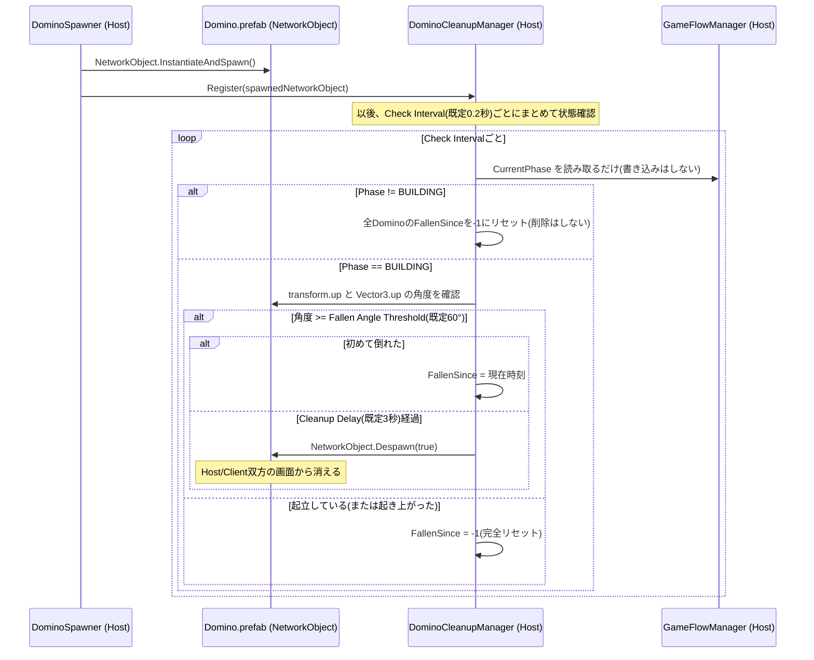

# DominoLifecycle(Domino配置後の生存管理)

このドキュメントは、Step 7で追加した「BUILDING中に倒れたDominoを自動的にNetwork Despawnする」仕組み(`DominoCleanupManager`)について、設計の意図・パラメータ・GameFlowとの関係を説明します。Placement(配置)そのものについては`PlayerSystem.md`の「Placement Mode」章、GameFlow(BUILDING/READY/RUNNING/SUCCESS)については`GameFlow.md`を参照してください。

---

## 1. 何のための仕組みか

BUILDING中(Playerがコースを組み立てている間)、うっかり自分や他のDominoに接触して倒してしまうことは頻繁に起こります。Step 6までは、一度倒れたDominoはずっとその場に残り続け、Playerが再びその場所へ配置しようとしても既存のDominoが邪魔になる、という問題がありました。

Step 7では、**BUILDING中に限り**、倒れたまま一定時間放置されたDominoを自動的に削除(Network Despawn)し、Playerが同じ場所に置き直せるようにしました。

**重要**: この仕組みが働くのはBUILDING中だけです。READY/RUNNING/SUCCESSでは、倒れたDominoはChain Reaction/Clear判定に使われる可能性があるため、**一切削除されません**。

---

## 2. 全体の流れ



---

## 3. Inspectorパラメータ

`DominoCleanupManager`(Scene内`NetworkManager` GameObjectにアタッチ)には3つの調整可能な値があります。

| フィールド | 既定値 | 意味 |
|---|---|---|
| `Fallen Angle Threshold` | 60° | この角度以上傾いたら「倒れた」と判定 |
| `Cleanup Delay` | 3秒 | 倒れた状態がこの秒数**連続**したら削除 |
| `Check Interval` | 0.2秒 | 登録済みDomino全体の状態確認を行う間隔 |

`Fallen Angle Threshold`は、GameFlow側の`CheckpointZone`等が使っている「倒れた」判定(同じく`Vector3.Angle(domino.up, Vector3.up)`ベース、既定60°)と**同じ考え方を流用していますが、別々の設定値**です。将来どちらか一方だけを調整したくなった場合も、もう片方に影響しません。

---

## 4. なぜタイマーを「一時停止」ではなく「リセット」にしたか

Domino が傾いて閾値を超えた瞬間から`Cleanup Delay`のカウントが始まりますが、その途中で起き上がって角度が閾値未満に戻ると、経過時間を保持したまま止める(Pause)のではなく、`FallenSince`を`-1`(未倒壊)へ完全にリセットします。

- **理由**: 「今にも倒れそうでずっとグラグラ揺れているDomino」が、閾値をまたぐたびに時間だけが積み上がっていって、想定より早く削除されてしまう事態を避けるためです。「倒れている状態が本当に連続何秒続いたか」だけを見るシンプルなルールにすることで、挙動が直感的になり、実装も`FallenSince`という1つの`float`だけで完結します。

Phaseが変わった場合(BUILDING → READY等)も同じ「リセット」方式を採用しています。BUILDING中に倒れて数秒経過したDominoがあっても、READYへ遷移した瞬間に`FallenSince`は`-1`に戻り、その後BUILDINGへ戻ったときは(まだ倒れていれば)改めて0秒からカウントが始まります。ユーザー様のご要望通り「一時停止して途中から再開」ではなく「常に0からやり直す」という、より単純な仕様です。

---

## 5. Scene全体検索をしない理由と、登録の仕組み

`DominoCleanupManager`は`FindObjectsByType<Domino>()`のようなScene全体を毎回検索する処理を一切持ちません。代わりに、`DominoSpawner.TryPlaceDomino()`が`NetworkObject.InstantiateAndSpawn()`でDominoを生成した直後に、その`NetworkObject`を`DominoCleanupManager.Instance.Register()`へ明示的に渡す方式です。

```csharp
NetworkObject spawned = NetworkObject.InstantiateAndSpawn(dominoPrefab, ...);

if (DominoCleanupManager.Instance != null)
{
    DominoCleanupManager.Instance.Register(spawned);
}
```

この方式には2つの利点があります。

1. **パフォーマンス**: Scene内のDomino数が増えても、`Update()`のたびに全GameObjectを検索するコストが発生しません
2. **Step 3の`DominoLine`が自動的に対象外になる**: `DominoLine`配下の20個のDominoは、Scene上に直接配置されたテスト用インスタンスであり、`DominoSpawner`経由でSpawnされたものではありません。そのため、これらは`Register()`が一度も呼ばれず、構造的にCleanup対象から除外されます(現在`DominoLine`自体が非アクティブなため実害はありませんが、将来再度アクティブ化した場合でも意図せずCleanup対象になることはありません)

---

## 6. Host専用であること

`DominoCleanupManager`は`NetworkBehaviour`ではなく通常の`MonoBehaviour`です(`DominoSpawner`と同じパターン)。`Update()`の先頭で次のガードを行っています。

```csharp
if (NetworkManager.Singleton == null || !NetworkManager.Singleton.IsServer) return;
```

これにより、Client上でも`DominoCleanupManager`のGameObject/コンポーネント自体は存在しますが、実際の判定・削除処理は一切走りません。**Despawnの判定と実行は常にHostのみが行い、Clientが独自にタイマーを持つことはありません。** 削除の結果(Dominoが消えること)は、NGOの標準的なDespawn同期の仕組みによってHost/Client双方の画面に反映されます。

---

## 7. GameFlowとの責務分離

`DominoCleanupManager`が`GameFlowManager`について知っているのは`CurrentPhase`を読み取ることだけです。`GamePhase`・`StartTriggered`・`CheckpointProgress`のいずれも書き込みません。逆に`GameFlowManager`側にもCleanup関連のコードは一切追加していません。この分離により、「Cleanupの都合でClear判定が狂う」「Clear判定の都合でCleanupが誤作動する」といった相互干渉が構造的に起こり得ないようになっています。

---

## 7.5. Zone内でDespawnされたDominoに関する既知の不具合と修正(Step 7.1)

上記の「責務分離」は**GameFlow側の状態(NetworkVariable)を直接書き換えない**という意味では正しく機能していましたが、Step 7.1で、Cleanupが**Start/Checkpoint/Goal Areaの内部トリガーリストを間接的に壊してしまう**不具合が見つかりました。

Start/Checkpoint/Goal Areaの各Zone(`DominoFallenZone`)は、`OnTriggerEnter`/`OnTriggerExit`で「今Zone内にいるDomino」のTransform参照を`_dominoesInside`というリストに保持しています。BUILDING中にZone内で倒れたDominoが`DominoCleanupManager`によってDespawnされると、UnityはColliderが破棄される際に`OnTriggerExit`を確実には発火させないため、このリストに**破棄済みのTransform参照**が残ってしまうことがありました。この状態でRUNNINGが開始されると、Zone側の`OnRunStart()`がこの破棄済み参照へアクセスして例外を投げ、`GameFlowManager.BeginRun()`が`SetPhase(RUNNING)`に到達する前に処理が中断する、という形で症状が現れました(詳細と修正内容は`GameFlow.md`の第4章を参照)。

修正は`DominoFallenZone.cs`側(Zoneの内部リストを破棄済み参照に対して安全にする)のみで行い、`DominoCleanupManager`のコード自体は一切変更していません。Cleanupは今回も「BUILDING中に倒れたDominoをDespawnする」以上のことは行っておらず、GameFlow側のNetworkVariableにも触れていません。今回の教訓は、**「別のシステムの状態を直接書き換えていなくても、それが管理しているオブジェクトを削除すること自体が、そのシステム内部のキャッシュされた参照を壊しうる」**という点です。DominoのDespawn/Destroyを行う可能性のある将来の機能(例えばStage ResetによるDomino一括削除)を追加する際は、Zone側の`_dominoesInside`のような「Transform参照をキャッシュしている箇所」に同種の注意が必要です。

---

## 8. 既知の制約・今後の検討事項

- **Object Poolingは未導入**: 現時点ではSpawn/Despawnのたびに実際にGameObjectを生成・破棄しています。将来的にDomino数が大幅に増える場合はPoolingの検討余地がありますが、Step 7では通常のNetwork Spawn/Despawn Lifecycleの動作確認を優先しています
- **SUCCESS後のリセットは未実装**: SUCCESS到達後、コースを最初から作り直す(Dominoを一括削除する)機能はまだありません。将来のStage Reset機能で扱う予定です
- **Clear Judgementの「まとめて追いつく」既知の課題**: `GameFlow.md`の第5章を参照してください。Step 7のCleanupとは無関係な、別の既知の課題です
