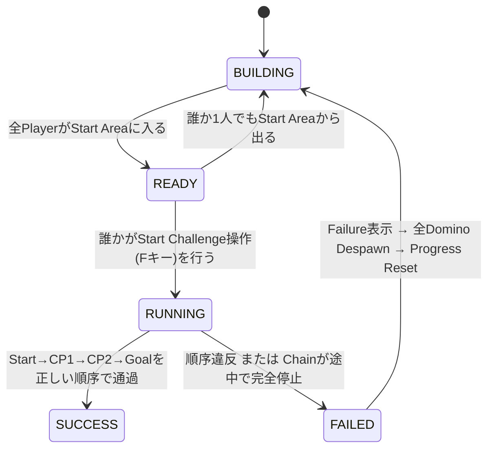
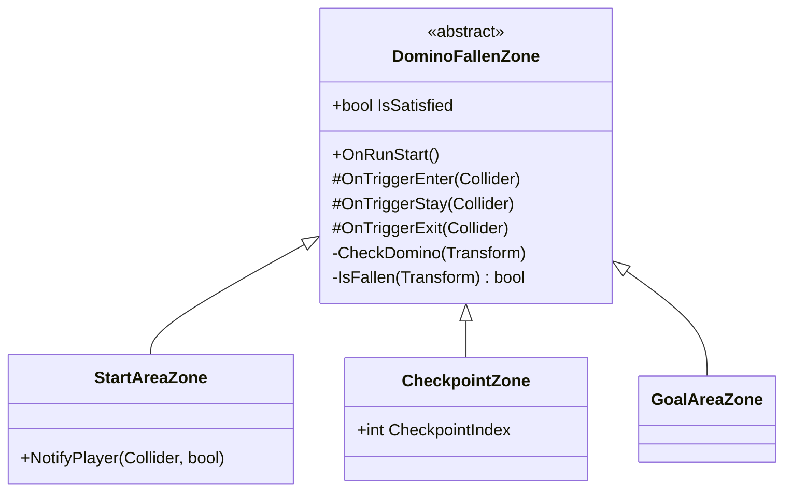
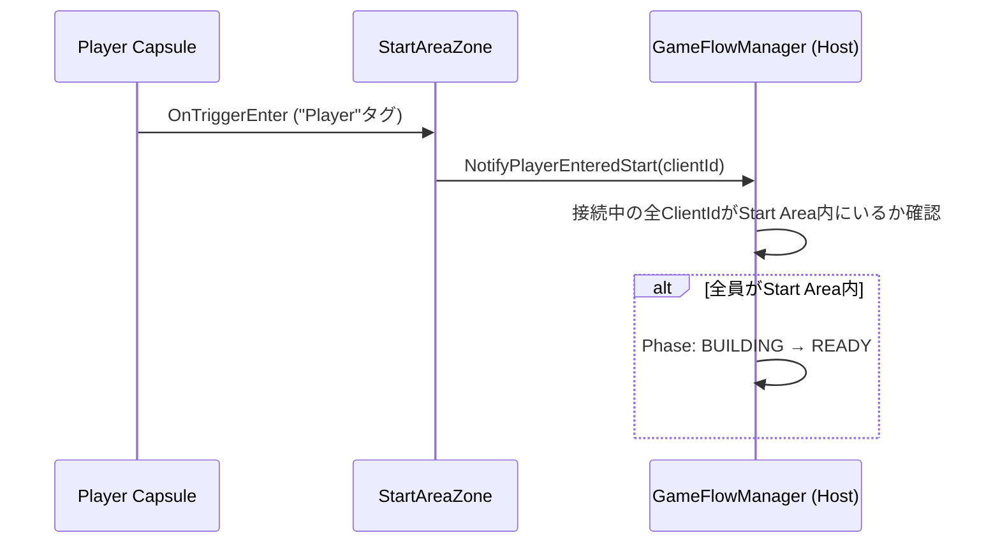
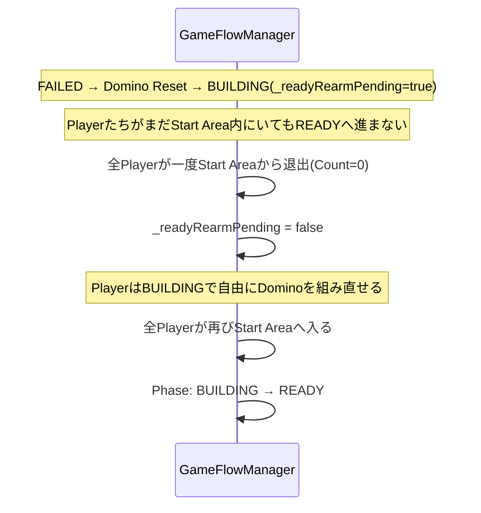
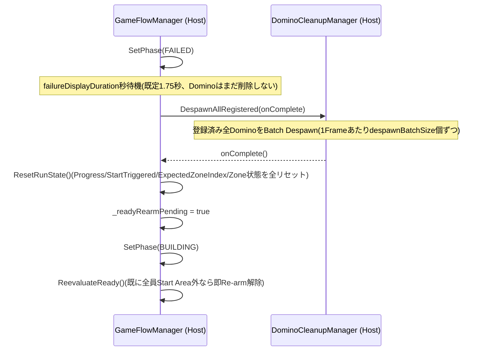

# GameFlow(ゲームの進行管理)

このドキュメントは、Step 6で追加し、Step 7.5で`FAILED`と厳密なClear判定を追加した「BUILDING → READY → RUNNING → SUCCESS / FAILED」というゲーム進行の仕組みについて、実際の実装を基に説明します。対象読者は、Unity/Netcodeを久しぶりに触る開発者を想定しています。

---

## 1. GamePhaseとは何か

```csharp
public enum GamePhase
{
    BUILDING,
    READY,
    RUNNING,
    SUCCESS,
    FAILED
}
```

ゲーム全体が今どの状態にあるかを表す5つの値です(`FAILED`はStep 7.5で追加)。それぞれの意味は次の通りです。

| Phase | 状態 | Domino配置 | Checkpoint/Goal判定 |
|---|---|---|---|
| **BUILDING** | Playerが自由に移動してDominoを配置している段階 | 可能 | 無効(何が倒れても進行しない) |
| **READY** | 全員がStart Areaに入り、挑戦を始められる状態 | 不可 | 無効 |
| **RUNNING** | 正式なDomino Challenge中 | 不可 | 有効 |
| **SUCCESS** | Start→Checkpoint→Goalを正しい順序で通過し終えた状態 | 不可 | (クリア済み。Dominoは削除されず残る) |
| **FAILED** | 順序違反、またはChainが途中で完全に静止して失敗した状態 | 不可 | (失敗確定。表示後、全Domino削除→BUILDINGへ) |

Step 7.6で、Player Camera(Overview⇔Third Person)とPlayer移動範囲(Start Area拘束)もこのPhaseに連動するようになりました。`GameFlowManager.IsChallengeActive`(`RUNNING || SUCCESS || FAILED`のいずれか)という1つのプロパティが、両方の切り替え判定の共通の拠り所です。詳細は`PlayerSystem.md`の「RUNNING中のPlayer移動制限とOverview Camera」章を参照してください。

---

## 2. 全体の流れ



`SUCCESS`から`BUILDING`へ戻る経路(Retry/Next Stage)は今回意図的に実装していません(Step 6・7.5いずれの対象外です)。`FAILED`から`BUILDING`へは自動的に戻りますが、その直後すぐに`READY`へ進めるわけではない点に注意してください(第9章「Ready Re-arm」を参照)。

---

## 3. なぜHost Authorityなのか

`GameFlowManager`は`NetworkBehaviour`で、Phase(進行状態)は**必ずHost側だけが書き換え**、`NetworkVariable`で全Clientへ配信する設計です。ClientやHostの区別なく、どのPCでも同じ`GameFlowManager`インスタンスが存在しますが、実際に状態を変更するメソッド(`SetPhase`、`ReevaluateReady`等)はすべて先頭で`if (!IsServer) return;`を確認しています。

**なぜこの設計にしたか**: DominoはStep 5から一貫してHost Authorityです。「どのDominoがどのタイミングで倒れたか」を正確に把握できるのはHostだけなので、それを基にした「Checkpointを通過したかどうか」の判定も自然とHost側だけの責任になります。Host/Clientがそれぞれ独自に判定を進めてしまうと、わずかな物理演算のズレ(Step 3・4で確認したカオス的挙動)によって、PlayerごとにGameFlowの状態が食い違ってしまう危険があります。

```csharp
private readonly NetworkVariable<GamePhase> _phase = new NetworkVariable<GamePhase>(
    GamePhase.BUILDING, NetworkVariableReadPermission.Everyone, NetworkVariableWritePermission.Server);
```

`NetworkVariableWritePermission.Server`が「Hostしか書き換えられない」を保証し、`NetworkVariableReadPermission.Everyone`が「全員が読める(表示できる)」を保証しています。

---

## 4. Zoneの仕組み(Start Area / Checkpoint / Goal Area共通)

3種類のZone(`StartAreaZone`、`CheckpointZone`、`GoalAreaZone`)は、いずれも共通の基底クラス`DominoFallenZone`を継承しています。



### 「倒れた」の判定方法

各Zoneは`Collider`(`m_IsTrigger = true`)を持ち、`"Domino"`タグの付いたオブジェクトとの接触を`OnTriggerEnter`/`OnTriggerStay`/`OnTriggerExit`で監視します。Unityは、トリガー同士の接触を毎`FixedUpdate`ごとに自動で通知してくれるため、**全Dominoを毎フレーム検索するような重い処理は一切ありません**。

Dominoが「倒れた」かどうかは、Domino自身のUp方向と世界のUp方向の角度差で判定しています。

```csharp
Vector3.Angle(dominoTransform.up, Vector3.up) >= fallenAngleThreshold  // 既定60°
```

判定処理(`CheckDomino`)はHost側でのみ実行され(`NetworkManager.Singleton.IsServer`を確認)、`RUNNING`中でなければ何もしません。一度`IsSatisfied`が`true`になったZoneは、それ以降そのRUNNING中は判定をやり直しません(Dominoが転がってZoneの外へ出ても、達成状態は取り消されません)。

### RUNNING開始前から倒れていたDominoの除外

`OnRunStart()`は、`GameFlowManager`がRUNNINGへ移行する瞬間に全Zoneへ向けて呼ばれます。この時点でZone内に**既に**倒れているDominoがあれば、そのDominoを「除外リスト」へ登録し、以後そのRUNNING中は二度とカウント対象にしません。

```csharp
public void OnRunStart()
{
    IsSatisfied = false;
    _excludedDominoes.Clear();
    _dominoesInside.RemoveWhere(t => t == null);  // Step 7.1で追加(下記の既知の不具合と修正を参照)
    foreach (var t in _dominoesInside)
    {
        if (IsFallen(t)) _excludedDominoes.Add(t);
    }
}
```

**なぜこれが必要か**: BUILDING中にPlayerが誤ってDominoにぶつかり、たまたまStart/Checkpoint/Goal Areaの中で倒れてしまうことは十分あり得ます。この「事故」がRUNNING開始と同時に「もう通過済み」として扱われてしまうと、プレイヤーが実際に何もしていないのにゲームが進んでしまいます。除外リストによって、「このRUNNING開始時点で既に倒れていたDomino」と「このRUNNING中に新しく倒れたDomino」を区別しています。

> **バグ修正の記録(Step 7.1)**: Step 7で追加したBUILDING中の自動Cleanup(`DominoLifecycle.md`参照)により、「Zone内で倒れたまま放置されたDomino」がNetwork Despawnされるようになりましたが、これによって`_dominoesInside`が**破棄済みのTransform参照**を保持し続けてしまう不具合が見つかりました。UnityはColliderが破棄される際、`OnTriggerExit`を確実には発火させないため、Cleanupで削除されたDominoがZoneの内部リストから正しく除去されないケースがあったのが原因です。この状態でRUNNINGが開始されると、`OnRunStart()`が破棄済みのTransformの`.up`にアクセスして`MissingReferenceException`を送出し、`GameFlowManager.BeginRun()`が`SetPhase(RUNNING)`に到達する前に処理を中断していました(RPCハンドラ内の未処理例外としてNGOがログに記録するのみで、`GamePhase`はREADYのまま変化しないため、「Fキーを押してもRUNNINGへ遷移しない」という形で現れていました)。修正として、`OnRunStart()`の先頭で`_dominoesInside`から破棄済み参照を`RemoveWhere(t => t == null)`で除去し、`IsFallen()`自体にもnullガードを追加しました。この修正はStart/Checkpoint/Goalの3種すべてに共通の基底クラス(`DominoFallenZone`)で行っているため、3つのZoneすべてに適用されています。

---

## 5. Strict Clear判定: Fresh Fallen Eventの順序(Step 7.5で刷新)

Step 6〜Step 7.1までは、`GameFlowManager`が「今どのZoneが`IsSatisfied`か」を毎回**全Zone再スキャン**して`CheckpointProgress`を計算していました。この方式には、`CP2`が先に倒れてしまっていても、あとから`CP1`が正しい順序で倒れた瞬間に`CP2`の分もまとめて「追いつき」でクリア扱いになってしまう、というClear判定の緩さがありました(過去の実装は本章の履歴として末尾に残しています)。

Step 7.5では、この「全Zone再スキャン+まとめて追いつく」方式を廃止し、**「RUNNING中に発生したFresh Fallen Eventの順序」だけを正**とする方式に変更しました。

### Expected Zone Index

`GameFlowManager`は`Awake()`時に、Start→Checkpoint(`CheckpointIndex`昇順)→Goalを1本の順序リストにまとめます。

```csharp
private List<DominoFallenZone> _orderedZones; // [startArea, cp0, cp1, ..., cpN-1, goalArea]
private int _expectedZoneIndex; // 次にFresh Fallen Eventが来るべきZoneのIndex
```

RUNNING開始時、`_expectedZoneIndex`は`0`(=Start)にリセットされます。Checkpoint数をハードコードしていないため、Stage Authoringで将来Checkpointを何個追加・削除しても同じ仕組みがそのまま機能します。

### Zoneからの通知とOrder判定

各Zone(`DominoFallenZone.CheckDomino()`)は、以前と同じく「(除外対象でない)Dominoが新しく倒れた瞬間」に一度だけ`GameFlowManager`へ通知します。ただし通知先メソッドが変わり、**どのZoneが発火したか**を渡すようになりました。

```csharp
// DominoFallenZone.cs
if (IsFallen(dominoTransform))
{
    IsSatisfied = true;
    GameFlowManager.Instance.OnZoneFallen(this);
}
```

```csharp
// GameFlowManager.cs
public void OnZoneFallen(DominoFallenZone zone)
{
    if (!IsServer) return;
    if (_phase.Value != GamePhase.RUNNING) return;

    int firedIndex = _orderedZones.IndexOf(zone);
    if (firedIndex != _expectedZoneIndex)
    {
        TriggerFailure();   // 順序違反 = 即FAILED
        return;
    }

    if (zone == goalArea) { SetPhase(GamePhase.SUCCESS); return; }
    if (zone == startArea) _startTriggered.Value = true;
    else _checkpointProgress.Value++;

    _expectedZoneIndex++;
}
```

`GameFlowManager`は他のZoneの状態を一切再スキャンしません。発火したZoneが「今まさに期待されているIndexと一致するか」だけを見て、一致すれば1つ進め、一致しなければ即座に`FAILED`とします。これにより:

- **CP2が先に倒れてもProgressが進まない**: `Expected=CP1(Index 1)`の状態で`CP2(Index 2)`のFresh Eventが来ると、`firedIndex(2) != _expectedZoneIndex(1)`なので即`FAILED`になります(以前のように無視されたり、後から追いつくことはありません)
- **CP2を先に倒してからCP1を倒しても、CP2は再利用されない**: `DominoFallenZone.IsSatisfied`は1回のRUNNINGにつき1度しか`true`にならない(一度trueになったら`CheckDomino`が即returnする)ため、CP2のZoneは既にこのRUNNING中の"持ち球"を使い切っています。仮にCP2が先に倒れてFAILEDにならなかったとしても(理論上は即FAILEDになりますが)、その後CP1が正しい順序で倒れてCP1のExpectedを満たしても、CP2のZoneが改めてEventを発火することはありません
- **Goalが先に倒れてもSUCCESSにならない**: 全Checkpointを飛ばしてGoalのFresh Eventが来た場合も、同じ順序チェックで`FAILED`になります

### Wrong Orderの具体例

| Expected | 実際に発火したZone | 結果 |
|---|---|---|
| Start(0) | Start | Progress進行、Expected→CP0 |
| CP0(1) | CP0 | Progress進行、Expected→CP1 |
| CP1(1相当) | CP2 | **FAILED**(CP1を飛ばした) |
| Start(0) | CP1 または Goal | **FAILED**(Startより前) |

---

## 5.5. RUNNING開始前から倒れていたDominoの除外(維持)

Step 6から維持している「RUNNING開始時点で既にZone内で倒れていたDominoは除外する」仕組み(`OnRunStart()`/`_excludedDominoes`、第4章参照)は、Step 7.5でも一切変更していません。除外されたDominoは`CheckDomino`内で早期returnするため、`OnZoneFallen`自体が呼ばれず、Fresh Fallen Event判定の対象にすらなりません。RUNNING開始後に**新しく**Zone内に入ってきたDomino(既に倒れた状態で転がり込んできたケースを含む)は除外対象ではないため、通常通りFresh Eventとして扱われます。

---

## 6. Player Ready判定(Start Area)

`StartAreaZone`だけは、Dominoに加えてPlayerの出入りも監視します。



`GameFlowManager`は`_playersInStartArea`(`HashSet<ulong>`)で「今Start Area内にいるClientId」を管理し、`NetworkManager.ConnectedClientsIds`(現在接続中の全Client)と突き合わせて「全員揃っているか」を判定します。誰かが切断した場合も`OnClientDisconnectCallback`で追跡から外れるため、既に切断した人を待ち続けることはありません。

### Ready Re-arm(Step 7.5で追加)

`FAILED`から`BUILDING`へ自動的に戻った直後、RUNNING中にStart Areaへ入ったままだったPlayerがまだそこに残っていることがあります。何もしなければ、`_playersInStartArea`が既に「全員揃っている」状態のままなので、Domino Reset完了と同時に即座に`READY`へ戻ってしまい、Playerが新しくDominoを置き直す間もなく再挑戦を促されてしまいます。

これを防ぐため、`_readyRearmPending`というフラグを設けました。Failure Reset(第9章)の最後で`true`にセットされ、`ReevaluateReady()`はこのフラグが立っている間、たとえ`AllConnectedPlayersInStartArea()`が`true`でも`READY`へは進みません。

```csharp
private void ReevaluateReady()
{
    if (!IsServer) return;
    if (_phase.Value == GamePhase.RUNNING || _phase.Value == GamePhase.SUCCESS || _phase.Value == GamePhase.FAILED) return;

    if (_readyRearmPending)
    {
        if (_playersInStartArea.Count > 0) return;  // 全員退出するまでREADYへ進めない
        _readyRearmPending = false;
    }

    bool allReady = AllConnectedPlayersInStartArea();
    ...
}
```

`_playersInStartArea.Count`が`0`になった(=全Playerが一度でもStart Areaの外へ出た)瞬間にフラグが解除され、以後は通常通り「全員揃ったらREADY」の判定に戻ります。これにより、Failure後の自然な流れは次のようになります。



Failure Reset完了時にPlayerが既に全員Start Areaの外にいた場合(RUNNING中に外へ出ていた等)も取りこぼさないよう、Reset処理の最後で`ReevaluateReady()`を明示的に一度呼び、その場でフラグを解除できるようにしています。

---

## 7. Start Challenge(READY → RUNNING)

READY状態になっただけでは自動的にRUNNINGへ移行しません。`F`キー(`ChallengeInput.cs`、Player.prefabに追加)を押すと、Hostへ向けてRPCが送信されます。

```csharp
[Rpc(SendTo.Server, InvokePermission = RpcInvokePermission.Everyone)]
public void RequestStartChallengeRpc(RpcParams rpcParams = default)
{
    if (_phase.Value != GamePhase.READY) return;
    if (!AllConnectedPlayersInStartArea()) return;

    BeginRun();
}
```

`InvokePermission = RpcInvokePermission.Everyone`としているのは、`GameFlowManager`のNetworkObjectがHost所有(Server-owned)であり、「Owner限定」にしてしまうとHost自身しかこのRPCを呼べなくなってしまうためです(Player.prefabの`PlacementController`とは逆の設定である点に注意してください)。誰から呼ばれても構いませんが、内部で必ず「READY状態かどうか」「本当に全員がStart Area内にいるか」を**再検証**しており、Client側のキャッシュされた情報を無条件に信用していません。

`ChallengeInput.cs`をあえて`PlacementController`と別スクリプトにしているのは、これが配置操作とは無関係な単発の入力トリガーであり、将来UIボタンに置き換える際に配置システムを一切触らずに済むようにするためです。

---

## 8. Chain Stop Failure判定(Step 7.5で追加)

正しい順序で進んでいても、Domino Chainが物理的に途中で完全に止まってしまうケースもFailureとして扱います。「3秒経過したらFailure」のような単純Timerではなく、**登録済みDominoが実際に静止しているかどうか**をRigidbodyの速度から判定します。

```csharp
private void Update()
{
    if (!IsServer) return;
    if (_phase.Value != GamePhase.RUNNING) return;
    if (!_startTriggered.Value) return;  // Startすら倒れていない間はFailure判定しない

    _timeSinceLastFailureCheck += Time.deltaTime;
    if (_timeSinceLastFailureCheck < failureCheckInterval) return;
    _timeSinceLastFailureCheck = 0f;

    bool anyActive = DominoCleanupManager.Instance != null &&
        DominoCleanupManager.Instance.AnyTrackedDominoActive(linearVelocityThreshold, angularVelocityThreshold);

    if (anyActive) { _settledSince = -1f; return; }
    if (_settledSince < 0f) { _settledSince = Time.time; return; }
    if (Time.time - _settledSince >= failureSettleDuration) TriggerFailure();
}
```

### なぜStartTriggered前は判定しないのか

RUNNINGへ入った直後は、まだ誰もStart Dominoに触れていないため、全Dominoが完全に静止しているのが**正常な状態**です。`_startTriggered.Value`が`true`になるまでは`Update()`の先頭で早期returnし、PlayerがStart Dominoを倒すまで何秒でも待てるようにしています。

### Domino Activity判定(DominoCleanupManagerの既存Registryを再利用)

「今何かが動いているか」の判定は、Step 7で追加した`DominoCleanupManager`が既に持っている登録リスト(`DominoSpawner`がSpawn時に`Register()`したもの)をそのまま再利用します。Scene全体を検索する処理は追加していません。

```csharp
// DominoCleanupManager.cs
public bool AnyTrackedDominoActive(float linearVelocityThreshold, float angularVelocityThreshold)
{
    float linSq = linearVelocityThreshold * linearVelocityThreshold;
    float angSq = angularVelocityThreshold * angularVelocityThreshold;
    foreach (var tracked in _tracked)
    {
        if (tracked.NetworkObject == null || !tracked.NetworkObject.IsSpawned) continue;
        if (tracked.Rigidbody == null) continue;
        if (tracked.Rigidbody.linearVelocity.sqrMagnitude > linSq) return true;
        if (tracked.Rigidbody.angularVelocity.sqrMagnitude > angSq) return true;
    }
    return false;
}
```

単純に速度が完全な`0`かどうかを見ると、浮動小数点誤差やDomino同士の微振動で誤判定しやすいため、`linearVelocityThreshold`(既定`0.02`m/秒)・`angularVelocityThreshold`(既定`0.05`ラジアン/秒)という小さな閾値を設け、これを下回れば「静止」とみなしています。1つでも閾値を超えて動いているDominoがあれば`_settledSince`を`-1`(未静止)へ戻し、静止継続時間の計測をやり直します。

### SUCCESS優先

Goalの正しいFresh Fallen Eventは`OnZoneFallen()`から**同期的に即座に**`SetPhase(GamePhase.SUCCESS)`しますが、これは物理のTrigger Callback(`FixedUpdate`相当のタイミング)から呼ばれます。Unityは1フレーム内で物理更新→`Update()`の順に処理するため、同一フレーム内でGoal到達とChain Stop Failureの条件が両方満たされていても、`Update()`側の判定は`if (_phase.Value != GamePhase.RUNNING) return;`で必ず弾かれ、既に`SUCCESS`になった後にFailureが上書きされることはありません。

---

## 9. Failure Reset(FAILED → BUILDING)

`TriggerFailure()`が呼ばれると(順序違反・Chain Stop Failureのいずれからでも共通)、以下の流れでBUILDINGへ戻ります。



### Batch Despawn(Step 5のTransport Queue警告対策)

Step 5で、10個のDominoを同一フレームでSpawnした際にUnityTransportの受信キュー警告が発生したことが記録されています。同じ問題がFailure時の一括Despawnでも起こりうるため、`DominoCleanupManager.DespawnAllRegistered()`は`despawnBatchSize`(既定10個)ごとに1フレーム分`yield return null`で間を空けるコルーチンとして実装しています。Transport自体のQueue Size設定は変更していません。

```csharp
// DominoCleanupManager.cs
public void DespawnAllRegistered(Action onComplete) => StartCoroutine(DespawnAllRegisteredRoutine(onComplete));

private IEnumerator DespawnAllRegisteredRoutine(Action onComplete)
{
    var toDespawn = ...; // 現在の登録リストのスナップショット
    _tracked.Clear();
    int count = 0;
    foreach (var no in toDespawn)
    {
        if (no != null && no.IsSpawned) no.Despawn(true);
        if (++count % despawnBatchSize == 0) yield return null;
    }
    onComplete?.Invoke();
}
```

全Dominoの削除が完了する(`onComplete`が呼ばれる)まで`GameFlowManager`は`BUILDING`へ戻さず待機します。これにより「Despawn途中でPlayerがもう配置を始めてしまう」ような状態を避けています。

### SUCCESSではリセットしない

`SUCCESS`はこのリセットフローの対象外です。成功したDomino Chainはそのまま画面に残り、Retry/Next Stage等は将来のStepで扱います。

### Cleanupとの責務分離

`DespawnAllRegistered()`・`AnyTrackedDominoActive()`はいずれも`DominoCleanupManager`の既存Registry(Step 7で`DominoSpawner`がSpawn時に登録したリスト)を読み書きするだけで、`GamePhase`等のGameFlow状態には一切触れません。逆に`GameFlowManager`側も、Step 7から続く「BUILDING中に倒れたまま3秒経過したDominoを個別に削除する」通常のCleanup(`DominoCleanupManager.Update()`)には一切関与していません。**BUILDING中の個別Cleanup(Step 7)**と**FAILED時の一括Reset(Step 7.5)**は、目的も実行タイミングも完全に別のものです。詳細は`DominoLifecycle.md`を参照してください。

---

## 10. 関連コンポーネントの一覧

| ファイル | クラス | 継承元 | 役割 |
|---|---|---|---|
| [GamePhase.cs](../Assets/_Project/Scripts/GameFlow/GamePhase.cs) | `Domino.GameFlow.GamePhase` | enum | ゲーム進行状態の定義 |
| [GameFlowManager.cs](../Assets/_Project/Scripts/GameFlow/GameFlowManager.cs) | `Domino.GameFlow.GameFlowManager` | `NetworkBehaviour` | Phase/Checkpoint進捗をHost Authorityで管理し、NetworkVariableで同期する司令塔。Step 7.5でExpected Zone順序判定・Chain Stop Failure監視・Failure Reset・Ready Re-armを追加 |
| [DominoFallenZone.cs](../Assets/_Project/Scripts/GameFlow/DominoFallenZone.cs) | `Domino.GameFlow.DominoFallenZone` | `MonoBehaviour`(abstract) | 「Zone内でDominoが倒れたか」を判定する共通ロジック |
| [StartAreaZone.cs](../Assets/_Project/Scripts/GameFlow/StartAreaZone.cs) | `Domino.GameFlow.StartAreaZone` | `DominoFallenZone` | Start Domino判定 + Player Ready判定 |
| [CheckpointZone.cs](../Assets/_Project/Scripts/GameFlow/CheckpointZone.cs) | `Domino.GameFlow.CheckpointZone` | `DominoFallenZone` | Checkpoint判定 + 通過順序(`CheckpointIndex`) |
| [GoalAreaZone.cs](../Assets/_Project/Scripts/GameFlow/GoalAreaZone.cs) | `Domino.GameFlow.GoalAreaZone` | `DominoFallenZone` | Goal判定 |
| [ChallengeInput.cs](../Assets/_Project/Scripts/Player/ChallengeInput.cs) | `Domino.Player.ChallengeInput` | `NetworkBehaviour` | `F`キー押下をHostへのRPC呼び出しに変換する |

Zone自体(`NetworkObject`を持たない)はStage(Scene)側に配置するPrefabで、Stage Authoringの詳細は`StageAuthoring.md`を参照してください。
