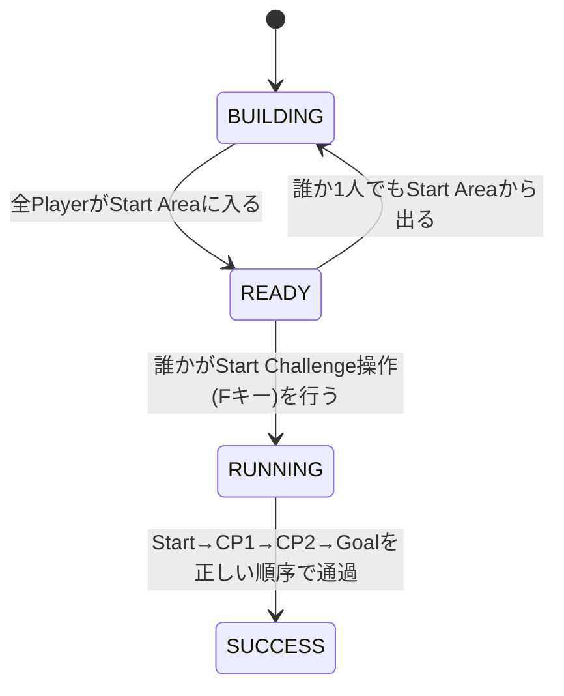
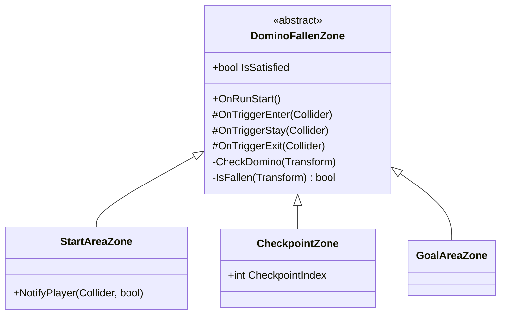
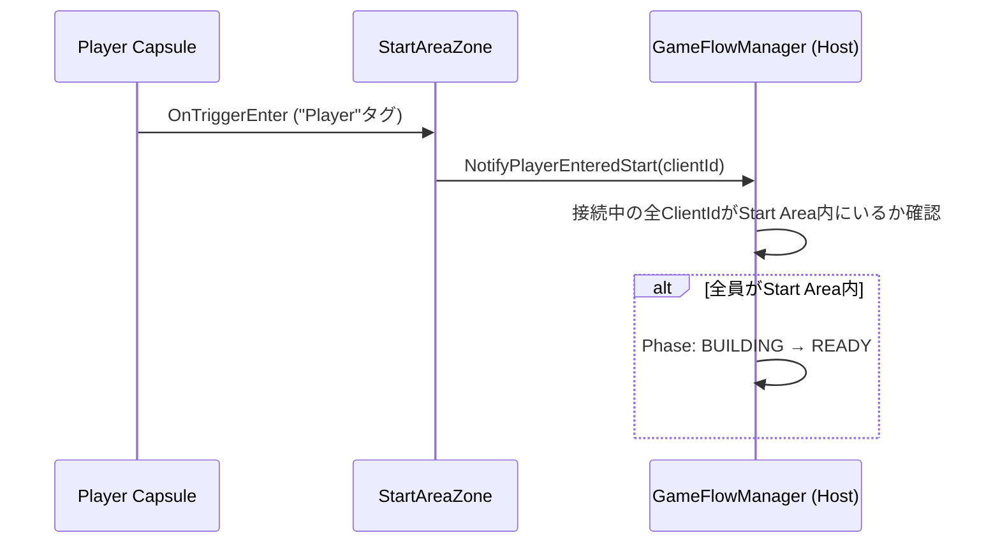

# GameFlow(ゲームの進行管理)

このドキュメントは、Step 6で追加した「BUILDING → READY → RUNNING → SUCCESS」というゲーム進行の仕組みについて、実際の実装を基に説明します。対象読者は、Unity/Netcodeを久しぶりに触る開発者を想定しています。

---

## 1. GamePhaseとは何か

```csharp
public enum GamePhase
{
    BUILDING,
    READY,
    RUNNING,
    SUCCESS
}
```

ゲーム全体が今どの状態にあるかを表す4つの値です。それぞれの意味は次の通りです。

| Phase | 状態 | Domino配置 | Checkpoint/Goal判定 |
|---|---|---|---|
| **BUILDING** | Playerが自由に移動してDominoを配置している段階 | 可能 | 無効(何が倒れても進行しない) |
| **READY** | 全員がStart Areaに入り、挑戦を始められる状態 | 不可 | 無効 |
| **RUNNING** | 正式なDomino Challenge中 | 不可 | 有効 |
| **SUCCESS** | Start→Checkpoint→Goalを正しい順序で通過し終えた状態 | 不可 | (クリア済み) |

`FAILED`(失敗)は今回のStepではまだ実装していません。

---

## 2. 全体の流れ



`RUNNING`から`BUILDING`や`READY`へ戻る経路は、今回意図的に実装していません(Restart/Retryの正式な仕組みはStep 6の対象外です)。

---

## 3. なぜHost Authorityなのか

`GameFlowManager`は`NetworkBehaviour`で、Phase(進行状態)は**必ずHost側だけが書き換え**、`NetworkVariable`で全Clientへ配信する設計です。ClientやHostの区別なく、どのPCでも同じ`GameFlowManager`インスタンスが存在しますが、実際に状態を変更するメソッド(`SetPhase`、`ReevaluateReady`等)はすべて先頭で`if (!IsServer) return;`を確認しています。

**なぜこの設計にしたか**: DominoはStep 5から一貫してHost Authorityです。「どのDominoがどのタイミングで倒れたか」を正確に把握できるのはHostだけなので、それを基にした「Checkpointを通過したかどうか」の判定も自然とHost側だけの責任になります。Host/Clientがそれぞれ独自に判定を進めてしまうと、わずかな物理演算のズレ(Step 3・4で確認したカオス的挙動)によって、PlayerごとにGameFlowの状態が食い違ってしまう危険があります。

```csharp
private readonly NetworkVariable<GamePhase> _phase = new NetworkVariable<GamePhase>(
    GamePhase.BUILDING, NetworkVariableReadPermission.Everyone, NetworkVariableWritePermission.Server);
```

`NetworkVariableWritePermission.Server`が「Hostしか書き換えられない」を保証し、`NetworkVariableReadPermission.Everyone`が「全員が読める(表示できる)」を保証しています。

---

## 4. Zoneの仕組み(Start Area / Checkpoint / Goal Area共通)

3種類のZone(`StartAreaZone`、`CheckpointZone`、`GoalAreaZone`)は、いずれも共通の基底クラス`DominoFallenZone`を継承しています。



### 「倒れた」の判定方法

各Zoneは`Collider`(`m_IsTrigger = true`)を持ち、`"Domino"`タグの付いたオブジェクトとの接触を`OnTriggerEnter`/`OnTriggerStay`/`OnTriggerExit`で監視します。Unityは、トリガー同士の接触を毎`FixedUpdate`ごとに自動で通知してくれるため、**全Dominoを毎フレーム検索するような重い処理は一切ありません**。

Dominoが「倒れた」かどうかは、Domino自身のUp方向と世界のUp方向の角度差で判定しています。

```csharp
Vector3.Angle(dominoTransform.up, Vector3.up) >= fallenAngleThreshold  // 既定60°
```

判定処理(`CheckDomino`)はHost側でのみ実行され(`NetworkManager.Singleton.IsServer`を確認)、`RUNNING`中でなければ何もしません。一度`IsSatisfied`が`true`になったZoneは、それ以降そのRUNNING中は判定をやり直しません(Dominoが転がってZoneの外へ出ても、達成状態は取り消されません)。

### RUNNING開始前から倒れていたDominoの除外

`OnRunStart()`は、`GameFlowManager`がRUNNINGへ移行する瞬間に全Zoneへ向けて呼ばれます。この時点でZone内に**既に**倒れているDominoがあれば、そのDominoを「除外リスト」へ登録し、以後そのRUNNING中は二度とカウント対象にしません。

```csharp
public void OnRunStart()
{
    IsSatisfied = false;
    _excludedDominoes.Clear();
    foreach (var t in _dominoesInside)
    {
        if (IsFallen(t)) _excludedDominoes.Add(t);
    }
}
```

**なぜこれが必要か**: BUILDING中にPlayerが誤ってDominoにぶつかり、たまたまStart/Checkpoint/Goal Areaの中で倒れてしまうことは十分あり得ます。この「事故」がRUNNING開始と同時に「もう通過済み」として扱われてしまうと、プレイヤーが実際に何もしていないのにゲームが進んでしまいます。除外リストによって、「このRUNNING開始時点で既に倒れていたDomino」と「このRUNNING中に新しく倒れたDomino」を区別しています。

---

## 5. Checkpointの順序判定

`CheckpointZone`自体は「順序」を気にしません。単に「(除外対象でない)Dominoが倒れたかどうか」だけを`IsSatisfied`として持っています。順序の管理は`GameFlowManager`側の責務です。

```csharp
public void OnZoneStateChanged()
{
    if (!IsServer) return;
    if (_phase.Value != GamePhase.RUNNING) return;
    if (!startArea.IsSatisfied) return;

    int progress = 0;
    foreach (var cp in _orderedCheckpoints)  // checkpointIndexの昇順に並べ替え済み
    {
        if (!cp.IsSatisfied) break;
        progress++;
    }
    _checkpointProgress.Value = progress;

    if (progress >= _orderedCheckpoints.Count && goalArea.IsSatisfied)
    {
        SetPhase(GamePhase.SUCCESS);
    }
}
```

先頭(`Index 0`)から順に「`IsSatisfied`かどうか」を確認し、`false`に当たった時点で数えるのをやめる、というシンプルなロジックです。これにより:

- **CP2が先に倒れてもProgressが進まない**: `_orderedCheckpoints`は`[CP0, CP1]`の順で並んでいるため、CP0が`false`のままだとループは0回目で`break`し、`progress`は0のままです。
- **CP2が先に倒れていても、CP1が正しい順序で倒れた瞬間にまとめて追いつく**: この関数は各Zoneが`IsSatisfied`になるたびに(`GameFlowManager.OnZoneStateChanged()`経由で)呼ばれます。CP1が倒れて`IsSatisfied = true`になった直後にこの関数が実行されると、ループはCP0を通過し、続けてCP1(既にtrueだった)も通過するため、`progress`は一気に2まで進みます。「先に倒してしまったCheckpointは、正しい番のときに来たらまとめて処理される」という、直感的でプレイヤーに優しい仕様です。Goalについても同様の理屈で、Goalが先に倒れていても最後のCheckpointが正しい順序で完了した瞬間にSUCCESS判定へ進みます。

この「まとめて追いつく」設計により、Start/Checkpoint/Goal AreaのZoneはお互いの状態を意識する必要がなく、それぞれが「自分の中のDominoが倒れたかどうか」だけを見ればよいシンプルな実装になっています。

---

## 6. Player Ready判定(Start Area)

`StartAreaZone`だけは、Dominoに加えてPlayerの出入りも監視します。



`GameFlowManager`は`_playersInStartArea`(`HashSet<ulong>`)で「今Start Area内にいるClientId」を管理し、`NetworkManager.ConnectedClientsIds`(現在接続中の全Client)と突き合わせて「全員揃っているか」を判定します。誰かが切断した場合も`OnClientDisconnectCallback`で追跡から外れるため、既に切断した人を待ち続けることはありません。

---

## 7. Start Challenge(READY → RUNNING)

READY状態になっただけでは自動的にRUNNINGへ移行しません。`F`キー(`ChallengeInput.cs`、Player.prefabに追加)を押すと、Hostへ向けてRPCが送信されます。

```csharp
[Rpc(SendTo.Server, InvokePermission = RpcInvokePermission.Everyone)]
public void RequestStartChallengeRpc(RpcParams rpcParams = default)
{
    if (_phase.Value != GamePhase.READY) return;
    if (!AllConnectedPlayersInStartArea()) return;

    BeginRun();
}
```

`InvokePermission = RpcInvokePermission.Everyone`としているのは、`GameFlowManager`のNetworkObjectがHost所有(Server-owned)であり、「Owner限定」にしてしまうとHost自身しかこのRPCを呼べなくなってしまうためです(Player.prefabの`PlacementController`とは逆の設定である点に注意してください)。誰から呼ばれても構いませんが、内部で必ず「READY状態かどうか」「本当に全員がStart Area内にいるか」を**再検証**しており、Client側のキャッシュされた情報を無条件に信用していません。

`ChallengeInput.cs`をあえて`PlacementController`と別スクリプトにしているのは、これが配置操作とは無関係な単発の入力トリガーであり、将来UIボタンに置き換える際に配置システムを一切触らずに済むようにするためです。

---

## 8. 関連コンポーネントの一覧

| ファイル | クラス | 継承元 | 役割 |
|---|---|---|---|
| [GamePhase.cs](../Assets/_Project/Scripts/GameFlow/GamePhase.cs) | `Domino.GameFlow.GamePhase` | enum | ゲーム進行状態の定義 |
| [GameFlowManager.cs](../Assets/_Project/Scripts/GameFlow/GameFlowManager.cs) | `Domino.GameFlow.GameFlowManager` | `NetworkBehaviour` | Phase/Checkpoint進捗をHost Authorityで管理し、NetworkVariableで同期する司令塔 |
| [DominoFallenZone.cs](../Assets/_Project/Scripts/GameFlow/DominoFallenZone.cs) | `Domino.GameFlow.DominoFallenZone` | `MonoBehaviour`(abstract) | 「Zone内でDominoが倒れたか」を判定する共通ロジック |
| [StartAreaZone.cs](../Assets/_Project/Scripts/GameFlow/StartAreaZone.cs) | `Domino.GameFlow.StartAreaZone` | `DominoFallenZone` | Start Domino判定 + Player Ready判定 |
| [CheckpointZone.cs](../Assets/_Project/Scripts/GameFlow/CheckpointZone.cs) | `Domino.GameFlow.CheckpointZone` | `DominoFallenZone` | Checkpoint判定 + 通過順序(`CheckpointIndex`) |
| [GoalAreaZone.cs](../Assets/_Project/Scripts/GameFlow/GoalAreaZone.cs) | `Domino.GameFlow.GoalAreaZone` | `DominoFallenZone` | Goal判定 |
| [ChallengeInput.cs](../Assets/_Project/Scripts/Player/ChallengeInput.cs) | `Domino.Player.ChallengeInput` | `NetworkBehaviour` | `F`キー押下をHostへのRPC呼び出しに変換する |

Zone自体(`NetworkObject`を持たない)はStage(Scene)側に配置するPrefabで、Stage Authoringの詳細は`StageAuthoring.md`を参照してください。
