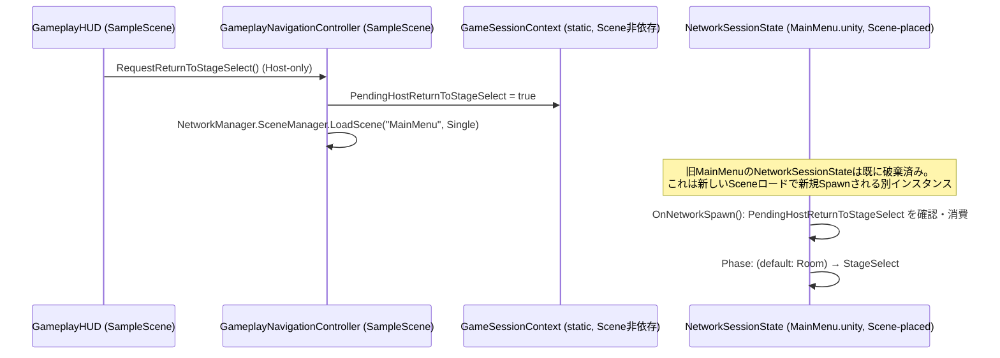

# MenuFlow(Main Menu / Session Flow)

Step 9で追加した、「Gameplayそのもの」ではなく「PlayerがGameplayへ入るまでのFlow」を扱う仕組みについて記載します。Gameplay自体の仕様(Placement/BUILD TIME/READY/RUNNING/SUCCESS/FAILED等)は`GameFlow.md`を参照してください。

## 1. 全体像

```text
TITLE
  ↓
MODE SELECT
  ├───────────────────────┐
  │                       │
TIME ATTACK            ONLINE PLAY
(Single Player)           │
  │                       ↓
  │                 CREATE / JOIN         (Step 9B)
  │                       ↓
  │                     ROOM              (Step 9B)
  │                       ↓
  │             2 Players以上集合          (Step 9B)
  │                       ↓
  │               CHARACTER SELECT        (Step 12.1、各Playerが自分のCharacterを選択)
  │                       ↓
  │                  STAGE SELECT
CHARACTER SELECT          │
  │                       ↓
  ↓                  HostがStage選択     (Step 9C)
STAGE SELECT              │
  │                       │
  └──────────┬────────────┘
             ↓
         GAMEPLAY
```

Step 9A〜9Cを通じて、Single Player(TITLE→MODE SELECT→TIME ATTACK→STAGE SELECT→GAMEPLAY)とOnline(TITLE→MODE SELECT→ONLINE PLAY→CREATE or JOIN→ROOM→(2人以上)→STAGE SELECT(Host-only)→GAMEPLAY)の全経路が実装済みでした。Step 12.1で両経路の間に**CHARACTER SELECT**を挿入し、Stage選択の前にPlayerが使用するCharacterを選べるようにしています(第11章)。Online側の詳細(Session API・Room・Host Authority・Late Join禁止等)は`Docs/OnlineSession.md`を、Character Catalog/Player側の詳細は`Docs/CharacterSystem.md`を参照してください。

## 2. Scene構成

```text
Assets/_Project/Scenes/MainMenu.unity   (Step 9で新規、Build Index 0)
Assets/Scenes/SampleScene.unity          (既存Gameplay Scene、Build Index 1)
```

MainMenu Sceneは`MODE SELECT`等のUI PanelとNetworkManagerのみを持ち、`GameFlowManager`/`Domino`/`Player`等のGameplay Objectは一切含みません。Gameplay Sceneは既存のSampleSceneをそのまま使用し、Single Player/Onlineいずれの経路でも別のGameplay Sceneを新設していません(第9章参照)。

## 3. Menu Architecture(1 Scene + Panel切り替え)

MainMenu Scene内は、Sceneを毎回切り替えるのではなく、単一の`Canvas`の下に以下7つのPanelを持ち、`MainMenuController`が`MenuState` Enumに応じて表示切り替えを行う方式です。

```text
Canvas (MainMenuController)
├─ TitlePanel
├─ ModeSelectPanel
├─ OnlineSelectPanel
├─ OnlineCreatePanel      (Step 9Bで機能実装、9Aはプレースホルダ)
├─ OnlineJoinPanel        (Step 9Bで機能実装、9Aはプレースホルダ)
├─ OnlineRoomPanel        (Step 9B/9Cで機能実装、9Aはプレースホルダ)
├─ CharacterSelectPanel   (Step 12.1で追加)
└─ StageSelectPanel
```

`MainMenuController.ShowState(MenuState)`が全Panelを一括で非表示にしてから対象のPanelのみ表示します。Backナビゲーション用に`Stack<MenuState>`の簡易履歴を持ち、`OnBackClicked()`(各PanelのBackボタン、およびEscapeキー両方から呼ばれる)で1つ前のStateへ戻ります。

責務分離(第51章の指示どおり):
- `MainMenuController`: Panel表示切り替え・Back履歴・Escapeキー入力のみを扱う。Stage DataやNetworkingは一切知らない。
- `StageSelectController`(StageSelectPanelにアタッチ): `StageCatalog`からGrid Cardを動的生成し、クリックされたStageでSingle Player経路のSession開始(Local Host + Scene Load)を行う。
- `OnlineSessionController`等(Step 9Bで追加予定): Online CreateRoom/JoinRoom/Room/Networkingを扱う。

## 4. TITLE / MODE SELECT

`TitlePanel`は起動時に表示される最初のPanelです。`START`ボタン(`MainMenuController.OnStartClicked`)で`ModeSelectPanel`へ遷移します。

`ModeSelectPanel`は`TIME ATTACK`(`OnTimeAttackClicked`)と`ONLINE PLAY`(`OnOnlinePlayClicked`)の2ボタンを持ちます。`OnTimeAttackClicked`は`GameSessionContext.IsOnline = false`を設定した上で`CharacterSelectPanel`へ遷移します(Step 12.1以降。Stage Selectへは、Character Select Panel自身の`STAGE SELECT`ボタンから1段階後に到達します)。

## 5. Single Player Architecture(Local Host)

既存のGameplayはNGO / NetworkBehaviour前提のため、Single Player専用にNetwork処理を取り除いた別実装は作っていません。TIME ATTACKは内部的に「Local Hostとして1人でGameplayを開始する」方式です。

```text
Single Player
↓
NetworkManager.Singleton.StartHost()   (Relayへは接続しない)
↓
Connected Player = 1
↓
NetworkManager.Singleton.SceneManager.LoadScene(sceneName, LoadSceneMode.Single)
↓
Gameplay (既存GameFlowがConnected Players = 1のままそのまま動作)
```

`StageSelectController.StartLocalHostAndLoadGameplay()`がこの2行を担っています。`StartHost()`が失敗した場合(実装確認時に検証環境のPort競合で実際に確認済み)は、`SceneManager.LoadScene()`を呼ばずにエラーログを出して中断します - 呼び出し元の状態に関わらずScene遷移だけ実行してしまうと、Networkingが起動していない状態でのSceneManager呼び出しという未定義動作になるため、これは明示的に防いでいます。

## 6. Stage Catalog

`Docs/ImplementationStatus.md`のStep 9Aエントリ、および以下のAsset群を参照してください。

```text
Assets/_Project/Scripts/Menu/StageDefinition.cs   (ScriptableObject: Stage ID / Display Name / Gameplay Scene Name)
Assets/_Project/Scripts/Menu/StageCatalog.cs      (ScriptableObject: StageDefinitionのList)
Assets/_Project/Data/Stages/Stage_01.asset 〜 Stage_08.asset
Assets/_Project/Data/StageCatalog.asset
```

Step 9時点では8Stageすべてが`gameplaySceneName = "SampleScene"`を指しており、実際のStageは1つだけです。将来的に`Stage_02`が別のScene名を持つよう変更するだけで、コード変更なしに個別Stageを追加できるArchitectureです。`StageSelectController`はUIへ8回ハードコードする代わりに、`StageCardTemplate`(StageGrid内の非表示テンプレート、Button+TextMeshProUGUI)を`catalog.Stages`の数だけ`Instantiate`して構築しています。

## 7. NetworkManager Lifecycle(Menu ⇄ Gameplay間の永続化)

Step 9より前は、`NetworkManager`(+`UnityTransport`/`NetworkBootstrap`/`DominoSpawner`/`DominoCleanupManager`)がGameplay Scene(SampleScene)に直接配置されていました。Step 9でMainMenu Sceneへ移動し、`NetworkBootstrap.Awake()`で明示的に`DontDestroyOnLoad(gameObject)`を呼ぶことで、Menu→Gameplayの Scene遷移(`NetworkManager.SceneManager.LoadScene(..., LoadSceneMode.Single)`)を跨いで同一インスタンスが生き続けるようにしています。

SampleScene側には、Step 9以降`NetworkManager`は一切配置されていません(Duplicate NetworkManager防止、第46章)。`GameFlowManager`(Scene-placed NetworkObject、Start/Checkpoint/Goal Zoneへの参照を持つ)はGameplay固有のためSampleScene側に残しています。

`LoadSceneMode.Single`によるScene遷移は、`DontDestroyOnLoad`されたGameObject(NetworkManager等)を除く現在ロード中の全Sceneをアンロードしてから対象Sceneをロードします。そのためMainMenu Sceneの`Canvas`等(DontDestroyOnLoad対象外)は正しく破棄され、NetworkManager側だけが生き残ります。

## 8. NetworkBootstrap(Normal Startup と Development Auto-start Modeの分離、Step 9.1で修正)

### Normal Startup(通常起動)

**通常のApplication起動・通常のPlay Modeでは、必ずMainMenuのTITLE画面から始まります。** `NetworkBootstrap`はNetworkを一切自動開始せず、`NetworkManager.IsListening`は`false`のまま、Gameplay Sceneへの遷移も一切発生しません。Networkの開始は、常にUser Actionによって(`MainMenuController`/`StageSelectController`/`OnlineSessionController`経由で)行われます。

```text
Application Start
↓
MainMenu Scene Load
↓
TITLE(NetworkManager: not listening)
↓
User Action(TIME ATTACK選択 / CREATE ROOM / JOIN ROOM)によってのみNetwork開始
```

### バグ修正の記録: MainMenuの意図しない自動Skip(Step 9.1)

Step 9AでStage Selectを実装した際、`NetworkBootstrap.Start()`が**無条件に**`TryStartFromMultiplayerPlayModeTags()`を呼んでいました。このMethodは`CurrentPlayer.Tags`(MPPM Player識別用のTag)に`"Host"`が含まれているかどうかだけを見て`NetworkManager.StartHost()`+Gameplay Scene Auto Loadを実行する作りでした。本Projectでは開発テストの都合上、Main EditorにMPPM `"Host"` Tagが恒久的に設定されていたため、**普通にPlay Modeへ入っただけで**(Userが何も操作していなくても)、このTagが「Auto-startして良い」という意図的な合図であるかのように扱われ、即座にHost化+Gameplay Scene遷移が発生し、MainMenuのTITLE画面が完全にSkipされていました。

これはMPPM Tag自体が本来「Development上のPlayer識別情報」でしかなく、「今すぐAuto-startしてよい」という明示的な合図ではないにも関わらず、両者を区別せず同一視していたことが原因です。

### Development Auto-start Mode(Explicit Opt-in、Step 9.1で修正)

`NetworkBootstrap`に`developmentAutoStartViaMppmTag`(`bool`、既定値`false`)を追加しました。この値が`true`の場合のみ、MPPM Tagに応じたHost/Client Auto-start(+Hostの場合はGameplay Scene Auto Load)を行います。既定では`false`のため、**MPPM Host Tagが付与されていても、それだけではAuto-startしません**。

```csharp
private void Start()
{
    if (developmentAutoStartViaMppmTag && TryStartFromMultiplayerPlayModeTags()) return;
    StartFromCommandLineArgs();
}
```

過去のMPPMベースの高速な開発テストを完全に使えなくしたわけではなく、開発者がInspector上で`developmentAutoStartViaMppmTag`を明示的にONにした場合のみ、以前と同じAuto-start経路(Hostとして起動→即座に`developmentGameplaySceneName`へScene遷移)が働きます。「必要な時だけ開発者自身が明示的に有効化する」設計です。

CLI引数(`-host`/`-client`)による経路(`StartFromCommandLineArgs()`)はStep 9.1で変更していません。この経路は元々`if (Application.isEditor) return;`により、Standalone Buildを実際にコマンドラインから`-host`等の引数付きで起動した場合にのみ働く、既に十分Explicitな仕組みでした(通常のダブルクリック起動では引数が無いため発火しません)。

### Interactive Menu Mode(通常のUser操作)

`NetworkBootstrap`とは完全に独立して、`MainMenuController`/`StageSelectController`/`OnlineSessionController`がUser Actionに応じてNetworkを開始します(TIME ATTACK選択時の`StartHost()`、CREATE ROOM時の`CreateSessionAsync()`、JOIN ROOM時の`JoinSessionByCodeAsync()`)。`NetworkBootstrap`側のDevelopment Auto-start Modeが無効(既定)の場合、この経路が実質的に唯一のNetwork開始手段になります。

## 9. Online Play(Step 9B / 9C)

Online Play(Create Room / Join Room / Join Code / Online Room / Player Count / Host-only Online Stage Select / Selected Stage同期 / Network Scene Transition / Late Join禁止)はStep 9B・9Cで実装済みです。詳細は`Docs/OnlineSession.md`を参照してください。

Step 9の対象外(Friend機能・Random Match・Public Room List・Matchmaking・Host Migration・Reconnect・Spectator Join・Ranking等)は今後の別Stepの対象です。

---

## 10. Gameplay → MainMenu Navigation(Step 10B)

Step 10Bで、Gameplay(Pause Menu / SUCCESS Result)からMainMenuへ戻る経路を追加しました。Pause自体の仕組みは`PauseSystem.md`を参照してください。本章はMenu側の状態(Scene遷移・MenuState・Online Session)がどう絡むかに絞って説明します。

### 2つの戻り方

```text
Stage Select(Online Host-only 例外あり)
  Session/Networkを維持したまま、MainMenuへ戻ってStage Selectを直接表示
  Single Playerでは実質Titleと同じ(維持すべきSessionが無いため)

Return to Title
  Single Player: Local Host Shutdown
  Online: Session を実際にLeave(Host/Client両方)
  → いずれもNetwork Shutdown後、MainMenuはTitleから開始
```

いずれも実装は`GameplayNavigationController`(SampleScene側)が担い、GameplayHUDのボタン/Confirmation Dialogから呼ばれます。

### NetworkSessionStateはGameplay中は存在しない(重要な設計上の制約)

`NetworkSessionState`は`NetworkManager`と異なり`DontDestroyOnLoad`されていません(第7章)。そのためGameplay Scene(SampleScene)にいる間、`NetworkSessionState.Instance`は**常にnull**です。

Step 10Bの実装当初、Gameplay側から直接`NetworkSessionState.Instance?.HostReturnToStageSelect()`のようなメソッドを呼ぼうとしましたが、これは`Instance`がnullのため常に無言で失敗する(何も起きない)ことが実機検証で判明しました。代わりに、`GameSessionContext.PendingHostReturnToStageSelect`という静的flagを使う方式に変更しています。



`GameSessionContext`(第6章のStage Catalog文脈で既出、静的クラス・Scene非依存で自動的に生存)がこの橋渡し役です。同様の理由で、`MainMenuController.Start()`がTitleではなく直接目的のPanelを表示するための`GameSessionContext.ReturnDestination`(`MenuState?`)も同じ仕組みを使っています。

### Online Session(`ISession`)もGameplay中は保持先が無い

`OnlineSessionController`もMainMenu Sceneの`Canvas`上にあり、非永続(Gameplay中は破棄済み)です。Join Code・Player Count等を保持する`ISession`参照は、Step 10Bで**instance fieldからstatic fieldへ変更**し、Scene再ロードをまたいで生存するようにしました。

- **Stage Select Return**: MainMenu再ロード後、新しい`OnlineSessionController`インスタンスが`Start()`でこのstaticな`_session`を検出し、`Changed`/`StateChanged`イベントを再購読して(`RehydrateSession()`)、Room/Stage Select UIを正しく復元します。新しいSessionをCreate/Joinし直すわけではありません。
- **Return to Title**: `GameSessionContext.PendingLeaveOnlineSession`フラグを使い、新しい`OnlineSessionController`インスタンスの`Start()`が既存の`LeaveSessionAsync()`(Step 9Bから無変更のTimeout Guard付き実装)を呼び出し、実際にSessionを離脱します。

### Gameplay Player Cleanup(Section 31)

`NetworkManager.SceneManager.LoadScene(..., LoadSceneMode.Single)`は、Scene-placed NetworkObject(`GameFlowManager`等)は自動的に破棄しますが、動的にSpawnされたPlayer NetworkObjectは**自動では破棄しません**。これはStep 9.2で修正したRoot Cause(Player落下バグ)と全く同じ性質の罠で、今回はGameplay→MainMenu方向で再発しうるため、`GameplayPlayerSpawner.DespawnAllGameplayPlayers()`(Step 10Bで追加、Server-only)をStage Select Return直前に明示的に呼んでいます。Return to Title(Shutdown経由)はNGO自身のSession Teardownが全NetworkObjectを片付けるため、この明示的Despawnは不要です(Shutdown()のみで十分)。

### Escapeキー/PauseとSceneTransitionの分離

`GameplayNavigationController`はNGOの`NetworkManager.OnClientStopped`イベントを購読し、Shutdown()経由の遷移(Single Playerの両操作、Onlineの両ロールのReturn to Title)は**すべて同じ1箇所**でSceneをLoadします(`HandleClientStopped`)。これにより、「自分から明示的にLeaveした」ケースと「Hostが切断して意図せず切られた」ケース(Section 44/56)を、別々のコードパスを書かずに同じ結果へ収束させています。Stage Select Return(Onlineのみ)はSession/Networkを維持したままの遷移のため、この経路は使わず`NetworkManager.SceneManager.LoadScene()`を直接呼びます。

### 未確認事項

実際の2台のClientによるOnline Stage Select Return / Title Returnの直接End-to-End確認は、既存のStep 9系ドキュメントと同じ制約(同一Editorプロセスから2つの独立したRelay接続を同時に張ることが困難)により、Host自身の1接続によるシミュレーションのみで検証しています。詳細な実機確認結果は`Docs/ImplementationStatus.md`のStep 10Bエントリを参照してください。

---

## 11. Character Select(Step 12.1 / Step 12.1.1)

Stage Selectの前に、PlayerがGameplayで使用するCharacterを選ぶ`CharacterSelectPanel`を追加しました。Character Catalog・Player側のVisual切り替えの詳細は`Docs/CharacterSystem.md`を、Online側のPer-player同期は`Docs/OnlineSession.md`「11. Character Select」を参照してください。本章はMenu Flow/Panel構成に絞って記載します。

### 新しい経路

```text
Single:  TIME ATTACK → CHARACTER SELECT → STAGE SELECT → GAMEPLAY
Online:  ROOM(2人以上) → CHARACTER SELECT → STAGE SELECT(Host-only) → GAMEPLAY
```

`CharacterSelectPanel`は既存の`StageSelectPanel`と同じ「1 Scene + Panel切り替え」Architectureの上に構築しており、新しいSceneは追加していません。`MenuState`に`CharacterSelect`を追加しただけです。

### `CharacterSelectController`(StageSelectControllerと同じ責務分離)

`StageSelectController`と全く同じ形の責務分離です。`MainMenuController`はPanelの表示/非表示のみを行い、`CharacterSelectController`(`CharacterSelectPanel`にアタッチ)がCatalogからCard Gridを動的生成し、Single Player/Onlineの分岐を持ちます。

- **Card Click**: `GameSessionContext.SelectedCharacterId`を即座に更新するだけ(Stage Selectへは進まない、既存のStage Card Clickとは異なる挙動)
- **`STAGE SELECT`ボタン**: Single Playerは即座に`MenuState.StageSelect`へ。Onlineは、Step 12.1.1で追加したAll-player Gate(全員選択済みの場合のみInteractable、下記)を通過後、Host Confirmation Dialogを経てから`OnlineSessionController.OnStageSelectButtonClicked()`(Host-only)を呼ぶ

### All-player Gate と Host Confirmation(Step 12.1.1)

Online限定。`CharacterSelectPanel`に`SelectionCountText`("Players: X / Y" / "Selected: X / Y")と`ConfirmationPanel`(半透明の背景 + DialogBox + Message + Yes/Noボタン、既存Panelの配色を踏襲)を追加しました。

- 全Connected PlayerがCharacterを最低1回選択するまで、`STAGE SELECT`ボタンはHostであってもDisabledのまま("STAGE SELECT (Waiting)")
- 全員選択済みになるとEnabledになりますが、押しても即座には進まず、`ConfirmationPanel`("All players have selected.\nProceed to Stage Select?")が表示される
- Yes: `OnlineSessionController.OnStageSelectButtonClicked()`を呼び、実際にPhase遷移を要求
- No: `ConfirmationPanel`を閉じるだけ - Selection状態は一切変化せず、全PlayerはCharacterを変更し続けられる

Server側の詳細(`SelectedCount`のNetworkVariable同期、`PlayerCharacterSelectionStore`によるHasSelectedCharacter管理、Yes時の再Validation)は`Docs/OnlineSession.md`「11. Character Select」の「All-player Gate」を参照してください。

### Character Grid(5 × 4 = 20 Cards)

`StageGrid`(4列)と同じ`GridLayoutGroup`ベースの構成を、`FixedColumnCount = 5`で複製しています。Card Template(`CharacterCardTemplate`)は**Grid Containerの外(Panel直下)に配置**しています - Grid内に置くとInactiveなTemplate自身もGridLayoutGroupのLayout対象になり、20枚のCardが実質21枚分の位置計算をされて最終行がButton行と重なる不具合が実装時に発覚したため(既存の`StageSelectPanel`も同じ構造上の性質を持ちますが、8 Stage/4列という少ない枚数のため症状が顕在化しにくく、本Stepでは手を加えていません)。

### Back Navigation(Section 37)

Single PlayerのCharacter Selectは通常のBack履歴(`MainMenuController.OnBackClicked()`)でMode Selectへ戻れます。**Online中のCharacter Selectは意図的にBackを無効化**しています。

```csharp
if (CurrentState == MenuState.CharacterSelect && GameSessionContext.IsOnline) return;
```

Client側だけがLocalにRoom画面へ戻ってしまうとSession Phase(全員で共有しているCharacterSelect Phase)と食い違うため、Leaveは既存のOnline Room Panelの`Leave`のみを経由させています。

### 動作確認済み(Step 12.1.1、実際のHost+Client 2 Player)

Step 12.1完了報告時点では同一Editorプロセスから2つの独立したRelay接続を張ることが困難としていましたが、Step 12.1.1では**開発者ご自身がMultiplayer Play Mode(MPPM)のPlayer 2を操作し、Claude(Host側操作)と共同で実際の2 Player Online Testを実施しました**(`Docs/MultiplayerTesting.md`の手順)。

- Host/Client双方で正しくCharacter Select画面(20 Card)が表示されることを確認(Bug A修正確認)
- Host=Character 1、Client=Character 2をそれぞれ選択 → `SelectedCount`が正しく`2/2`になり、Host側`STAGE SELECT`がEnabledになることを確認
- Clientが選択後にCharacterを`9 → 3 → 9`と複数回変更しても`SelectedCount`が`2`のまま維持されることを確認(Section 22)
- Host Confirmation DialogでNo → Character Selectのまま(状態変化なし)、再度STAGE SELECT → Yes → 両画面ともStage Selectへ遷移することを確認
- Stage Select → Gameplay後、Host=Capsule・Client=Green BoyがHost画面・Client画面**両方**で一致して見えることを確認(Bug B修正確認、最重要)
- Client(Green Boy)のIdle/Walkアニメーションが正常に見えることを確認

途中、実装とは無関係のEditor Play Mode不安定化(`is_paused`のまま固まるTransition、Relay接続Timeout)に1度遭遇し、Host+Clientとも再接続してテストをやり直しました - 詳細と切り分けは`Docs/OnlineSession.md`「11. Character Select」を参照してください。

### 未確認事項

3人以上でのAll-player Gate確認、Late Join時の再Gate確認は今回未実施です(2 Playerのみ)。
