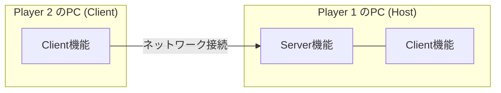
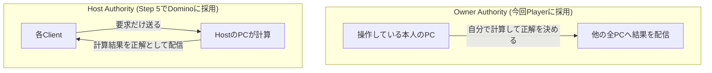
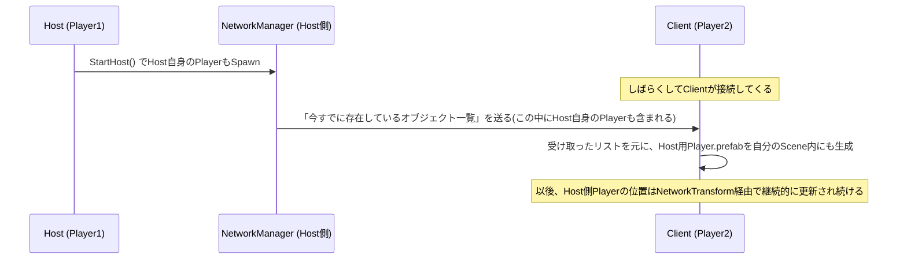
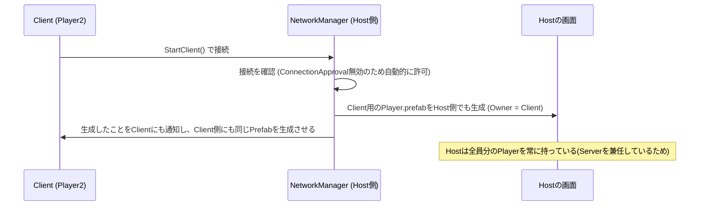
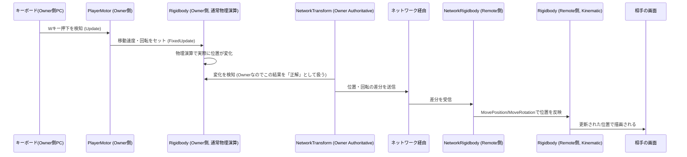
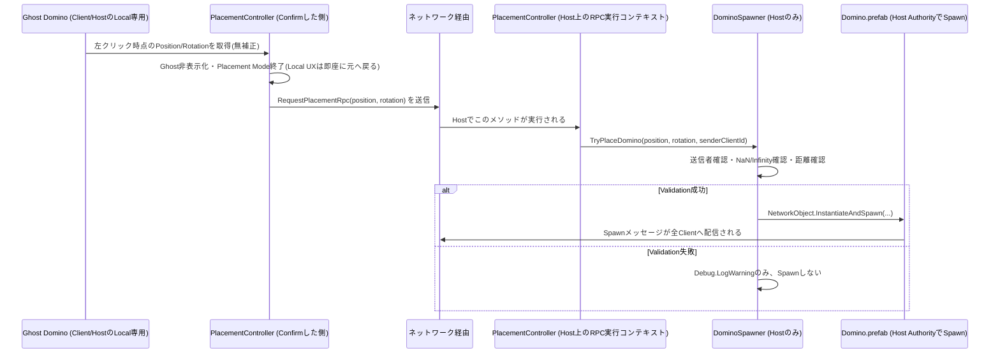
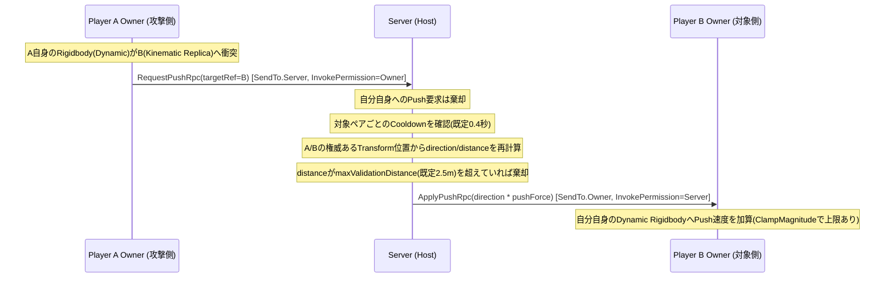
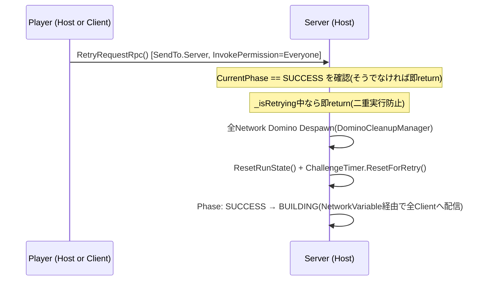

# Networking(オンライン対戦の仕組み)

このドキュメントは、このプロジェクトで使っているオンライン対戦の仕組み(Netcode for GameObjects)について、Unityのネットワーク機能を初めて/久しぶりに触る人でも理解できるように説明します。

---

## 1. Netcode for GameObjectsとは何か

Unity公式が提供している、マルチプレイヤーゲームを作るための機能一式(パッケージ)です。略して **NGO** と呼ばれます。

普通のUnityゲームでは「1台のPCの中に1つのゲーム世界がある」だけですが、オンラインゲームでは「複数のPCそれぞれにゲーム世界のコピーがあり、それらを一致させ続ける」必要があります。NGOは次のようなことを肩代わりしてくれます。

- どのPCがどのキャラクターを操作しているかの管理
- キャラクターなどのオブジェクトを、他のPCにも同じタイミングで登場させる(Spawn)
- 位置や回転などの情報を、他のPCへ自動的に送り続ける(同期)
- 誰かが切断したときの後片付け

NGOを使わない場合、これらをすべて自分でネットワークプログラミングとして書く必要があり非常に大変です。NGOはその大部分を「コンポーネントを付けるだけ」で済むようにしてくれます。

---

## 2. NetworkManagerの役割

`NetworkManager` は、このプロジェクトでは Scene内の `NetworkManager` という名前のGameObjectに付いています。オンライン機能全体の「管理人」のような存在です。

- 「これから自分はHostとして待ち受けるのか、Clientとして誰かに接続しに行くのか」を決めて実行する(`StartHost()` / `StartClient()`)
- 「接続してきた人がいたら、どのPrefabをキャラクターとして生成するか」を知っている(`NetworkConfig.PlayerPrefab` = `Player.prefab`)
- どのPrefabならネットワーク越しにSpawnしてよいかのリストを持っている(`NetworkConfig.Prefabs` → `DefaultNetworkPrefabs.asset`)
- 1秒間に何回、通信のための処理を行うか(`TickRate = 30`、つまり1秒間に30回)

`NetworkManager` はScene内に1つだけ存在すればよく、Playerのように何体も生成されるものではありません。

---

## 3. UnityTransportの役割

`NetworkManager` 自体は「何を」「いつ」送るかを決める係ですが、実際にデータをネットワーク上に送り出す部分(郵便配達人にあたる部分)は別の部品が担当しています。それが `UnityTransport` です。

このプロジェクトでの設定:
```
Address: 127.0.0.1     ← 接続先(Client視点)。127.0.0.1は「自分自身のPC」を指す特別なアドレス
Port: 7778              ← 通信に使うポート番号
ServerListenAddress: 127.0.0.1  ← 待ち受け(Host視点)のアドレス
```

`127.0.0.1` を使っているのは、現時点ではまだ「同じPC内で2つのUnityを起動してテストする」段階のためです。実際に別々のPCからインターネット越しに接続する場合は、この値を実際のIPアドレスや、Unity Multiplayer Services / Relay経由の接続情報に置き換える必要があります(これはStep 2の範囲外で、まだ未実装です)。

---

## 4. Host / Clientとは何か

このプロジェクトは「Host + Client方式」というシンプルな構成を採用しています。

- **Server**: ゲームのルールを判定し、全員に正しい情報を配る「審判」役。プレイヤーは操作できない裏方。
- **Client**: Serverから情報を受け取って画面に表示し、自分の操作をServerへ送る側。
- **Host**: **ServerとClientを1台のPCで同時に兼任する**役割。このプロジェクトの「Player 1」がHostにあたります。



Host方式を選んでいる理由は、専用のサーバー機を別途用意する必要がなく、「友達の誰か1人がHostになれば残りは接続するだけ」というシンプルな運用ができるためです(GameDesign.md 13節の方針とも一致します)。

---

## 5. NetworkObjectとは何か

「このGameObjectはネットワークで管理する対象です」という**目印**をつけるコンポーネントです。`Player.prefab` にはこれが付いているため、NGOは以下のようなことができるようになります。

- 誰か1人が接続してきたときに、Host側でこのPrefabを実体化し、他の全員にも同じものを実体化させる
- 生成された無数のコピーの中から「これは特定のどのオブジェクトなのか」をネットワーク越しに特定する(内部的にIDを持つ)
- 「これは誰の持ち物か(Owner)」という情報を管理する

**逆に言うと、`NetworkObject` が付いていないGameObject(例えば `Ground` や `Main Camera`)はネットワークの管理対象外**で、各PCがそれぞれ個別に持っているだけの存在です。同期する必要がないものにはあえて付けていません。

---

## 6. NetworkTransformとは何か

`NetworkObject` が「これは管理対象です」という目印だとすると、`NetworkTransform` は「このオブジェクトの**位置と回転**を実際に他のPCへ送り届ける」役割を持つ部品です。

内部的にやっていることをものすごく簡単に言うと、「1秒に30回、位置が変わっていないか確認し、変わっていたらその差分を送信する。受信した側は、送られてきた位置に向かって滑らかに移動させる」という処理です。

このプロジェクトでは `AuthorityMode = Owner`(オーナー権威)という設定にしています。この意味は次の章で説明します。

---

## 7. NetworkRigidbodyとは何か

`NetworkTransform` は位置と回転を送るだけですが、Playerには物理演算用の `Rigidbody` も付いています。もし何もしなければ、次のような問題が起きます。

- 自分のPCでは物理演算(重力・衝突)でRigidbodyが動いている
- 他人のPC側でも同じPrefabのRigidbodyが「別に」物理演算をしてしまい、`NetworkTransform` が送ってくる位置と噛み合わなくなってブルブル震えたり、変な動きになる

`NetworkRigidbody` はこれを防ぐための部品で、次の2つを自動で行います。

1. **持ち主(Owner)ではない側のRigidbodyを自動的にKinematicにする**(`AutoUpdateKinematicState`)。Kinematicになった Rigidbody は自分で物理演算をしなくなり、代わりに外部から位置を指定されるのを待つだけの状態になります。
2. **その「外部から位置を指定する」処理を、Transformの直接書き換えではなく `Rigidbody.MovePosition/MoveRotation` を使って行う**(`UseRigidBodyForMotion`)。これにより、物理エンジンの目線でも「本当にそこへ動いた」と認識され、他の物体(将来のDominoなど)と正しく衝突判定ができるようになります。

---

## 8. Owner Authority / Host Authorityの違い

「Authority(権威)」とは、「複数のPCの間で意見が食い違ったとき、誰の言い分を正解とするか」というルールのことです。オンラインゲームでは必ずこれを決めておく必要があります。

- **Owner Authority(オーナー権威)**: そのオブジェクトを**操作している本人のPC**の計算結果を正解とする。
- **Host(Server) Authority(ホスト権威)**: そのオブジェクトの計算は**必ずHostのPCだけ**が行い、Hostの結果を正解とする。操作している本人であっても、自分のPC上の計算はあくまで「予測」に過ぎない。



## 9. 現在PlayerをOwner Authorityにしている理由

Playerの移動は **Owner Authority** を採用しています。理由は次の通りです。

- このゲームは対戦ではなく協力プレイであり、「自分の操作が数十ミリ秒遅れて反映される」ことのデメリットの方が、「多少のズルができてしまう」というデメリットより大きい
- Host Authorityにすると、移動のたびにClientがHostへ「動きたい」という要求を送り、Hostが計算した結果が返ってくるまで反映を待つ(または予測してあとで補正する)処理が必要になり、実装が複雑になる
- Owner Authorityなら、自分のPC上でRigidbodyを動かした結果がそのまま正解になるため、操作した瞬間に画面に反映され、動きが機敏に感じられる

この方針には最初から注意点がありました。GameDesign.md 14節にある通り、Domino(倒れる物理演算)は **Host Authority** で統一する設計であり、「Owner AuthorityのPlayer」と「Host AuthorityのDomino」が物理的に衝突したときに正しく振る舞うよう、`NetworkRigidbody` の設定(第7章)を先回りして入れてありました。Step 5でDominoを実際にNetwork化した結果は以下の通りです。

- **HostのPlayer(Owner Authority) → Host Authority Dominoの衝突**: 実機(Play Mode)で確認済み。HostのPlayerがNetwork化されたDominoに歩いて接触すると正しく倒れ、その結果がClient側にも同期されることを確認しました
- **ClientのPlayer(Owner Authority) → Host Authority Dominoの衝突**: **Step 5終了時点で未確認です。** これはツール側の制約(MPPMの仮想Playerウィンドウへキーボード入力を自動送信できなかったため、Client自身を歩かせる操作を自動テストできなかった)によるものであり、コードや設計上の既知の問題が見つかったわけではありません。詳細と根拠は `ImplementationStatus.md` のStep 5章を参照してください。**開発者ご自身での実機確認を推奨します。**

---

## 10. Host PlayerがClient画面に表示される仕組み



ポイントは、Host自身のPlayerも(HostがServerを兼任しているだけで)ネットワーク上ではただの1つのPlayerオブジェクトとして扱われる、という点です。だからこそClientが後から接続してきても、「すでに存在していたHostのキャラクター」を正しく認識して自分の画面にも表示できます。

## 11. Client PlayerがHost画面に表示される仕組み



HostはServerを兼任しているため、「接続してきた全員のキャラクター」は必ずHostのScene内にも存在します。これが、Step 2の動作確認で「HostのGame Viewに2体のCapsuleが表示される」ことの理由です。

---

## 12. WASD入力 → Rigidbody移動 → Network同期 → 相手画面表示までの流れ



自分のPC内では「入力→物理演算→画面表示」がそのまま行われ、それとは別に `NetworkTransform` が結果を横取りしてネットワークに流している、というイメージです。`PlayerMotor` 自身はネットワークのことを一切意識しておらず、普通にRigidbodyを動かしているだけである点が重要です。

---

## 13. PlayerMotorのIsOwner判定がなぜ必要なのか

`Player.prefab` は、接続している人数分だけコピーが生成されます。例えば2人プレイなら、**HostのPC上に2つ、ClientのPC上にも2つ**、合計4つの `PlayerMotor` インスタンスが存在することになります(自分の分＋相手の分、それぞれのPC上に)。

もし `IsOwner` の確認をしていなかったら、どうなるでしょうか。

- Hostの画面上にある「Client用のPlayerの分身」も、Hostのキーボード入力に反応して勝手に動こうとしてしまう
- しかもそのPlayerは本来 `NetworkRigidbody` によってKinematic化されている(第7章)ため、`PlayerMotor` が `Rigidbody.linearVelocity` を書き換えようとしてもうまく動かない、あるいはネットワークから来る正しい位置と競合して不具合になる

`if (!IsOwner) return;` を `Update()` と `FixedUpdate()` の先頭に入れることで、「この分身が自分の持ち物であるときだけ、入力を読んで動かす処理を実行する」というルールを徹底しています。これにより、4つ存在する `PlayerMotor` のうち、実際に「操作ロジックとして働く」のは常にちょうど2つ(それぞれのPCにとっての「自分のキャラクター」)だけになります。

---

## 14. Multiplayer Play ModeのPlayer 1 / Player 2と実際のHost / Clientの対応関係

Unity Editor内でHost/Clientを同時にテストするための機能が **Multiplayer Play Mode(MPPM)** です。この機能上の「Player 1」「Player 2」という呼び方と、ゲーム内の「Host」「Client」という役割は、**自動的に対応しているわけではありません**。このプロジェクトでは以下のように紐付けています。

| MPPM上の呼び方 | 実体 | 割り当てたTag | 実際の役割 |
|---|---|---|---|
| Main Editor(Player 1) | 普段使っているUnity Editorそのもの | `Host` | `StartHost()` を呼ぶ |
| Player 2(Virtual Player) | MPPMが起動する、もう1つの軽量なEditorインスタンス(別ウィンドウ) | `Client` | `StartClient()` を呼ぶ |

MPPMには、各Playerに好きな文字列の「Tag」を付けられる機能があり、実行中のコードから `Unity.Multiplayer.PlayMode.CurrentPlayer.Tags` を読むことで「自分に何のTagが付いているか」を確認できます。このプロジェクトでは、Main Editorに `"Host"`、Player 2に `"Client"` というTagを付けており、`NetworkBootstrap`(次章)がこのTagを読んで自動的に役割を判断します。

つまり「Player 1 = Host」「Player 2 = Client」という対応は、Unityの機能として決まっているのではなく、**このプロジェクトでそう設定したから**そうなっている、という点に注意してください。TagをつけかえればPlayer 1をClientにすることも可能です。

---

## 15. NetworkBootstrapが何をしているか(Step 9.1で全面改訂)

`NetworkBootstrap.cs` は現在、**Development Auto-start Mode専用**のスクリプトです。`NetworkManager` と同じGameObject(MainMenu Sceneに常駐、Step 9)に付いています。

```csharp
private void Start()
{
    if (developmentAutoStartViaMppmTag && TryStartFromMultiplayerPlayModeTags()) return;
    StartFromCommandLineArgs();
}
```

**通常のGame起動(Normal Startup、Step 9で実装したTITLE画面から始まる経路)では、このスクリプトは何もしません。** `NetworkManager.StartHost()`/`StartClient()`は、`MainMenuController`/`StageSelectController`/`OnlineSessionController`がUserのButton操作(TIME ATTACK選択・CREATE ROOM・JOIN ROOM)に応じて呼び出します。詳細は`MenuFlow.md`「8. NetworkBootstrap」を参照してください。

判定は2段階です。

1. **MPPMのTagを確認する**(`TryStartFromMultiplayerPlayModeTags`): `developmentAutoStartViaMppmTag`(Inspector、既定`false`)が`true`の場合のみ実行。前章の通り、`"Host"` タグが付いていれば `StartHost()`、`"Client"` タグが付いていれば `StartClient()` を呼ぶ。
2. **コマンドライン引数を確認する**(`StartFromCommandLineArgs`): 1で何も起動しなかった場合のフォールバック。実際にビルドしたゲーム(.exe)を起動時の引数`-host`/`-client`付きで実行した場合にのみ働く経路。**Editor内(`Application.isEditor == true`)ではこの経路は使われません。**

**バグ修正の記録(Step 9.1)**: Step 9AでStage Select実装時に、この`developmentAutoStartViaMppmTag`によるGateが無く、MPPM `"Host"` Tagが付いているだけで無条件にAuto-startしていました。本ProjectではMain EditorにこのTagが恒久的に設定されていたため、**普通にPlay Modeへ入っただけでMainMenuのTITLE画面が完全にSkipされ、Gameplayへ直行してしまう**という実害のあるバグとして発覚し、修正しました。詳細は`ImplementationStatus.md`のStep 9.1章を参照してください。

MPPMでの高速な開発テストが必要な場合は、`NetworkManager` GameObjectの`NetworkBootstrap`コンポーネントで`developmentAutoStartViaMppmTag`を明示的にONにしてください(Scene保存前提、開発者自身によるOpt-in操作)。

---

## 16. Port 7778が何に使われているか

`UnityTransport` が実際に通信を行うためのポート番号です。当初はNetcode for GameObjectsの標準的な初期値である `7777` を使っていましたが、開発中の検証作業で、Unity Editorのプロセス内でこのポートを掴んだままのソケットが残ってしまう(解放されない)事象が発生したため、それを避けて **7778** に変更しました。

- 現状は `127.0.0.1`(自分自身のPC)への接続にしか使っていないため、番号自体に深い意味はなく、8000番でも9000番でも動作上は問題ありません。
- 7777番のソケットは、Unity Editorを再起動すれば解放されます。7778のままでも実害はないため、現時点では戻す必要はないと判断しています。
- 将来、実際のインターネット経由の通信(Relay等)に切り替える際には、この固定ポート番号への依存自体がなくなる見込みです(Relayは接続のたびに動的にポート/経路を割り当てる仕組みのため)。

---

## 16.5 NetworkVariableによるGameFlowの同期(Step 6)

Step 6で、ゲーム進行状態(`GamePhase`)やCheckpoint進捗を`GameFlowManager`(`NetworkBehaviour`)の`NetworkVariable<T>`で管理・同期する仕組みを追加しました。これはDominoのHost Authority(第17章以降)と全く同じ考え方の応用で、「HostだけがGamePhaseを書き換えてよい」「全員が現在の値を読める」という制約を、コード上で以下のように表現しています。

```csharp
private readonly NetworkVariable<GamePhase> _phase = new NetworkVariable<GamePhase>(
    GamePhase.BUILDING, NetworkVariableReadPermission.Everyone, NetworkVariableWritePermission.Server);
```

`NetworkTransform`(位置・回転専用)とは異なり、`NetworkVariable<T>`は任意の値(enum・int・boolなど)を同期できる、より汎用的な仕組みです。Domino/Playerの位置同期には使いませんが、「今何のPhaseか」のような**ゲーム全体で1つだけ存在する状態**を同期するのに向いています。GameFlowManager自体の詳しい設計は`GameFlow.md`にまとめています。

---

## 17. Domino.prefabのNetwork化(Step 5)

Step 5で `Domino.prefab` に `NetworkObject`・`NetworkTransform`・`NetworkRigidbody` を追加し、Playerと同じ仕組みでネットワーク対応させました。Playerとの決定的な違いは **Authorityの向き** です。

| | Player.prefab | Domino.prefab(Step 5〜) |
|---|---|---|
| `NetworkTransform.AuthorityMode` | `Owner`(値1) | `Server`(値0) |
| 正解を決めるのは誰か | 操作している本人(Owner) | 常にHost |
| 誰の持ち物としてSpawnするか | 接続したClient自身 | 常にHost/Server(`OwnerClientId = 0`) |
| Host以外のPC上のRigidbody | 自分がOwnerなら通常物理演算、そうでなければKinematic | **常にKinematic**(HostだけがOwnerかつAuthorityを持つため) |

`NetworkRigidbody` の `AutoUpdateKinematicState` / `UseRigidBodyForMotion` の仕組み自体は第7章で説明したものと全く同じです。Domino側では常に「HostだけがDynamic、それ以外は全員Kinematic」という状態になる点だけがPlayerと異なります。これにより、Domino物理演算を実際に計算しているのはHostだけであり、ClientはHostから届いた位置・回転を`MovePosition`/`MoveRotation`で反映しているだけ、という状態が保証されます(実機確認結果は`ImplementationStatus.md`のStep 5章を参照)。

---

## 18. Placement Request(Domino配置の要求)の通信フロー

Step 4まではConfirm(左クリック)した瞬間にClient自身がローカルで`Instantiate()`していましたが、Step 5でこれを廃止し、「ConfirmしたClientはHostへ配置を"お願い"するだけで、実際にDominoを生み出すのは常にHost」という流れに変更しました。



**なぜGhostを表示したまま応答を待たないのか**: Step 4から変更していないUX方針として、「ConfirmしたらすぐPlacement Modeを終了し、Third Person Cameraへ戻ってPlayerが動けるようにする」ことを優先しています。Hostからの応答(実際のDomino表示)は、その直後か少し遅れて自然に画面に現れる形で構わないという判断です。将来的にRTT(往復遅延)が大きい環境で「配置したはずなのに一瞬何も見えない」という違和感が問題になった場合は、Client側だけの仮表示(Client Prediction)を検討する余地がありますが、Step 5では意図的に実装していません。

### 使用したRPC API

NGO 2.13.2で導入されている、`ServerRpc`/`ClientRpc`を統合した新しいRPC属性を使用しています。

```csharp
[Rpc(SendTo.Server, InvokePermission = RpcInvokePermission.Owner)]
private void RequestPlacementRpc(Vector3 position, Quaternion rotation, RpcParams rpcParams = default)
{
    ulong senderClientId = rpcParams.Receive.SenderClientId;
    DominoSpawner.Instance.TryPlaceDomino(position, rotation, senderClientId);
}
```

- `SendTo.Server`: 「このメソッドは呼び出し元がClientでもHostでも、必ずServer(Host)上で実行される」ことを表す宛先指定です。古い`[ServerRpc]`属性に相当します
- `InvokePermission = RpcInvokePermission.Owner`: このRPCを実際に呼び出せるのは、そのNetworkObjectの持ち主(Owner)だけに制限しています。これにより「他人のPlayerに紐づくPlacementControllerを勝手に呼び出す」ことをNGO自身のレベルで防いでいます(`PlacementController`はPlayer.prefabに付いており、各Playerの持ち主は自分自身のPlacementControllerしか実質操作できない構造とあわせて二重の保護になっています)
- `RpcParams rpcParams = default`: 引数の最後にこの型を追加すると、NGOが自動的に「誰がこのRPCを送ってきたか」の情報を渡してくれます。`rpcParams.Receive.SenderClientId` で送信者のClient IDを取得しています

---

## 19. Placement Requestの検証(Validation)

Hostは、Clientから送られてきたPosition/Rotationを無条件には信用しません。`DominoSpawner.TryPlaceDomino()` が以下の3点を確認し、いずれか1つでも失敗すれば配置を拒否します(Spawnせず、理由をConsoleにWarning出力するだけで終了)。

1. **送信者確認**: `senderClientId` が現在接続中のClientであり、かつその接続にPlayerObjectが存在すること(`NetworkManager.ConnectedClients`を参照)
2. **数値確認**: Position/RotationにNaN・Infinityが含まれていないこと
3. **距離確認**: 配置しようとしている位置が、その送信者自身のPlayerの現在位置から`maxPlacementDistance`(既定3m、Inspectorで調整可能)以内であること。Ghostは通常Player前方1.2m程度に表示されるため、3mは通信遅延等のマージンを見込んだ値です

これはあくまでMVP水準のValidationであり、本格的なAnti-Cheatではありません(GameDesign.mdの将来仕様にも本格的なAnti-Cheatは含まれていません)。あくまで「明らかにおかしい要求を弾く」ことが目的です。

---

## 20. Domino DespawnもHost/Server専用(Step 7)

Step 7で追加した`DominoCleanupManager`は、BUILDING中に倒れたまま一定時間経過したDominoを`NetworkObject.Despawn(true)`で削除します。Spawn(第17〜19章)と対になる「Despawn」の権威も、Spawnと同じく**常にHost/Serverだけが行います**。

- `DominoCleanupManager`は`NetworkBehaviour`ではなく通常の`MonoBehaviour`ですが、`Update()`の先頭で`NetworkManager.Singleton.IsServer`を確認するガードを持ち、Host以外では判定・削除処理そのものが実行されません(`DominoSpawner`と同じパターン)
- Client上にも`DominoCleanupManager`のインスタンス自体は存在します(Scene内の`NetworkManager` GameObjectがHost/Client共通で持つコンポーネントのため)が、上記ガードにより**Client側では常に何もしない**状態になります。Client独自のCleanup Timerは存在しません
- `NetworkObject.Despawn(true)`はHost/Server上で呼ばれた瞬間、NGOの標準的な同期の仕組みによってDespawnメッセージが全Clientへ配信され、Host/Client双方の画面から同じタイミングでDominoが消えます。これはSpawn時の`InstantiateAndSpawn()`と対称的な仕組みです

Spawn(Validationの上でHostが生成)・Despawn(Cleanup判定の上でHostが削除)のどちらも「HostのPCだけが正解を決め、Clientはその結果を一方的に受け取る」という、第8章で説明したHost Authorityの考え方を一貫して守っています。仕組みの詳細・パラメータは`DominoLifecycle.md`を参照してください。

---

## 21. Player Push(Player同士の衝突Push)のAuthority Flow(Step 8A)

PlayerはOwner Authority(第9章)のままですが、「相手Playerを押す」という操作だけは、以下のような**Server-validatedな2段階RPC**で実現しています。Player Movement全体をHost Authorityへ切り替えることはしていません。



- **なぜOwner Authorityのまま実現できるか**: `NetworkRigidbody`は非Owner側を自動的にKinematic化するため(第7章)、Client Aのローカル物理シミュレーション上でBは動かせません。そこでPushの**適用**だけは必ずBの本来のOwnerで行い(`[Rpc(SendTo.Owner)]`)、Aの役割は「押した」という事実をServerへ伝えるだけに限定しています。Movementそのものの権威(位置を最終的に確定するのが誰か)は今まで通りBの実際のOwnerです
- **なぜAが直接Bへ効果を及ぼせないか**: `RequestPushRpc`は`[Rpc(SendTo.Server, InvokePermission = RpcInvokePermission.Owner)]`で、必ずServerを経由します。Client Aが任意のClient BへPushを直接及ぼす経路はコード上存在しません
- **Double Applyの防止**: `RequestPushRpc`送信側(Attacker)は接触検出のたびに`_lastRequestSentTime`で自己Cooldownを持ち、Server側もTargetへの実適用ごとに`_lastPushAppliedTime`でCooldownを持ちます。1回の物理的接触に対して同一方向のPushが二重に適用されることはありません
- **Per-frame RPC禁止の遵守**: RPCが送信されるのは`OnCollisionEnter`(接触の開始時のみ)で、`OnCollisionStay`は使用していません。接触が継続していても連続でRPCが飛ぶことはありません
- **Clamp**: Push適用先の`PlayerMotor.ApplyPushRpc()`は水平成分のみを`_pushVelocity`へ加算し(`horizontalVelocity.y = 0`で明示的にYを無視)、`Vector3.ClampMagnitude(..., maxPushSpeed)`で連続Pushによる際限ない加速を防いでいます

詳細な設計判断・パラメータは`PlayerSystem.md`「4.6. Player Collision Stability / Player-vs-Player Push」を参照してください。

---

## 22. Retry(SUCCESS → BUILDING)のAuthority Flow(Step 8.5)



- **Timer Authority**: BUILD TIME(`ChallengeTimer`)は完全にHost/Server Authorityです。`_accumulatedBuildSeconds`・`_activeSegmentStartServerTime`・`_finalBuildSeconds`・`_timerStarted`はすべて`NetworkVariableWritePermission.Server`で、Client側から書き換える経路はありません。表示用の計算(`GetBuildSeconds()`)は各ClientがLocalで行いますが、参照する`NetworkManager.ServerTime.Time`自体がNGOの標準的な時刻同期機構によるServer時刻の推定値であるため、Host/Client間で表示される数値が食い違うことは基本的にありません
- **Start Time同期**: RUNNING開始時(正確にはBUILD TIMEのPause開始時)に何かを新規同期するわけではなく、既存の`_accumulatedBuildSeconds`(Pause済みの値としてそのまま各Clientに見える)を使い続けるだけです。新しいBuild Session自体の開始は`_timerStarted`/`_activeSegmentStartServerTime`の1回の書き込みで同期されます(`ChallengeTimer.md`参照)
- **Final Time同期**: SUCCESS時に`_finalBuildSeconds`へ1回だけ書き込み、以降Host/Client双方が同じ値を表示し続けます
- **Retry要求のAuthority**: Retry自体のGame State Reset(Domino Despawn・Progress Reset・Timer Reset・Phase遷移)は必ずServer/Hostが実行します。現時点ではプロトタイプとしてHost/Clientどちらも`RetryRequestRpc`を要求できますが(`InvokePermission = RpcInvokePermission.Everyone`)、実際にResetを行うかどうかはServer側で`CurrentPhase == SUCCESS`を再検証した上で決定しており、Clientが要求した内容をそのまま信用して実行しているわけではありません
- **二重実行防止**: `_isRetrying`フラグ(Server側のみが読み書き)により、複数Playerからほぼ同時にRequestが来ても、Domino DespawnとState Resetが複数回走ることはありません

詳細な設計判断は`GameFlow.md`「9.6. Retry」を参照してください。

---

## 23. NetworkManagerのScene常駐先(Step 9)

Step 9より、`NetworkManager`(および同居する`UnityTransport`/`NetworkBootstrap`/`DominoSpawner`/`DominoCleanupManager`)は、Gameplay Scene(`SampleScene.unity`)ではなく`MainMenu.unity`に常駐しています。`NetworkBootstrap.Awake()`の明示的な`DontDestroyOnLoad`により、`NetworkManager.SceneManager.LoadScene(..., LoadSceneMode.Single)`によるMenu→Gameplayの遷移を跨いでも同一インスタンスが生き続けます。本章より上のRPC/Authority/Timer Authority等の説明は「NetworkManagerがどのSceneにいるか」に依存しない内容のため変更していません。Scene構成そのものの詳細は`Architecture.md`「3. Scene構成」、Menu側のFlow詳細は`MenuFlow.md`を参照してください。
