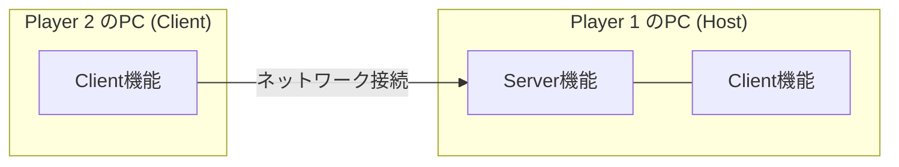
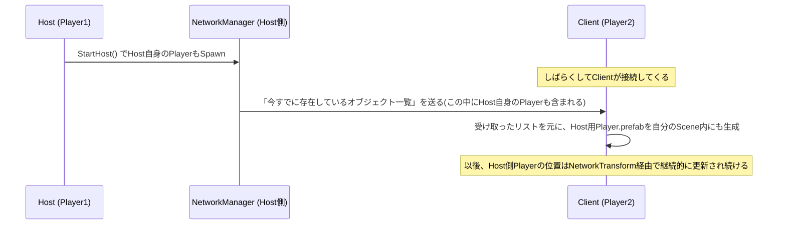
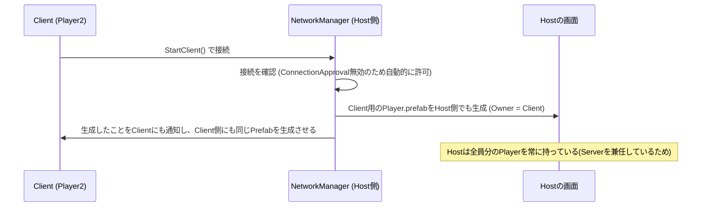
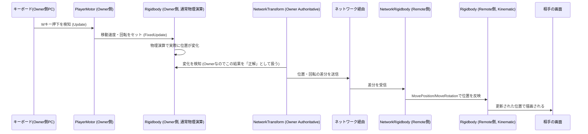

# Networking(オンライン対戦の仕組み)

このドキュメントは、このプロジェクトで使っているオンライン対戦の仕組み(Netcode for GameObjects)について、Unityのネットワーク機能を初めて/久しぶりに触る人でも理解できるように説明します。

---

## 1. Netcode for GameObjectsとは何か

Unity公式が提供している、マルチプレイヤーゲームを作るための機能一式(パッケージ)です。略して **NGO** と呼ばれます。

普通のUnityゲームでは「1台のPCの中に1つのゲーム世界がある」だけですが、オンラインゲームでは「複数のPCそれぞれにゲーム世界のコピーがあり、それらを一致させ続ける」必要があります。NGOは次のようなことを肩代わりしてくれます。

- どのPCがどのキャラクターを操作しているかの管理
- キャラクターなどのオブジェクトを、他のPCにも同じタイミングで登場させる(Spawn)
- 位置や回転などの情報を、他のPCへ自動的に送り続ける(同期)
- 誰かが切断したときの後片付け

NGOを使わない場合、これらをすべて自分でネットワークプログラミングとして書く必要があり非常に大変です。NGOはその大部分を「コンポーネントを付けるだけ」で済むようにしてくれます。

---

## 2. NetworkManagerの役割

`NetworkManager` は、このプロジェクトでは Scene内の `NetworkManager` という名前のGameObjectに付いています。オンライン機能全体の「管理人」のような存在です。

- 「これから自分はHostとして待ち受けるのか、Clientとして誰かに接続しに行くのか」を決めて実行する(`StartHost()` / `StartClient()`)
- 「接続してきた人がいたら、どのPrefabをキャラクターとして生成するか」を知っている(`NetworkConfig.PlayerPrefab` = `Player.prefab`)
- どのPrefabならネットワーク越しにSpawnしてよいかのリストを持っている(`NetworkConfig.Prefabs` → `DefaultNetworkPrefabs.asset`)
- 1秒間に何回、通信のための処理を行うか(`TickRate = 30`、つまり1秒間に30回)

`NetworkManager` はScene内に1つだけ存在すればよく、Playerのように何体も生成されるものではありません。

---

## 3. UnityTransportの役割

`NetworkManager` 自体は「何を」「いつ」送るかを決める係ですが、実際にデータをネットワーク上に送り出す部分(郵便配達人にあたる部分)は別の部品が担当しています。それが `UnityTransport` です。

このプロジェクトでの設定:
```
Address: 127.0.0.1     ← 接続先(Client視点)。127.0.0.1は「自分自身のPC」を指す特別なアドレス
Port: 7778              ← 通信に使うポート番号
ServerListenAddress: 127.0.0.1  ← 待ち受け(Host視点)のアドレス
```

`127.0.0.1` を使っているのは、現時点ではまだ「同じPC内で2つのUnityを起動してテストする」段階のためです。実際に別々のPCからインターネット越しに接続する場合は、この値を実際のIPアドレスや、Unity Multiplayer Services / Relay経由の接続情報に置き換える必要があります(これはStep 2の範囲外で、まだ未実装です)。

---

## 4. Host / Clientとは何か

このプロジェクトは「Host + Client方式」というシンプルな構成を採用しています。

- **Server**: ゲームのルールを判定し、全員に正しい情報を配る「審判」役。プレイヤーは操作できない裏方。
- **Client**: Serverから情報を受け取って画面に表示し、自分の操作をServerへ送る側。
- **Host**: **ServerとClientを1台のPCで同時に兼任する**役割。このプロジェクトの「Player 1」がHostにあたります。



Host方式を選んでいる理由は、専用のサーバー機を別途用意する必要がなく、「友達の誰か1人がHostになれば残りは接続するだけ」というシンプルな運用ができるためです(GameDesign.md 13節の方針とも一致します)。

---

## 5. NetworkObjectとは何か

「このGameObjectはネットワークで管理する対象です」という**目印**をつけるコンポーネントです。`Player.prefab` にはこれが付いているため、NGOは以下のようなことができるようになります。

- 誰か1人が接続してきたときに、Host側でこのPrefabを実体化し、他の全員にも同じものを実体化させる
- 生成された無数のコピーの中から「これは特定のどのオブジェクトなのか」をネットワーク越しに特定する(内部的にIDを持つ)
- 「これは誰の持ち物か(Owner)」という情報を管理する

**逆に言うと、`NetworkObject` が付いていないGameObject(例えば `Ground` や `Main Camera`)はネットワークの管理対象外**で、各PCがそれぞれ個別に持っているだけの存在です。同期する必要がないものにはあえて付けていません。

---

## 6. NetworkTransformとは何か

`NetworkObject` が「これは管理対象です」という目印だとすると、`NetworkTransform` は「このオブジェクトの**位置と回転**を実際に他のPCへ送り届ける」役割を持つ部品です。

内部的にやっていることをものすごく簡単に言うと、「1秒に30回、位置が変わっていないか確認し、変わっていたらその差分を送信する。受信した側は、送られてきた位置に向かって滑らかに移動させる」という処理です。

このプロジェクトでは `AuthorityMode = Owner`(オーナー権威)という設定にしています。この意味は次の章で説明します。

---

## 7. NetworkRigidbodyとは何か

`NetworkTransform` は位置と回転を送るだけですが、Playerには物理演算用の `Rigidbody` も付いています。もし何もしなければ、次のような問題が起きます。

- 自分のPCでは物理演算(重力・衝突)でRigidbodyが動いている
- 他人のPC側でも同じPrefabのRigidbodyが「別に」物理演算をしてしまい、`NetworkTransform` が送ってくる位置と噛み合わなくなってブルブル震えたり、変な動きになる

`NetworkRigidbody` はこれを防ぐための部品で、次の2つを自動で行います。

1. **持ち主(Owner)ではない側のRigidbodyを自動的にKinematicにする**(`AutoUpdateKinematicState`)。Kinematicになった Rigidbody は自分で物理演算をしなくなり、代わりに外部から位置を指定されるのを待つだけの状態になります。
2. **その「外部から位置を指定する」処理を、Transformの直接書き換えではなく `Rigidbody.MovePosition/MoveRotation` を使って行う**(`UseRigidBodyForMotion`)。これにより、物理エンジンの目線でも「本当にそこへ動いた」と認識され、他の物体(将来のDominoなど)と正しく衝突判定ができるようになります。

---

## 8. Owner Authority / Host Authorityの違い

「Authority(権威)」とは、「複数のPCの間で意見が食い違ったとき、誰の言い分を正解とするか」というルールのことです。オンラインゲームでは必ずこれを決めておく必要があります。

- **Owner Authority(オーナー権威)**: そのオブジェクトを**操作している本人のPC**の計算結果を正解とする。
- **Host(Server) Authority(ホスト権威)**: そのオブジェクトの計算は**必ずHostのPCだけ**が行い、Hostの結果を正解とする。操作している本人であっても、自分のPC上の計算はあくまで「予測」に過ぎない。


## 9. 現在PlayerをOwner Authorityにしている理由

Playerの移動は **Owner Authority** を採用しています。理由は次の通りです。

- このゲームは対戦ではなく協力プレイであり、「自分の操作が数十ミリ秒遅れて反映される」ことのデメリットの方が、「多少のズルができてしまう」というデメリットより大きい
- Host Authorityにすると、移動のたびにClientがHostへ「動きたい」という要求を送り、Hostが計算した結果が返ってくるまで反映を待つ(または予測してあとで補正する)処理が必要になり、実装が複雑になる
- Owner Authorityなら、自分のPC上でRigidbodyを動かした結果がそのまま正解になるため、操作した瞬間に画面に反映され、動きが機敏に感じられる

ただし、この方針には注意点があります。GameDesign.md 14節にある通り、将来実装するDomino(倒れる物理演算)は **Host Authority** で統一する設計です。「Owner AuthorityのPlayer」と「Host AuthorityのDomino」が物理的に衝突したときに正しく振る舞うよう、`NetworkRigidbody` の設定(第7章)を先回りして入れてありますが、**これはあくまで設計上の備えであり、実際にDominoを実装してHost/Client環境で衝突させてみるまでは「問題ないと確定した」わけではありません。** Domino実装時に必ず実機(複数プロセス)で検証してください。

---

## 10. Host PlayerがClient画面に表示される仕組み



ポイントは、Host自身のPlayerも(HostがServerを兼任しているだけで)ネットワーク上ではただの1つのPlayerオブジェクトとして扱われる、という点です。だからこそClientが後から接続してきても、「すでに存在していたHostのキャラクター」を正しく認識して自分の画面にも表示できます。

## 11. Client PlayerがHost画面に表示される仕組み



HostはServerを兼任しているため、「接続してきた全員のキャラクター」は必ずHostのScene内にも存在します。これが、Step 2の動作確認で「HostのGame Viewに2体のCapsuleが表示される」ことの理由です。

---

## 12. WASD入力 → Rigidbody移動 → Network同期 → 相手画面表示までの流れ



自分のPC内では「入力→物理演算→画面表示」がそのまま行われ、それとは別に `NetworkTransform` が結果を横取りしてネットワークに流している、というイメージです。`PlayerMotor` 自身はネットワークのことを一切意識しておらず、普通にRigidbodyを動かしているだけである点が重要です。

---

## 13. PlayerMotorのIsOwner判定がなぜ必要なのか

`Player.prefab` は、接続している人数分だけコピーが生成されます。例えば2人プレイなら、**HostのPC上に2つ、ClientのPC上にも2つ**、合計4つの `PlayerMotor` インスタンスが存在することになります(自分の分＋相手の分、それぞれのPC上に)。

もし `IsOwner` の確認をしていなかったら、どうなるでしょうか。

- Hostの画面上にある「Client用のPlayerの分身」も、Hostのキーボード入力に反応して勝手に動こうとしてしまう
- しかもそのPlayerは本来 `NetworkRigidbody` によってKinematic化されている(第7章)ため、`PlayerMotor` が `Rigidbody.linearVelocity` を書き換えようとしてもうまく動かない、あるいはネットワークから来る正しい位置と競合して不具合になる

`if (!IsOwner) return;` を `Update()` と `FixedUpdate()` の先頭に入れることで、「この分身が自分の持ち物であるときだけ、入力を読んで動かす処理を実行する」というルールを徹底しています。これにより、4つ存在する `PlayerMotor` のうち、実際に「操作ロジックとして働く」のは常にちょうど2つ(それぞれのPCにとっての「自分のキャラクター」)だけになります。

---

## 14. Multiplayer Play ModeのPlayer 1 / Player 2と実際のHost / Clientの対応関係

Unity Editor内でHost/Clientを同時にテストするための機能が **Multiplayer Play Mode(MPPM)** です。この機能上の「Player 1」「Player 2」という呼び方と、ゲーム内の「Host」「Client」という役割は、**自動的に対応しているわけではありません**。このプロジェクトでは以下のように紐付けています。

| MPPM上の呼び方 | 実体 | 割り当てたTag | 実際の役割 |
|---|---|---|---|
| Main Editor(Player 1) | 普段使っているUnity Editorそのもの | `Host` | `StartHost()` を呼ぶ |
| Player 2(Virtual Player) | MPPMが起動する、もう1つの軽量なEditorインスタンス(別ウィンドウ) | `Client` | `StartClient()` を呼ぶ |

MPPMには、各Playerに好きな文字列の「Tag」を付けられる機能があり、実行中のコードから `Unity.Multiplayer.PlayMode.CurrentPlayer.Tags` を読むことで「自分に何のTagが付いているか」を確認できます。このプロジェクトでは、Main Editorに `"Host"`、Player 2に `"Client"` というTagを付けており、`NetworkBootstrap`(次章)がこのTagを読んで自動的に役割を判断します。

つまり「Player 1 = Host」「Player 2 = Client」という対応は、Unityの機能として決まっているのではなく、**このプロジェクトでそう設定したから**そうなっている、という点に注意してください。TagをつけかえればPlayer 1をClientにすることも可能です。

---

## 15. NetworkBootstrapが何をしているか

`NetworkBootstrap.cs` は、Scene開始時に「自分はHostとして起動すべきか、Clientとして接続すべきか」を自動判定して実行するスクリプトです。`NetworkManager` と同じGameObjectに付いています。

```csharp
private void Start()
{
    if (TryStartFromMultiplayerPlayModeTags()) return;
    StartFromCommandLineArgs();
}
```

判定は2段階です。

1. **MPPMのTagを確認する**(`TryStartFromMultiplayerPlayModeTags`): 前章の通り、`"Host"` タグが付いていれば `StartHost()`、`"Client"` タグが付いていれば `StartClient()` を呼ぶ。該当するTagがなければ何もせず `false` を返す。
2. **コマンドライン引数を確認する**(`StartFromCommandLineArgs`): 1で何も起動しなかった場合のフォールバック。これはEditorではなく実際にビルドしたゲーム(.exe)を使ってテストするための経路で、起動時の引数に `-host` または `-client` が含まれていれば、それに応じて起動する。**Editor内(`Application.isEditor == true`)ではこの経路は使われません。**

この2つの経路が同時に問題を起こすことはありません。MPPMのTagはEditor(Main EditorとVirtual Player)でのみ意味を持ち、コマンドライン引数はビルドしたゲームを直接実行したときにしか使われないため、状況が重なることがないからです。

**なぜこのスクリプトが必要か**: `NetworkManager` は「HostになるかClientになるか」を自分では決めてくれません。誰かが明示的に `StartHost()` または `StartClient()` を呼ぶ必要があります。UIボタンなどはまだ実装していないため、現時点ではこの `NetworkBootstrap` が「起動時に自動でその呼び出しを行う」係を担っています。将来、タイトル画面やロビー画面(GameDesign.md 13節)を実装する際には、このスクリプトの役割はUIからの明示的なボタン操作に置き換わっていく想定です。

---

## 16. Port 7778が何に使われているか

`UnityTransport` が実際に通信を行うためのポート番号です。当初はNetcode for GameObjectsの標準的な初期値である `7777` を使っていましたが、開発中の検証作業で、Unity Editorのプロセス内でこのポートを掴んだままのソケットが残ってしまう(解放されない)事象が発生したため、それを避けて **7778** に変更しました。

- 現状は `127.0.0.1`(自分自身のPC)への接続にしか使っていないため、番号自体に深い意味はなく、8000番でも9000番でも動作上は問題ありません。
- 7777番のソケットは、Unity Editorを再起動すれば解放されます。7778のままでも実害はないため、現時点では戻す必要はないと判断しています。
- 将来、実際のインターネット経由の通信(Relay等)に切り替える際には、この固定ポート番号への依存自体がなくなる見込みです(Relayは接続のたびに動的にポート/経路を割り当てる仕組みのため)。
