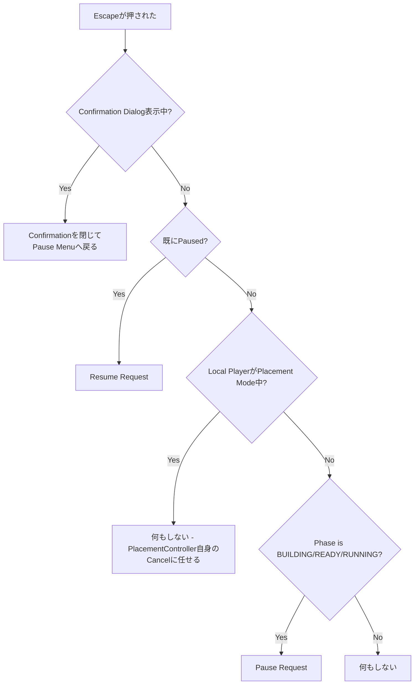

# PauseSystem(Pause Menu / Restart / Navigation / Result Actions)

Step 10Aで追加した、Gameplay中のPause機能について記載します。Gameplay進行(BUILDING/READY/RUNNING/SUCCESS/FAILED)自体は`GameFlow.md`、BUILD TIMEの詳細計算は`ChallengeTimer.md`を参照してください。Step 10BでPause Menu / SUCCESS ResultにStage Select・Return to Titleを追加しました(第9章)。Scene遷移・Online Session・MenuState等、Menu側の詳しい仕組みは`MenuFlow.md`「10. Gameplay → MainMenu Navigation」を参照してください。

---

## 1. Pause Authority(Server Authoritative)

Pauseの正解は`GameplayPauseManager`(`SampleScene`にScene-placedされた`NetworkObject`、`GameFlowManager`と同じパターン)が持つ、次の1つの`NetworkVariable<bool>`だけです。

```csharp
private readonly NetworkVariable<bool> _isPaused = new NetworkVariable<bool>(
    false, NetworkVariableReadPermission.Everyone, NetworkVariableWritePermission.Server);
```

ClientはLocalだけでPauseすることはできません。必ず`RequestPauseRpc()`/`RequestResumeRpc()`(いずれも`[Rpc(SendTo.Server, InvokePermission = RpcInvokePermission.Everyone)]`)をServerへ送り、Serverが妥当性を確認した上で`_isPaused.Value`を書き換えます。

```csharp
[Rpc(SendTo.Server, InvokePermission = RpcInvokePermission.Everyone)]
public void RequestPauseRpc(RpcParams rpcParams = default)
{
    if (_isPaused.Value) return;
    if (GameFlowManager.Instance == null || !IsPausablePhase(GameFlowManager.Instance.CurrentPhase)) return;
    _isPaused.Value = true;
}
```

`IsPausablePhase`はBUILDING/READY/RUNNINGのみを許可します。SUCCESS中はResult画面が別途あるため通常のPause Menuは開きません(Step 10Bで専用のConfirmation付きResult Actionsを追加)。FAILED中はShort Reset Transition中のため今回は非対応です。

---

## 2. Online = Global Pause

`_isPaused`はSampleScene全体で1つだけ存在する`NetworkVariable`のため、**誰か1人がPauseすれば、接続中の全Player(Host/Client問わず)が同時にPauseされます**。個別のClientだけをPauseする仕組みは存在しません。Single Playerも同じ`GameplayPauseManager`をそのまま使っており、Online専用のコードパスはありません(Local Host = Connected Player 1人のOnlineと同じアーキテクチャという既存方針、Networking.md第4章のまま)。

---

## 3. Time.timeScaleによる実際のPause適用

```csharp
private static void ApplyLocal(bool paused)
{
    Time.timeScale = paused ? 0f : 1f;
}
```

`_isPaused.OnValueChanged`を購読し、値が変わるたびに**全Client(Hostも含む)がこれを自分のPCで独立に、Local限定で**実行します(Network通信は`_isPaused`自体の同期だけで、`Time.timeScale`の適用自体はNetwork Traffic不要)。

### なぜTime.timeScale = 0で十分なのか

`Time.timeScale = 0`にすると、`MonoBehaviour.Update()`自体は毎フレーム引き続き呼ばれますが、`Time.deltaTime`・`Time.fixedDeltaTime`・`Time.time`はすべて0(または増加が止まった値)になり、**`FixedUpdate()`はUnityの標準的な仕様により呼ばれなくなります**。この性質だけで、以下がコード変更なしに正しくPauseされます。

| 止まるもの | 仕組み |
|---|---|
| Player Movement(`PlayerMotor.FixedUpdate`) | `FixedUpdate`自体が呼ばれない |
| Domino Physics(全Rigidbody) | Unity標準Physicsが`FixedUpdate`ベースのため同上 |
| Player Push(`PlayerPushController.OnCollisionEnter`) | 衝突自体がPhysics停止により発生しない |
| GameFlowManagerのFailure Monitor(`_settledSince`, `Time.time`基準) | `Time.time`が進まないため、経過時間の計算が自動的に凍結される |
| GameFlowManagerのReady Poll(`Time.deltaTime`加算) | `Time.deltaTime`が0のため加算が進まない |
| DominoCleanupManagerのFallenタイマー(`Time.time`基準) | 同上 |

**実機確認済み**(Play Mode): RUNNING中にDomino Chainが倒れている最中、Rigidbodyへ直接`linearVelocity`/`angularVelocity`を与えた状態でPauseし、4秒間の実時間待機後も`transform.position`/`linearVelocity`/`angularVelocity`が完全にビット単位で不変であることを確認。Resume後は同じ値から物理演算が正しく再開しました。

### UI / NGO / RPCはPause中も正常に動作する(実機確認済み)

`Time.timeScale`はUnityのUI(uGUI/EventSystem)やNetcode for GameObjectsの通信処理には影響しません。`Update()`自体が引き続き呼ばれ続けるため、Button ClickやRPCの送受信もPause中に正常に機能します。実機確認: `Time.timeScale == 0`の状態で`ExecuteEvents`経由の疑似ClickによりPause MenuのRestart/Resume/Confirm Yes/Noそれぞれのボタンが正しく反応し、対応するRPCが正しくServerへ到達・処理されることを確認しました。**「Pause中はResume Requestが処理されない」という懸念(実装前に検討が必要とされていた最大のリスク)は発生しません。**

---

## 4. BUILD TIMEとの連携(最も注意が必要な箇所)

`ChallengeTimer`(`ChallengeTimer.md`参照)は`NetworkManager.ServerTime.Time`という、**Local`Time.timeScale`の影響を一切受けないNGO自身のNetwork時刻推定値**を基準にBUILD TIMEを計算しています。そのため、上記の「Time.timeScale = 0で自動的にPauseされる」仕組みの**唯一の例外**です。何もしなければ、Pause中も`ServerTime.Time`は実時間のまま進み続け、BUILD TIMEに Pause時間がそのまま加算されてしまいます。

### 同期的なPause反映(ポーリングに頼らない)

当初、既存の`ChallengeTimer.Update()`のPhase変化検出(ポーリング)にPauseの状態も乗せる設計を試みましたが、**実機検証で問題が発覚**しました。RPCで`_isPaused.Value`を変更した直後に`ChallengeTimer.GetBuildSeconds()`を読むと、ポーリングによる実際の値更新が「次のUpdate() tick」まで反映されないため、その一瞬の間に大きくズレた値を返すことがありました(Editor非フォーカス時はUpdate()の実行間隔が数秒単位まで開くことがあり、この問題が顕著に現れました)。

**修正**: `GameplayPauseManager`の`_isPaused.OnValueChanged`から、`ChallengeTimer.SyncPauseState(bool)`を**同期的に**呼び出すよう変更しました。

```csharp
// GameplayPauseManager
private void HandlePausedChanged(bool previous, bool current)
{
    ApplyLocal(current);
    if (IsServer) ChallengeTimer.Instance?.SyncPauseState(current);
}
```

```csharp
// ChallengeTimer
public void SyncPauseState(bool paused)
{
    if (!IsServer) return;
    if (GameFlowManager.Instance == null) return;

    bool isActive = !paused && IsActivePhase(GameFlowManager.Instance.CurrentPhase);
    ApplyActiveTransition(isActive);
}
```

`ApplyActiveTransition()`は、既存のPhase変化検出(BUILDING→RUNNING等)と全く同じFold/Resume計算を共有する形へ整理しました。

```csharp
private void ApplyActiveTransition(bool isActive)
{
    if (isActive == _lastActiveState) return;

    if (_timerStarted.Value)
    {
        if (_lastActiveState && !isActive)
        {
            // Pausing、またはBUILDING/READYを抜ける(例: -> RUNNING):
            // 直前までのActive区間をAccumulatedへ畳み込む
            _accumulatedBuildSeconds.Value += NetworkManager.ServerTime.Time - _activeSegmentStartServerTime.Value;
        }
        else if (!_lastActiveState && isActive)
        {
            // Resuming、またはBUILDING/READYへ(再)突入:
            // 新しいActive区間を「今」から開始する - Pause時間は区間に含まれない
            _activeSegmentStartServerTime.Value = NetworkManager.ServerTime.Time;
        }
    }
    _lastActiveState = isActive;
}
```

`Update()`側は、Phase変化の検出にこの同じメソッドを呼ぶだけになりました(Pauseの検出はSyncPauseState経由のみ)。

### GetBuildSeconds()側もPausedを直接考慮

表示計算(`GetBuildSeconds()`、全ClientがLocalで毎フレーム計算)自体も、Phaseだけでなく`GameplayPauseManager.Instance.IsPaused`を直接読むよう変更しました。

```csharp
bool active = !IsPaused() && GameFlowManager.Instance != null && IsActivePhase(GameFlowManager.Instance.CurrentPhase);
if (!active) return _accumulatedBuildSeconds.Value;
return _accumulatedBuildSeconds.Value + (NetworkManager.ServerTime.Time - _activeSegmentStartServerTime.Value);
```

これにより、`SyncPauseState()`による内部状態の更新が万一遅れても、表示側は独立して正しく「Pause中は加算しない」判断ができます(二重の安全策)。

### 実機確認結果

| タイミング | BUILD TIME |
|---|---|
| Pause直前 | 例: 12.99秒 |
| Pause直後(同一Frame内) | 12.99秒(完全一致) |
| 5秒間の実時間Pause後 | 12.99秒(完全一致、ビット単位で不変) |
| Resume直後(同一Frame内) | 12.99秒(完全一致、ジャンプなし) |
| Resume後、実時間が経過 | 12.99秒から正しく増加再開 |

修正前(ポーリングのみ)の実装では、Resume直後に本来あり得ない大きな値へジャンプする不具合を実機で確認し、上記の同期化で解消したことを確認済みです。

---

## 5. Gameplay Inputのブロック(Pause中)

`Time.timeScale = 0`はPhysics/Time系のTimerを止めますが、**RPCの送信自体はTime.timeScaleの影響を受けません**。そのため、Placement(`E`/`A`/`D`/左Click)とChallenge Start(`F`)は、それぞれの`Update()`冒頭で明示的にPauseを確認し、早期returnするようにしています。

```csharp
// PlacementController.Update() / ChallengeInput.Update() (共通パターン)
if (GameplayPauseManager.Instance != null && GameplayPauseManager.Instance.IsPaused) return;
```

**Global Pauseであることへの配慮**: 自分ではなく別のPlayerがPauseした場合でも、この判定は正しく効きます(`GameplayPauseManager.IsPaused`は全Client共通の同期値のため)。Placement Mode中にGhost/Markerが表示されたままPauseされた場合、それらは強制Cancelされず、その場で見た目が凍結されたまま残ります(Ghost自身のWobbleアニメーションも`Time.deltaTime`基準のため自動的に凍結されます)。Resumeすれば何事もなかったかのように操作を再開できます。

**Server側の二重防御**: `DominoSpawner.TryPlaceDomino()`と`GameFlowManager.RequestStartChallengeRpc()`にも同じPauseチェックを追加し、Client側のGateを無条件に信用していません(既存のValidation思想と同じ)。

---

## 6. Escapeキーの優先順位(Placement Cancelとの衝突)

`Escape`キーは`PlacementController`の既存Cancelキーでもあります(Step 4以来、Placement Mode中のみ)。両者が同じ押下に反応しないよう、`GameplayHUD.HandlePauseKey()`が以下の優先順位でルーティングします。



Local Playerが現在Placement中かどうかは、`PlacementController`に追加した読み取り専用プロパティ`IsPlacing`で判定します。

```csharp
NetworkManager nm = NetworkManager.Singleton;
PlacementController placement = nm.LocalClient?.PlayerObject?.GetComponent<PlacementController>();
bool isLocalPlacing = placement != null && placement.IsPlacing;
```

これにより、「Placement Mode中にEscapeを押す」→Cancelのみ発生(Pauseは開かない)、「Placement Mode中でない時にEscapeを押す」→Pauseが開く、という単一のEscape押下につき単一の意味が常に成り立ちます。

---

## 7. Pause Menu UI

`GameplayHUD.prefab`に、既存のBuildingPanel/ReadyPanel等と同じCanvas配下へ2つのPanelを追加しました(UGUI + TextMeshPro、既存パターンを踏襲)。

- **PausePanel**: `PAUSED`ラベル + `Resume (Esc)`ボタン + `Restart`ボタン + `Stage Select`/`Return to Title`ボタン(後者2つはStep 10Bで追加、第9章)
- **ConfirmationPanel**: 汎用の確認ダイアログ。メッセージ文言 + `Yes`/`No`ボタン。Actionごとに文言を差し替える汎用設計(`ShowConfirmation(string message, PendingConfirmAction action)`)

表示優先順位(Confirmation > Pause > 通常HUD)は、PausePanelとConfirmationPanelを排他的に切り替える(同時表示しない)ことで単純に実現しています。「No」はConfirmationを閉じてPause Menuへ戻るだけで、Gameplay State(Phase/BUILD TIME/Domino等)には一切触れません(実機確認済み)。

---

## 8. Restart

Pause Menuの「Restart」は、SUCCESS画面の「Retry」と同じ`GameFlowManager.FullStageResetSequence()`を共有します。詳細(Domino全削除・BUILD TIME全リセット・Player Spawn Point再配置・Phase→BUILDING)は`GameFlow.md`「9.7. Pause / Restart」を参照してください。Restart完了時、`GameplayPauseManager.ServerForceUnpause()`が必ず呼ばれるため、Restart後にPauseが残ったまま固まることはありません。

Restart自体は`Confirmation Dialog`(第7章)を経由します(「Restart the current stage?\nAll progress will be lost.」)。「Yes」を押すまでは一切のGame State変更は発生しません。

### 実機確認済み(Runtime Test)

- **BUILDING Pause**: First Domino配置→BUILD TIME計測開始→Pause→5秒実時間待機→BUILD TIME完全凍結(ビット単位で不変)→Resume→ジャンプなく計測再開
- **RUNNING Pause(Physics)**: RUNNING中のDominoにRigidbody速度を直接付与した状態でPause→4秒実時間待機→位置/速度/角速度が完全に不変→Resume→同じ値から物理演算が正しく再開
- **Restart**: Player移動済み・Domino 2個設置済み・BUILD TIME計測中の状態からPause→Restart→Confirm Yes→Domino 0個、BUILD TIME `--:--.--`、全PlayerがSpawn Point(速度0)、Phase=BUILDING、Pause解除(`Time.timeScale == 1`)、Placement再度可能であることを確認
- **Confirmation Cancel**: Restart Confirmation表示中に「No」→Pause Menuへ復帰、Phase/BUILD TIME/Domino等のGame Stateが一切変化しないことを確認
- **UIボタン疎通**: Resume/Restart/Confirm Yes/Confirm NoのすべてをUnity UIの`ExecuteEvents`経由の疑似Clickで検証し、対応するRPC/State変更が正しく発火することを確認(`Time.timeScale == 0`の間も含む)
- Console: 上記すべてのテストを通じてProject由来のError/Warning 0件

---

## 9. Pause Menu / SUCCESS Result のNavigation(Step 10B)

Pause Menuに`Stage Select`・`Return to Title`ボタンを追加し(既存の`Resume`/`Restart`と合わせて4ボタン)、SUCCESS Resultにも同じ2ボタンを追加しました(既存の`Retry`ボタンは`Retry (R)`とラベルを変更し、Keyboard ShortcutをPlayerから見て分かるようにしています)。実際のScene遷移・Session取り扱いのロジックは`GameplayNavigationController`(SampleScene側、新規)が担い、`GameplayHUD`はUIとConfirmation Dialogの表示・呼び出しのみを行います(Retry/Restartと同じ役割分担)。

### Confirmationの有無(Section 15-17, 40-42)

| 操作 | Pause Menu | SUCCESS Result |
|---|---|---|
| Retry | - | 不要(既存、Step 8.5から無変更) |
| Restart | 必要(第8章) | - (Pause Menu限定) |
| Stage Select | 必要 | **不要** |
| Return to Title(Single Player) | 必要 | **不要** |
| Return to Title(Online) | 必要 | 必要 |

Confirmation Dialogの汎用実装(第7章)を`PendingConfirmAction`列挙にStageSelect/Titleを追加する形でそのまま再利用しています。Title確認時のメッセージ文言はSingle Player/Onlineで異なります(Section 17)。Stage Select確認時の文言は両者共通です(Section 16)。

### Online Stage SelectのHost-only表示(Section 28, 40)

Pause Menu・SUCCESS Resultどちらの`Stage Select`ボタンも、`NetworkManager.Singleton.IsHost`(Single Playerの場合は常にtrue)に応じて`interactable`とラベル文言(`"Stage Select"` / `"Stage Select (Host Only)"`)を毎フレーム更新しています。ClientのUI上でも「押せない理由」が文言で分かるようにする、という要件をこの1行のラベル切り替えで満たしています。

### 実機確認済み(Runtime Test、Step 10B)

- **Single Player Stage Select Return**: Pause → Stage Select → Confirm Yes → `NetworkManager.Shutdown()` → MainMenu → **Stage Selectへ直接遷移**(Titleを経由しない)ことを確認。続けて同じMainMenuからもう一度Single Playerを開始し、正常にGameplayへ入れることも確認
- **Single Player Return to Title**: Pause → Return to Title → Confirm Yes → Shutdown → MainMenu → **Title**へ遷移することを確認
- **Online Stage Select Return(Host自身の1接続によるシミュレーション)**: Pause → Stage Select → Confirm Yes → `NetworkManager.IsListening`が`true`のまま(Session/Relay接続を維持)MainMenuへ遷移し、`OnlineSessionController`が静的に保持していた`ISession`参照を正しく再利用してRoom/Stage Select UIを復元することを確認。Gameplay Player ObjectがMainMenuに残っていないこと(`ConnectedClients[0].PlayerObject == null`)も確認
- **Online Return to Title(Host自身)**: Pause → Return to Title → Confirm Yes → Session Leave + Shutdown → MainMenu → Title、`GameSessionContext.IsOnline`が正しく`false`に戻ることを確認
- **SUCCESS Result → Stage Select(Confirmationなし)**: Single PlayerでPhaseをSUCCESSにした状態からStage Selectボタンをクリックし、確認ダイアログを経由せず直接MainMenuのStage Selectへ遷移することを確認
- **SUCCESS Result → Return to Title(Single Player, Confirmationなし)**: 同様にTitleボタンをクリックし、確認ダイアログなしで直接Titleへ遷移することを確認
- **Confirmation Cancel(Stage Select / Title)**: それぞれ「No」でPause Menuへ復帰し、Scene/Phase/Network状態が一切変化しないことを確認
- Console: 上記すべてのテストを通じてProject由来のError/Warning 0件

### 発見・修正したバグ(このStep内)

- **`NetworkSessionState`はGameplay中に存在しない**: 当初、Gameplay側から直接`NetworkSessionState.Instance?.HostReturnToStageSelect()`を呼ぶ設計にしていましたが、`NetworkSessionState`は`NetworkManager`と異なり`DontDestroyOnLoad`されておらず、MainMenuを離れた時点で破棄されていることが実機検証で判明しました(`Instance`が常にnullなため、呼び出しが無言で失敗)。`GameSessionContext.PendingHostReturnToStageSelect`という静的flagを介し、MainMenu再ロード後に新しくSpawnする`NetworkSessionState`自身の`OnNetworkSpawn()`でPhase遷移を適用する方式に変更しました。詳細と実際のSequenceは`MenuFlow.md`「10. Gameplay → MainMenu Navigation」を参照してください

### 未確認事項

- 実際の2台のClientによるOnline Stage Select Return / Return to Titleの直接End-to-End確認(既存の制約と同じ、同一Editorプロセスから2つの独立したRelay接続を同時に張ることが困難なため、Host自身の1接続のみで検証)。開発者ご自身での実機確認を推奨します
- Online Host-only Stage Selectボタンが実際にClient側で `interactable=false` / "Host Only" 表示になることの直接確認(実際のClient roleでの接続が必要なため、コードロジックの確認に留まっています。`!GameSessionContext.IsOnline || NetworkManager.Singleton.IsHost`という単純な式のため、既存のOnline Room/Stage Select Panelで同種の判定(`_session.IsHost`ベース)が正しく機能してきた実績から、動作することを確信しています)

---

## 10. Pause関連の未確認事項(Step 10A由来)

- 実際の2台のClientによるOnline Global Pauseの直接確認(既存のStep 9系ドキュメントと同じ制約 - 同一Editorプロセスから2つの独立したRelay接続を同時に張ることが困難なため、Single Player/Host単独接続でのみ検証)。アーキテクチャ自体はGameFlowManager/NetworkSessionStateと同じScene-placed NetworkObjectパターンのため、既存のOnline機能と同様に動作すると判断していますが、開発者ご自身での実機確認を推奨します
- Escapeキーの実際のキー押下シミュレーションによるEnd-to-End確認は、本環境ではキー入力イベントの実フレーム反映タイミングを外部ツールから制御できず断念しました(Button ClickはExecuteEvents経由で確認済み)。`HandlePauseKey()`自体のロジックはコードレビューと、R-key(既存のRetry Shortcut、同じ`Keyboard.current`ポーリングパターン)がこれまで問題なく機能してきた実績から、動作することを確信しています

---

## 11. Pause → Character Select(Step 12.1)

Pause Menuに`Character Select`ボタンを追加し、`Resume(Esc) / Restart(R) / Character Select(C) / Stage Select(S) / Return to Title(T)`の5ボタン構成になりました。挿入位置はRestartとStage Selectの間です。既存の`Stage Select`/`Return to Title`(第9章)と完全に同じ設計パターンを踏襲しています。

### Confirmation文言(Section 28)

| | Single Player | Online(Host-only) |
|---|---|---|
| Character Select | `Return to Character Select?`<br>`Current progress will be lost.` | `Return everyone to Character Select?`<br>`Current progress will be lost.` |

`Return to Title`(第9章)と同じく、Online側だけ「全員に影響する」ことが伝わる文言に差し替えています。Stage Select確認文言(第9章、Single/Online共通)とは異なるパターンです。

### `GameplayNavigationController.RequestReturnToCharacterSelect()`

`RequestReturnToStageSelect()`と全く同じ形です(`GameSessionContext.ReturnDestination`/`PendingHostReturnToCharacterSelect`という対になるFlagを使うだけ)。

```text
Single:  Shutdown() → MainMenu再Load → Start()がReturnDestination(=CharacterSelect)を消費
Online:  DespawnAllGameplayPlayers() → NetworkManager.SceneManager.LoadScene(MainMenu)
         → 新しいNetworkSessionState.OnNetworkSpawn()がPendingHostReturnToCharacterSelectを消費 → Phase = CharacterSelect
```

Online側はSession/Relay接続を切断しません(Section 31、Stage Select Returnと同じ)。Gameplay Player Objectは`GameplayPlayerSpawner.DespawnAllGameplayPlayers()`で明示的に破棄してからScene遷移するため、Step 9.2で修正したPlayer落下バグの再発はありません(`MenuFlow.md`「10. Gameplay Player Cleanup」参照)。

### Host-only Gating(Section 31/32)

Stage Selectと全く同じパターンで、Onlineの間だけ`NetworkManager.Singleton.IsHost`に応じて`interactable`とラベル(`"Character Select (C)"` / `"Character Select (Host Only)"`)を切り替えます。ClientがCキーを押してもSession全体は遷移しません(Server-side再チェックはGameplayNavigationController自身が`NetworkManager.IsServer`を見て行います)。

### 実機確認済み(Single Player, Play Mode)

- Pause中に`Character Select (C)`ボタン/Cキーで確認ダイアログが表示され、文言が上表のSingle Player版と一致することを確認
- 「Yes」確定後、`GameSessionContext.ReturnDestination = MenuState.CharacterSelect`が正しくセットされ、MainMenu再Load後の`MainMenuController.Start()`がCharacterSelectPanelを直接表示することを確認(Shutdown Chainを経由しない直接呼び出しでの単体確認)
- Character 2(GreenBoy)でGameplayに入った状態からPause → Character Select → Character 1(Classic)を選び直し→Stage Select→Gameplayで、実際にGreenBoy→Capsuleへ切り替わることを確認

### 未確認事項

本Step実装中、長時間のPlay Modeサイクル(Single Player開始・停止を多数回繰り返す自動テスト)により、`NetworkManager.Shutdown()`が`ShutdownInProgress`のまま完了せず、後続の`StartHost()`がUDP Port再Bind失敗で失敗するという環境側の不安定化に複数回遭遇しました(Editor自体が`Play Mode Paused`状態に予期せず入る事象も併発)。そのため、「実際にPause → Character Select (C) → Confirm → Shutdown → OnClientStopped → MainMenu」という完全なEnd-to-Endの連続クリックを、Shutdown Chainを含めて最後まで安定して再現することはできませんでした。`ReturnDestination`によるMainMenu側の遷移ロジック自体は上記の通り単体確認済みですが、Shutdown Chain部分は`RequestReturnToStageSelect()`(Step 10Bで実機確認済み)と全く同じコードパスを再利用しているため、動作すると判断しています。Online版(Host-only Gating含む)の実機確認も同様の制約で未実施です。開発者ご自身での実機確認を推奨します。
