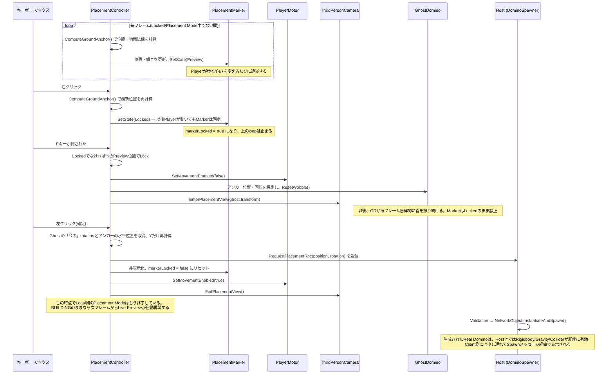
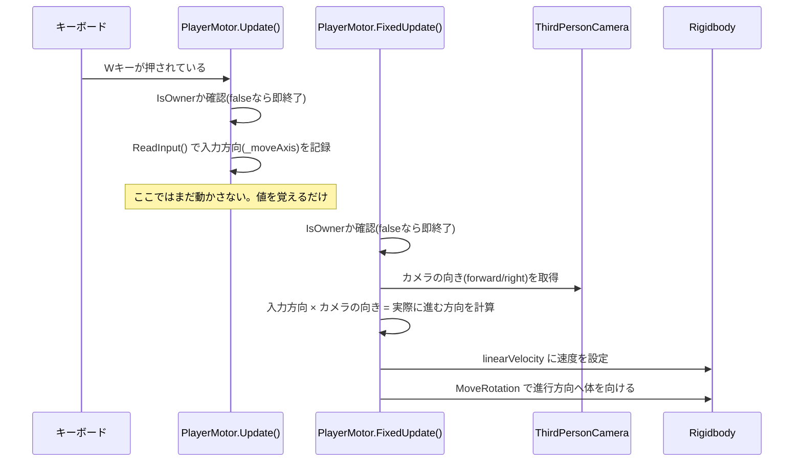

# PlayerSystem(プレイヤーの仕組み)

このドキュメントは `Player.prefab` を構成する各Componentの役割と、「WASDキーを押してからキャラクターが実際に動くまで」「Eキーを押してからDominoが配置されるまで」の処理の流れを説明します。対象読者は、Unityや通信対戦ゲームの実装を久しぶりに触る開発者を想定しています。

---

## 1. Player.prefab のHierarchy

```
Player (Root)                         ← ローカル座標 (0, 0.05, 0) でSpawn
├─ Rigidbody                          物理演算の本体
├─ CapsuleCollider                    当たり判定(半径0.4 / 高さ2 / 中心Y=1)
├─ PlayerStats                        数値パラメータの入れ物
├─ PlayerMotor                        入力読み取り+移動ロジック
├─ NetworkObject                      「ネットワークで管理される物」の目印
├─ NetworkTransform                   位置・回転をネットワーク経由で同期する部品
├─ NetworkRigidbody                   Rigidbodyの同期を物理的に正しく行うための部品
├─ PlacementController                Domino配置(Placement Mode)のロジック(Step 4で追加)
├─ Visual                             (子) 見た目(現状はCapsule)
│   ├─ MeshFilter (Capsule)
│   ├─ MeshRenderer
│   └─ Nose                           (孫) Step 7.7で追加。正面方向を示す小さな赤い球
│       ├─ MeshFilter (Sphere)
│       └─ MeshRenderer (Material: NoseMaterial)
└─ CameraTarget                       (子) ローカル座標 (0, 1.6, 0) = 頭の高さの目印
```

Rootには「物理」「ネットワーク」「入力ロジック」だけが集まっていて、「見た目(Visual)」だけが分離されています。これは意図的な設計で、理由は本ドキュメントの最後の章(Local/Remoteの違い)とArchitecture.mdで触れています。

**Nose(Step 7.7で追加)**: CapsuleだけのPrototype Characterでは正面がどちらか視覚的に分かりづらいという指摘を受け、Visual配下のローカル座標`(0, 0.6, 0.5)`(+Z方向、`PlayerMotor`が前進方向として扱う軸と一致)へ小さな赤い球を追加しました。Collider・Rigidbody・NetworkObject・NetworkTransform・Scriptはいずれも持たない、純粋な見た目専用の子オブジェクトです。Player本体のTransform(Owner AuthorityでNetwork同期される)にそのまま追従するだけなので、Player自身の同期・Physics設定には一切影響しません。将来Meshy等で正式なCharacter Modelに差し替える際は、この`Nose`ごと置き換える想定です。

---

## 2. 各Componentの役割

### PlayerStats
移動に関する数値をまとめて持っているだけの、ロジックを一切持たないコンポーネントです。

```csharp
public float moveSpeed = 5f;        // 通常時の移動速度 (m/s)
public float dashMultiplier = 1.8f; // Shiftダッシュ時にmoveSpeedへ掛ける倍率
public float jumpForce = 6f;        // ジャンプ時に与える上向き速度
public float rotationSpeed = 720f;  // 1秒間に何度まで体の向きを回転させられるか
public float mouseSensitivity = 2f; // (※現状未使用。下記参照)
```

**なぜ数値をここに分けているのか**: 将来「装備品によって移動速度が変わる」(GameDesign.md 17節)といった仕様を追加するとき、`PlayerMotor` のコードを書き換えるのではなく、この `PlayerStats` の値を装備品の効果で上書きするだけで済むようにするためです。現時点では装備システムは未実装なので、単なる初期値の置き場になっています。

**既知の未整理点**: `mouseSensitivity` フィールドはどこからも参照されていません。カメラの感度は `ThirdPersonCamera` 側が独自に持つ `sensitivity` フィールドで管理されており、両者は繋がっていません。将来「装備でカメラ感度を変える」等の予定がなければ、このフィールドは削除して問題ありません。

### PlayerMotor
このプレイヤーの「頭脳」にあたるスクリプトで、`NetworkBehaviour` を継承しています(`MonoBehaviour` ではなく `NetworkBehaviour` である理由は後述)。

主なField:
```csharp
[SerializeField] private float groundCheckDistance = 0.25f; // 接地判定の光線の長さ
[SerializeField] private LayerMask groundMask = ~0;          // 接地判定の対象レイヤー(現状は「すべて」)
[SerializeField] private Transform cameraTarget;              // カメラに渡す注視点(CameraTarget子オブジェクトへの参照)
```

主なMethod:
| Method | 呼ばれるタイミング | やっていること |
|---|---|---|
| `Awake()` | オブジェクト生成直後 | Rigidbody/PlayerStatsの参照を取得し、X軸・Z軸方向の回転を物理的にロックする(横に転ばないように) |
| `OnNetworkSpawn()` | ネットワーク上でこのオブジェクトが実体化した直後 | 自分の持ち主(Owner)である場合だけ、`ThirdPersonCamera` にカメラの追従対象として自分を登録する |
| `Update()` | 毎フレーム | 自分の持ち主である場合だけ、キーボード入力を読み取る(Placement Mode中はスキップ) |
| `FixedUpdate()` | 物理演算のたびに一定間隔で | 自分の持ち主である場合だけ、接地判定・移動・ジャンプを実行する(Placement Mode中はスキップ) |
| `SetMovementEnabled(bool)` | `PlacementController`がPlacement Modeの開始/終了時に呼ぶ(Step 4で追加) | `false`のときは`Update()`/`FixedUpdate()`の中身を丸ごとスキップさせ、その場で水平方向の速度を1回だけゼロにする。**Rigidbodyを`isKinematic`にしたりコンポーネント自体を無効化したりはしない**ため、Placement Mode中もPlayerは物理的に落下や衝突の影響を受け続ける |

**なぜ `OnNetworkSpawn` や `Update`/`FixedUpdate` の中で毎回 `IsOwner` を確認しているのか** は、このドキュメントの最後の章と `Networking.md` で詳しく説明します。一言で言うと「1つのキャラクターの分身が複数のPCに存在するが、実際に動かしていいのは持ち主のPCだけ」というルールを守るためです。

**なぜ`SetMovementEnabled`は「入力を無視するだけ」で「Rigidbodyを止める」わけではないのか**: Placement Mode中もPlayerが地面から浮いていたり他のDominoに押されたりする状況は普通にあり得るため、物理演算そのものを止めてしまうと不自然な挙動(宙に浮いたまま固定される等)になります。「動かす意思(入力)だけを止め、物理法則は止めない」という設計です。

### Rigidbody
Unity標準の物理演算コンポーネントです。設定値は次の通りです。

| 項目 | 値 | 意味 |
|---|---|---|
| Mass | 1 | 質量 |
| Linear Damping | 1 | 空気抵抗のようなもの。動きすぎを抑える |
| Interpolation | Interpolate | 物理更新の合間の動きを滑らかに見せる(カクつき防止) |
| Collision Detection | Continuous Dynamic | 高速で動いても壁や床をすり抜けにくくする設定 |
| Constraints | (スクリプトが起動時に設定) | `PlayerMotor.Awake()` でX軸・Z軸の回転を凍結。Y軸(体の向き)だけ回転可能 |

X/Z回転を凍結しているのは、物理的な衝突でキャラクターが横倒しにならないようにするためです。Y軸だけ空けているのは、`PlayerMotor` が移動方向を向くために `Rigidbody.MoveRotation()` でY軸回転を操作するからです。

### CapsuleCollider
半径0.4、高さ2、中心(0, 1, 0)のカプセル型の当たり判定です。足元(ローカルY=0)が地面に接するように配置されています。将来Dominoを実装したとき、プレイヤーがDominoにぶつかって倒す判定はこのColliderが担当します。

### NetworkObject
Netcode for GameObjectsが「このGameObjectはネットワークで管理する対象である」と認識するための目印となるコンポーネントです。これが付いていないGameObjectはネットワーク越しにSpawn/同期させることができません。詳しい仕組みは `Networking.md` を参照してください。

### NetworkTransform
このコンポーネントが実際に「位置と回転をネットワーク越しに送受信する」役割を持っています。設定のうち特に重要なのは:

- `AuthorityMode = Owner`(値としては `1`): **持ち主(操作している本人)側の位置情報を正解として扱う**という設定。詳しくはNetworking.mdの「Owner Authority」の章を参照。
- `Interpolate = true`: 受信側で位置が滑らかに補間される
- `PositionThreshold: 0.001` など: これ以上小さい変化は送信しない、という帯域節約のための閾値

### NetworkRigidbody
`NetworkTransform` だけでは「見た目の位置」は同期できても、物理演算としての正しい振る舞い(他のRigidbodyを押しのける等)までは保証されません。`NetworkRigidbody` は次の2つの設定でこれを補っています。

- `UseRigidBodyForMotion = true`: 受信側(持ち主ではない側)がネットワークから受け取った位置を適用するとき、Transformを直接書き換えるのではなく `Rigidbody.MovePosition/MoveRotation` を使う。これにより物理エンジンから見て「本当に動いている物体」として扱われる。
- `AutoUpdateKinematicState = true`: 持ち主側ではRigidbodyは通常どおり(Non-Kinematic)、持ち主以外の側では自動的にKinematicへ切り替える。

この2つの設定がある理由は「将来、Host権威で物理演算されるDominoに、Owner権威のPlayerがぶつかって倒す」という挙動を成立させるためです。Kinematic化されたRigidbodyは「一方的に他の物体を押せるが、自分は押し返されない」という性質を持つため、Host上に存在する(Hostから見て)他プレイヤーの分身も、Dominoに正しく衝突・干渉できるようになります。ただし**この設計が実際にDomino相手でも正しく動くかは、Domino実装時に改めて検証が必要**です(現時点では未検証)。

### Visual(子オブジェクト)
現状はUnity標準のCapsuleメッシュ(MeshFilter + MeshRenderer)だけを持つ、見た目専用の子オブジェクトです。当たり判定は一切持っていません。将来3Dモデルに差し替える際は、このオブジェクトの中身を丸ごと入れ替えるだけで済むようにしてあります。現時点では「見た目の切り替え」を行うスクリプト(例えば `PlayerVisual.cs`)はまだ存在せず、単にGameObjectの階層で役割を分離しているだけです。

### CameraTarget(子オブジェクト)
ローカル座標(0, 1.6, 0)、つまりCapsuleの頭あたりの高さに置かれた、見た目を持たない空のTransformです。`ThirdPersonCamera` はプレイヤーの足元ではなくこの点を狙ってカメラを配置するので、将来キャラクターの身長が変わっても(3Dモデルに差し替えても)ここの座標を調整するだけでカメラの目線を合わせ直せます。

### ThirdPersonCamera(Player.prefabの外、Main Cameraに付与)
`Player.prefab` の一部ではなく、Scene内の `Main Camera` に付いている別のコンポーネントです。ネットワーク対応(`NetworkBehaviour`)ではなく、ただの `MonoBehaviour` です。

- なぜネットワーク対応にしていないか: カメラの向きは完全に「自分のPC上での見た目」の話であり、相手に伝える必要が全くないからです。
- `Instance` という static プロパティを持つシングルトンになっており、`PlayerMotor` はこれを通じて「今、自分のキャラクターを映しているカメラ」にアクセスします。
- `SetTarget(Transform)` を外部(`PlayerMotor.OnNetworkSpawn()`)から呼ばれることで、初めて追従対象が決まります。それまではScene開始時にタグ`"Player"`を持つオブジェクトを自動で探す簡易フォールバックが `Start()` に入っています(1人プレイのテスト用)。
- **Placement View(Step 4で追加)**: `EnterPlacementView(Transform)`/`ExitPlacementView()`が外部(`PlacementController`)から呼ばれると、通常の三人称カメラ計算とは別に「Ghost Dominoを横から見た専用ビュー」の位置・回転を計算し、`Time.deltaTime`ベースで`Lerp`/`Slerp`しながら滑らかに切り替えます。通常ビューの計算自体は変更しておらず、`LateUpdate()`の最後で2つの計算結果をブレンド率(`_placementBlend`)に応じて合成しているだけです。Cinemachine等の新規パッケージは使わず、既存スクリプトの拡張のみで対応しています

**なぜPlacement Viewの視点が「Playerの右方向(`transform.right`)」を基準にしているのか**: `GhostDomino`の首振りは既定でローカルX軸(=Ghostの左右方向、Playerの進行方向前後に対応)を軸に回転します。Playerの右方向から見ることで、この首振りが「手前/奥への傾き」ではなく「画面上での左右の振れ」として視認しやすくなるように設計されています。

---

## 3. Placement Mode(Ghost Domino配置)の仕組み(Step 4で追加、Step 5でNetwork対応、Step 6でMarker追加、Step 6.1でLive Preview化、Step 7.1でAnchor追従を安定化、Step 7.7でCamera Aim基準へ再設計)

Step 4で、Playerが実際にDominoを配置するための`PlacementController`と`GhostDomino`を追加しました。Ghostは今も`NetworkObject`を持たない**各Playerのローカル画面だけで完結する機能**のままですが、Step 5で確定後のReal Dominoの生成方法が「ローカルInstantiate」から「HostへのRPCリクエスト」に変わりました(詳細は本章末とNetworking.mdの第17〜19章を参照)。Step 6では、床にPlacement位置を示す**Placement Marker**を追加しました。Step 6.1では、このMarkerを「右クリックしないと表示されない」ものから「BUILDING中は常に現在の配置候補を示し続けるLive Preview」に改善しました。

**Step 7.7で、Placement位置の基準を「Player前方」から「Camera Aim(画面中央が指す床の位置)」へ変更しました。** これは実際にプレイした結果、「Characterがどちらを向いているか」にPlacement位置が強く依存し、狙った場所へ置きにくいというフィードバックを受けたものです。以下の説明は**Step 7.7時点の実装**を基準にしています。

### 入力の役割(Step 6.1で確定)

| 操作 | やること |
|---|---|
| (何もしない) | Markerが**Preview状態**で常に表示され、Playerの位置・向きに追従し続ける |
| 右クリック | 今Previewが示している位置でMarkerを**Locked状態**にする(以後Playerが動いても位置は固定)。既にLockedならその場で今の位置へ再Lock |
| `E` | Lockedでなければ今のPreview位置をその場でLockした上でPlacement Mode開始。既にLockedならそのままPlacement Mode開始 |
| 左クリック | 確定(Real Dominoを生成) |
| `Escape` | キャンセル(Placement Mode中のキャンセル手段はEscapeのみ) |

### PlacementController(`Player.prefab`に追加、`NetworkBehaviour`)

主なField(すべてInspectorで調整可能):
```csharp
[SerializeField] private Key enterPlacementKey = Key.E;        // Placement Mode開始キー
[SerializeField] private Key cancelKey = Key.Escape;            // キャンセルキー
[SerializeField] private GameObject ghostDominoPrefab;           // Ghost Dominoの元プレハブ
[SerializeField] private GameObject placementMarkerPrefab;       // Step 6で追加。Placement Markerの元プレハブ
[SerializeField] private float maxPlacementRange = 2.7f;         // Step 7.7で追加。Player中心からの水平距離で置ける最大範囲
[SerializeField] private float hoverHeight = 0.15f;              // Ghostの首振りピボットを地面から何m浮かせるか(あくまでGhostの見た目用)
[SerializeField] private float cameraAimRange = 50f;             // Step 7.7で追加。画面中央Raycastの最大距離(奥のStage Surface検出用)
[SerializeField] private float groundRaycastRange = 3f;          // Range Clamp後のXZ位置で地面の高さ・傾きを検出する垂直Raycastの距離
[SerializeField] private LayerMask groundMask = Everything except "Domino","Player"; // 地面検出の対象レイヤー。Step 7.1で"Domino"、Step 7.7で"Player"を除外(下記参照)
[SerializeField] private float dominoRestingHeight = 0.5f;       // Real Dominoを生成するY座標(地面からDomino半分の高さ)
```

`dominoPrefab`フィールドはStep 5で削除しました。Real Dominoの生成はHost側の`DominoSpawner`が担当するため、`PlacementController`自身はもう`Domino.prefab`への参照を持ちません。Step 7.1で追加した`previewFollowSpeed`(Player向きの急な変化を減速させる仕組み)は、Anchorの基準が下記の通りCamera Aimへ変わったことで不要になったため、Step 7.7で削除しました。

### Camera Aim + Range Clamp(Step 7.7)

`ComputeGroundAnchor()`は、Playerの向きではなく**Camera(画面中央)から前方へのRaycast**を使うように再設計しました。

```csharp
Camera cam = ThirdPersonCamera.Instance.GetComponent<Camera>();
Vector3 rayOrigin = cam.transform.position;
Vector3 rayDirection = cam.transform.forward;

// 1. 画面中央のRaycastでStage Surface上の狙い位置を検出(groundMaskはDomino/Playerを除外)
Physics.Raycast(rayOrigin, rayDirection, out RaycastHit aimHit, cameraAimRange, groundMask, ...);

// 2. Player中心からの水平距離がmaxPlacementRangeを超えていたら、その方向へ最大距離までClamp
Vector3 flatOffset = ...; // aimPoint - Player位置(Y除く)
if (flatOffset.magnitude > maxPlacementRange) flatOffset = flatOffset.normalized * maxPlacementRange;

// 3. Clamp後のXZ位置で、改めて真下へRaycastし、実際の地面の高さ・傾きを検出
Physics.Raycast(new Vector3(candidateXZ.x, Player.y + groundRaycastRange, candidateXZ.z), Vector3.down, out RaycastHit vHit, ...);
```

**なぜPlayerからの範囲でClampするのか**: 画面奥の遠いStage Surfaceを狙っていても、実際に配置できるのはPlayerの近くだけです(`DominoSpawner.TryPlaceDomino()`が既に持つ距離Validationと矛盾しないようにするため)。`maxPlacementRange`(既定2.7m)は`DominoSpawner.maxPlacementDistance`(既定3m)より意図的に少し小さくしてあります。両者をピッタリ同じ値にすると、Rangeギリギリで確定した直後にPlayerがわずかに動いただけでHost側の距離Validationに弾かれる、という不具合が実際に発生したためです(詳細は`ImplementationStatus.md`のStep 7.7章を参照)。

**なぜPlayer LayerもGround検出から除外したのか(Step 7.7)**: Camera Aimの光線は、Third Person Cameraの位置(Playerの後方)からPlayerの方向へ向かって伸びるため、そのままでは自分自身のCapsule Colliderに当たってしまいます。Step 7.1で追加した`"Domino"` Layer除外と同じ考え方で、`"Player"` Layerも新設して`groundMask`から除外しました(Physics Layer Collision MatrixはPlayer↔Domino/Ground/Player同士とも引き続き衝突する設定のままで、Raycastの対象からのみ除外しています)。

**Marker/Ghost/Real Dominoの向き**: `_anchorFlatRotation`は、Player位置から狙い位置(Clamp後)へ向かう方向を基準にしています。Playerの実際の向きとは無関係に、常に「今狙っている方向」を向きます。

**Single Source of Truthとしてのアンカー**: Step 6では、Marker/Ghost/Real Dominoの3者が同じ「配置位置の計算結果」を共有するように整理しました。

```csharp
private Vector3 _anchorGroundPosition;   // 地面上のX/Y/Z(生の検出結果、オフセット無し)
private Quaternion _anchorFlatRotation;  // Playerの向きを基準にした水平な回転
private Vector3 _anchorGroundNormal;     // 地面の法線(Markerの傾き表示に使用)
```

これらは`ComputeGroundAnchor()`という1つのメソッドだけが計算します。Marker表示・Ghost表示・Real Domino確定のいずれも、このメソッドが計算した値を**そのまま**使い、それぞれ独自に位置を再計算することは一切ありません。「MarkerとGhostのX/Z位置がズレる」といった不整合が構造的に起こらないようにするための設計です。

主なField(Step 6.1で追加):
```csharp
private bool _markerLocked;  // false=Preview(追従中) / true=Locked(固定)
```

主なMethod:
| Method | 呼ばれるタイミング | やっていること |
|---|---|---|
| `OnNetworkSpawn()` | ネットワーク上でこのオブジェクトが実体化した直後 | 自分の持ち主でなければ`enabled = false`でコンポーネント自体を無効化(`PlayerMotor`と同じ考え方) |
| `Update()` | 毎フレーム(Owner のみ) | まず`GameFlowManager.CurrentPhase`が`BUILDING`かどうかを確認。BUILDING中、Placement Mode外かつ`_markerLocked == false`であれば**毎フレーム**`ComputeGroundAnchor()`→`ShowMarker(Preview)`を呼び、Live Previewを常に最新の位置へ更新する(Step 6.1で追加) |
| `ComputeGroundAnchor()` | Live Preview更新時・右クリック時・Ghost表示時に呼ばれる | Camera Aim(画面中央)のRaycast+Range Clampから`_anchorGroundPosition`等を計算する、位置計算の唯一の実装(Step 7.7で再設計) |
| `ShowMarker(MarkerState)` | Live Preview更新時・右クリック時(Step 6.1で追加、旧`UpdateMarker()`を置き換え) | Markerインスタンスをアンカー位置・地面の傾きに合わせて配置し、引数の状態(`Preview`/`Locked`)を`PlacementMarker.SetState()`へ伝える |
| `EnterPlacementMode()` | `E`キーが押された時 | `_markerLocked`が`false`ならこの瞬間のPreview位置でLock(`ShowMarker(Locked)`)してからPlacement Mode開始。既にLockedならそのままGhostを表示し、`PlayerMotor.SetMovementEnabled(false)`、`ThirdPersonCamera.EnterPlacementView()`を呼ぶ |
| `ConfirmPlacement()` | Placement Mode中に左クリックされた時 | Ghostの**回転**とアンカーの**水平位置(X/Z)**をそのまま使い、**Y座標だけ**`dominoRestingHeight`基準に再計算した上で`RequestPlacementRpc()`を呼ぶ。その後Placement Modeを終了する |
| `RequestPlacementRpc()` | `ConfirmPlacement()`から呼ばれる | `[Rpc(SendTo.Server)]`。Host上で実行され、`DominoSpawner.TryPlaceDomino()`へ処理を委譲する |
| `CancelPlacement()` | Placement Mode中に`Escape`が押された時 | 何も生成せず、Placement Modeを終了する |
| `ExitPlacementMode()` | 確定・キャンセル・Phase変化どれからも呼ばれる共通処理 | Ghostを非表示化、Markerも一旦非表示化した上で`_markerLocked = false`にリセット。BUILDINGのままなら**次のフレームから自動的にLive Previewが再開**する(Step 6.1)。`PlayerMotor.SetMovementEnabled(true)`、`ThirdPersonCamera.ExitPlacementView()`を呼ぶ |

**なぜ`ConfirmPlacement()`で角度の補正を一切行わないのか**: これはゲームデザイン上重要な意図的な仕様です。「ほぼ垂直なタイミングで確定すればDominoは立つ」「大きく傾いたタイミングで確定すればDominoはすぐに倒れる」という、プレイヤーの操作タイミングがそのまま結果に直結する緊張感を作るための設計です。コード上も`_ghostDomino.CurrentRotation`(Ghostの現在の`transform.rotation`をそのまま返すだけのプロパティ)を寸分の加工もなくRPCの引数に渡しています。

**なぜY座標だけはアンカーの値をそのまま使わないのか(Step 5で発見・修正)**: `hoverHeight`はGhostが**メトロノームのように首を振るための支点の高さ**であり、Real Dominoが物理的に正しく直立するための高さとは意味が異なります。Y座標だけは「地面ライン(`_anchorGroundPosition.y`)にDomino半分の高さ(`dominoRestingHeight`)を足す」という形で、Real Dominoが正しく地面に接する状態で生成されるようにしています。X/Z座標(水平位置)と回転はアンカー/Ghostの値をそのまま使います。

**なぜBUILDING中にしか配置できないのか(Step 6で追加)**: `Update()`の先頭で`GameFlowManager.Instance.CurrentPhase != GamePhase.BUILDING`を確認し、`BUILDING`以外の間は「Placement Mode中なら強制キャンセル、Markerが出ていれば強制非表示」を行った上で以降の入力処理を一切スキップします。READY/RUNNING/SUCCESS中に新しくDominoを配置できてしまうと、GameFlowの判定と噛み合わなくなるための安全策です。

**なぜLive Previewを追加したのか(Step 6.1)**: Step 6時点では、右クリックするまでMarkerが一切表示されず、「実際に押してみるまでどこに置かれるか分からない」という操作感の課題がありました。Dominoを何十個・何百個と置くゲームであるため、この「置く前に確認できない」という小さなストレスが積み重なりやすいという指摘を受け、Preview(常時追従・薄い表示)とLocked(固定・やや濃い表示)の2状態に分けることで、「歩きながら位置を合わせる→右クリックで確定→Eで配置」という自然な操作フローを実現しました。

**Performance上の配慮**: Live Previewは毎フレームRaycastを行いますが(Step 7.7でCamera Aim用・地面高さ検出用の2回に増加)、これは各Player自身のローカル処理であり、Network RPC・NetworkVariable・全Domino検索・他PlayerのMarker更新は一切発生しません。

### Screen Center Reticle(Step 7.7で追加)

Camera Aimがどこを狙っているか分かりやすいよう、BUILDING中は画面中央に小さな`+`を表示します。`PlacementController.OnGUI()`で`GUI.Label`を1つ描画するだけの、Canvas/UI Toolkitを使わない最小実装です。

```csharp
private void OnGUI()
{
    if (!IsOwner) return;
    if (GameFlowManager.Instance != null && GameFlowManager.Instance.CurrentPhase != GamePhase.BUILDING) return;
    // 画面中央に "+" を描画
}
```

`GamePhase.BUILDING`以外(READY/RUNNING/SUCCESS/FAILED)では描画をスキップするため、Reticleは自動的に非表示になります。

**Live Preview Anchorの向き追従を減速させている理由(Step 7.1で追加)**: `PlayerStats.rotationSpeed`は`720度/秒`と非常に高速で、Playerが移動キーを押しながらCameraを大きく回すと、Player自身の体が(Camera相対の移動方向を追いかけて)ほぼ瞬時に向きを変えます。Step 6.1時点の`ComputeGroundAnchor()`は毎フレーム`transform.forward`をそのまま使っていたため、この「体が高速で向きを変える」場面でMarkerがPlayerの周りをぐるぐる回るように見える不具合が実プレイで見つかりました。原因はCamera Transformを直接使っていたことではなく(Anchorの基準は元からPlayer基準のままです)、Playerの体そのものが高速回転するケースで、それを毎フレーム無条件に反映していたことです。修正として、Playerの生の`transform.forward`とは別に`_previewForward`という減速版の方向ベクトルを持たせ、`Vector3.RotateTowards()`で`previewFollowSpeed`(既定240度/秒、Player本体の720度/秒よりあえて遅く設定)を上限に追従させるようにしました。Lock/Cancel/Confirm/Phase変化でLive Previewが再開する瞬間だけは`_previewForwardValid`をリセットし、その場でPlayerの実際の向きへ即座に一致させます(再開直後に「古い方向から追いつく」ような不自然な動きが出ないようにするため)。

**Ground Raycastが設置済みDominoを拾わないようにした理由(Step 7.1で追加)**: 同じ不具合調査の過程で、`groundMask`が既定で「すべてのLayer」を対象にしていたため、Live Previewの地面検出Raycastが、Ground本体だけでなく**既に設置済みの他のReal Domino**にも当たってしまうケースがあることが分かりました(Ground/Domino双方とも元々`Default` Layerだったため)。Domino上にRaycastが当たると、Marker/Ghost/確定位置のY座標がDomino1個分の高さ(約1m)分だけ浮いてしまいます。この問題を解消するため、`Domino.prefab`専用の新しいUnity Layer `"Domino"`を追加し、`PlacementController.groundMask`から明示的に除外しました(Physics Layer Collision Matrix上は`Domino`↔`Domino`・`Domino`↔`Default`とも引き続き衝突する設定のままなので、Domino Physics・Chain Reactionの挙動には影響していません。Raycastの対象から除外しただけです)。

### PlacementMarker(`PlacementMarker.prefab`、通常の`MonoBehaviour`、Step 6で追加、Step 6.1でState対応)

```csharp
public enum MarkerState { Preview, Locked }

[SerializeField] private float size = 0.6f;                      // 円盤の直径
[SerializeField] private float groundOffset = 0.02f;             // 床からのZ-fighting回避オフセット
[SerializeField, Range(0f, 1f)] private float previewOpacity = 0.2f;   // Preview時の不透明度(Step 6.1)
[SerializeField, Range(0f, 1f)] private float lockedOpacity = 0.45f;   // Locked時の不透明度(Step 6.1)
```

`Awake()`でサイズを反映し、`MeshRenderer.material`のインスタンスを1度だけキャッシュします。`SetState(MarkerState)`が呼ばれるたびに、そのインスタンスの`Color.a`を`previewOpacity`/`lockedOpacity`のどちらかへ切り替えるだけの、ごく単純な見た目専用コンポーネントです。位置・回転の計算は一切行わず、`PlacementController`から`SetPositionAndRotation()`で外部から動かされるだけの存在です。`GhostDomino`と同じく`NetworkObject`を持たない完全ローカルオブジェクトで、床の傾き(Ground Normal)に応じて`Quaternion.FromToRotation(Vector3.up, groundNormal)`で軽く傾くようになっていますが、本格的な傾斜地対応(Slope Placement)はStep 6の対象外です。

Preview用・Locked用に別々のPrefabは作らず、同じ`PlacementMarker.prefab`のVisual State(Materialのalpha値)を切り替える構成にしています。

### GhostDomino(`GhostDomino.prefab`、通常の`MonoBehaviour`)

```csharp
[SerializeField] private float maxTiltAngle = 25f;   // 最大何度まで傾くか
[SerializeField] private float periodSeconds = 1.5f; // 1往復何秒か
[SerializeField] private Vector3 tiltAxis = Vector3.right; // どの軸を中心に傾くか
```

`Update()`の中で`Mathf.Sin()`を使い、`ResetWobble()`が呼ばれた時点の姿勢を基準に、指定した軸まわりに`-maxTiltAngle`〜`+maxTiltAngle`の範囲で滑らかに首を振り続けます。`NetworkBehaviour`ではなく普通の`MonoBehaviour`であり、`Collider`も`Rigidbody`も持たないため、Physics演算や他のPlayer/Dominoとの当たり判定には一切参加しません。

**なぜ既定の`tiltAxis`が`Vector3.right`(ローカルX軸)なのか**: Ghostの初期姿勢はPlayerの進行方向を向いているため、ローカルX軸まわりの回転は「前後方向への傾き」になります。これにより、Wobble中に確定したDominoは(倒れる場合)Playerの進行方向に沿って倒れることになり、「歩きながら配置していく」という基本ループと自然に噛み合うようになっています。

### 処理フロー



キャンセル(`Escape`)の場合は「RPCを送信する」行程だけが省略され、それ以外(Marker/Ghost非表示・`markerLocked`リセット・`SetMovementEnabled(true)`・`ExitPlacementView()`)は確定時と同じ処理が呼ばれます。RPC送信後、Local側は**Hostからの返事を待たずに**すぐPlacement Modeを終了する点がポイントです(Step 5でもStep 4のUX方針を維持)。

---

## 4. WASD入力から実際にPlayerが動くまでの処理フロー



ポイントは「入力を読む場所(`Update`)」と「実際に動かす場所(`FixedUpdate`)」が分かれていることです。これはUnityの一般的な作法で、物理演算(Rigidbodyの操作)は必ず `FixedUpdate` の中で行うことで、フレームレートが変動しても移動速度が一定に保たれます。

また、移動方向が「キー入力そのまま」ではなく「カメラの向きを基準にした方向」になっている点も重要です。`ThirdPersonCamera.transform.forward` を基準にすることで、「Wキー=カメラが向いている方向へ前進」という、三人称視点として自然な操作感になっています。**この基準はBUILDING/READY中のみで、RUNNING/SUCCESS/FAILED中はPlayer自身の向きが基準になります(次章参照)。**

---

## 4.5. RUNNING中のPlayer移動制限とOverview Camera(Step 7.6で追加、Step 7.7でMovement Basisを再設計)

RUNNING/SUCCESS/FAILED中(`GameFlowManager.IsChallengeActive == true`)、Playerの移動とカメラの挙動がBUILDING/READY時と変わります。

### Screen-relative Movement(Step 7.7)

Step 7.6では、Overview Camera(後述)がPlayerの向きと無関係な固定視点になることを踏まえ、この間だけ移動基準をPlayer自身の向きへ切り替えていました。しかし実際にプレイしたところ、「画面上でWキーを押したのに、見えている方向とは違う方向へ進む」という操作感の課題が見つかりました。

Step 7.7では、これを撤回し、**常に現在アクティブなCamera(BUILDING/READY中はThird Person、RUNNING/SUCCESS/FAILED中はOverview)を基準にしたScreen-relative Movement**へ統一しました。

```csharp
Transform cam = ThirdPersonCamera.Instance.transform;
Vector3 forward = Vector3.ProjectOnPlane(cam.forward, Vector3.up);
if (forward.sqrMagnitude < 0.0001f)
{
    // Cameraがほぼ真下/真上を向いていてForwardの地面投影が潰れた場合、
    // Forwardと必ず直交するUpベクトルを代わりに使う(Up自体が水平になっているはず)
    forward = Vector3.ProjectOnPlane(cam.up, Vector3.up);
}
forward = forward.sqrMagnitude > 0.0001f ? forward.normalized : Vector3.forward;
Vector3 right = Vector3.Cross(Vector3.up, forward);
```

`ThirdPersonCamera.transform`自体が、Phaseに応じて(第7章で説明するブレンドにより)Third Person / Overviewのどちらの向きも自然に反映するため、`PlayerMotor`側で「今どちらのCameraか」を意識する分岐は不要です。BUILDING中のThird Personは元々そこまで急な角度にならないため、Fallback分岐が実際に使われるのはOverview Cameraが急角度に設定された場合だけです。**BUILDING/READY中の操作感は、この統一によって一切変わっていません**(元々Camera相対だったため)。

### Character Rotation

Playerの体は、移動している間だけ実際の移動方向(上記`direction`)へ向きます。

```csharp
if (direction.sqrMagnitude > 0.0001f)
{
    Quaternion targetRotation = Quaternion.LookRotation(direction, Vector3.up);
    _rigidbody.MoveRotation(Quaternion.RotateTowards(_rigidbody.rotation, targetRotation, _stats.rotationSpeed * Time.fixedDeltaTime));
}
```

Overview Camera自体を(マウスで)回しても、入力(WASD)が無ければPlayerの体は一切回転しません。「動いた時だけ、動いた方向を向く」というシンプルなルールで、Step 6.1以前から変更していません。

### Start Area拘束(Constraint)

同じ`IsChallengeActive`の間、Playerは`StartAreaZone`のBoxCollider範囲(Position/Rotation/Scaleを反映したLocal空間、`Player Radius Margin`分だけ内側に縮小)から出られなくなります。

```csharp
// PlayerMotor.ApplyMovement()
if (confined)
{
    targetVelocity = ConstrainToStartArea(targetVelocity);
}
```

`ConstrainToStartArea()`は、今のFixedUpdateで進もうとしている**次の位置**を`StartAreaZone.ClampToLocalBounds()`でLocal空間内にクランプし、そこから「実際に許される速度」を逆算します。境界方向へ向かう成分だけが自然に削られ(Teleportは一切使わない)、境界に沿ったスライドも問題なく行えます。RUNNING開始時にPlayerが境界のすぐ外側にいた場合も、同じクランプ処理がその場で軽く押し戻すため、専用の補正コードは別途持っていません。

`StartAreaZone.ClampToLocalBounds()`は`Transform.InverseTransformPoint`/`TransformPoint`を使ってLocal空間で判定するため、Start Areaを回転・非一様Scaleしても正しく機能します(Stage Authoringで自由にStart Areaを配置できる設計を維持しています)。

**この制限があってもStart Dominoは倒せます**: Start DominoはStart Areaの範囲内に配置されるため、拘束範囲内での通常の移動で問題なく到達・衝突できます。

### Overview Camera

`ThirdPersonCamera`は、`IsChallengeActive`かつSceneに`OverviewCameraPoint`(Stage側で配置するTransform、詳細は`StageAuthoring.md`第9章)が存在する間、Position/Rotation/Field of Viewを`OverviewCameraPoint`の値へ`overviewBlendSpeed`(既定2、約0.5秒で遷移)を上限に滑らかにブレンドします。Placement Viewのブレンド(Step 4)と全く同じ`Mathf.MoveTowards`パターンで実装しており、Placement ViewとOverview Viewが同時に有効になることは(Placement自体がBUILDING専用のため)ゲームロジック上起こりません。

Camera自体はNetwork同期しません。`GamePhase`は既にNetworkVariableとして全Clientへ配信されているため、各ClientがLocalで`GameFlowManager.Instance.IsChallengeActive`を見て、自分自身のCameraだけを独立に切り替えます。

---

## 5. Local PlayerとRemote Playerで処理がどう違うか

同じ `Player.prefab` から生成されたオブジェクトでも、「自分のキャラクター(Local/Owner)」か「他人のキャラクター(Remote)」かによって、実際に動くコードとRigidbodyの状態がまったく異なります。

| 項目 | 自分のキャラクター(Owner) | 他人のキャラクター(Remote) |
|---|---|---|
| `PlayerMotor.Update()` | キーボードを読んで動く | `IsOwner == false` のため何もしない |
| `PlayerMotor.FixedUpdate()` | 移動・ジャンプ処理を実行 | `IsOwner == false` のため何もしない |
| Rigidbodyの状態 | 通常の物理演算(Non-Kinematic) | `NetworkRigidbody` が自動的にKinematicへ切り替え |
| 位置の決まり方 | 自分のRigidbodyの計算結果がそのまま位置になる | ネットワーク経由で受信した位置を `MovePosition/MoveRotation` で反映するだけ |
| カメラ | `ThirdPersonCamera` の追従対象になる | 一切関係しない(追従対象は常に1つ=自分だけ) |
| `PlacementController`(Step 4) | `enabled == true`。Eキー等の入力を受け付け、自分のGhost/Real Dominoを生成する | `OnNetworkSpawn()`時点で`enabled = false`。コンポーネント自体が丸ごと無効化されるため、他人のPlacement操作は一切見えない・影響しない |

つまり「同じスクリプトが2箇所で動いているが、`IsOwner` の判定によって片方は"実際に操作するモード"、もう片方は"ネットワークの結果を映すだけのモード"に自動的に切り替わる」という仕組みになっています。この判定がなぜ必要かは `Networking.md` でさらに詳しく説明します。
