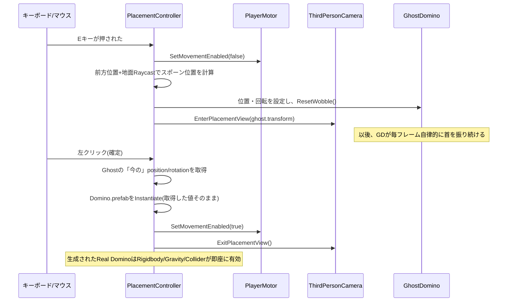
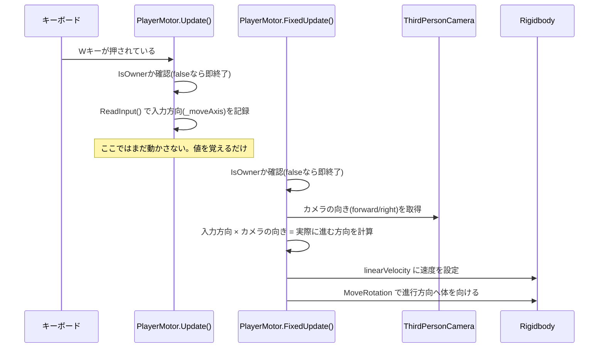

# PlayerSystem(プレイヤーの仕組み)

このドキュメントは `Player.prefab` を構成する各Componentの役割と、「WASDキーを押してからキャラクターが実際に動くまで」「Eキーを押してからDominoが配置されるまで」の処理の流れを説明します。対象読者は、Unityや通信対戦ゲームの実装を久しぶりに触る開発者を想定しています。

---

## 1. Player.prefab のHierarchy

```
Player (Root)                         ← ローカル座標 (0, 0.05, 0) でSpawn
├─ Rigidbody                          物理演算の本体
├─ CapsuleCollider                    当たり判定(半径0.4 / 高さ2 / 中心Y=1)
├─ PlayerStats                        数値パラメータの入れ物
├─ PlayerMotor                        入力読み取り+移動ロジック
├─ NetworkObject                      「ネットワークで管理される物」の目印
├─ NetworkTransform                   位置・回転をネットワーク経由で同期する部品
├─ NetworkRigidbody                   Rigidbodyの同期を物理的に正しく行うための部品
├─ PlacementController                Domino配置(Placement Mode)のロジック(Step 4で追加)
├─ Visual                             (子) 見た目(現状はCapsule)
│   ├─ MeshFilter (Capsule)
│   └─ MeshRenderer
└─ CameraTarget                       (子) ローカル座標 (0, 1.6, 0) = 頭の高さの目印
```

Rootには「物理」「ネットワーク」「入力ロジック」だけが集まっていて、「見た目(Visual)」だけが分離されています。これは意図的な設計で、理由は本ドキュメントの最後の章(Local/Remoteの違い)とArchitecture.mdで触れています。

---

## 2. 各Componentの役割

### PlayerStats
移動に関する数値をまとめて持っているだけの、ロジックを一切持たないコンポーネントです。

```csharp
public float moveSpeed = 5f;        // 通常時の移動速度 (m/s)
public float dashMultiplier = 1.8f; // Shiftダッシュ時にmoveSpeedへ掛ける倍率
public float jumpForce = 6f;        // ジャンプ時に与える上向き速度
public float rotationSpeed = 720f;  // 1秒間に何度まで体の向きを回転させられるか
public float mouseSensitivity = 2f; // (※現状未使用。下記参照)
```

**なぜ数値をここに分けているのか**: 将来「装備品によって移動速度が変わる」(GameDesign.md 17節)といった仕様を追加するとき、`PlayerMotor` のコードを書き換えるのではなく、この `PlayerStats` の値を装備品の効果で上書きするだけで済むようにするためです。現時点では装備システムは未実装なので、単なる初期値の置き場になっています。

**既知の未整理点**: `mouseSensitivity` フィールドはどこからも参照されていません。カメラの感度は `ThirdPersonCamera` 側が独自に持つ `sensitivity` フィールドで管理されており、両者は繋がっていません。将来「装備でカメラ感度を変える」等の予定がなければ、このフィールドは削除して問題ありません。

### PlayerMotor
このプレイヤーの「頭脳」にあたるスクリプトで、`NetworkBehaviour` を継承しています(`MonoBehaviour` ではなく `NetworkBehaviour` である理由は後述)。

主なField:
```csharp
[SerializeField] private float groundCheckDistance = 0.25f; // 接地判定の光線の長さ
[SerializeField] private LayerMask groundMask = ~0;          // 接地判定の対象レイヤー(現状は「すべて」)
[SerializeField] private Transform cameraTarget;              // カメラに渡す注視点(CameraTarget子オブジェクトへの参照)
```

主なMethod:
| Method | 呼ばれるタイミング | やっていること |
|---|---|---|
| `Awake()` | オブジェクト生成直後 | Rigidbody/PlayerStatsの参照を取得し、X軸・Z軸方向の回転を物理的にロックする(横に転ばないように) |
| `OnNetworkSpawn()` | ネットワーク上でこのオブジェクトが実体化した直後 | 自分の持ち主(Owner)である場合だけ、`ThirdPersonCamera` にカメラの追従対象として自分を登録する |
| `Update()` | 毎フレーム | 自分の持ち主である場合だけ、キーボード入力を読み取る(Placement Mode中はスキップ) |
| `FixedUpdate()` | 物理演算のたびに一定間隔で | 自分の持ち主である場合だけ、接地判定・移動・ジャンプを実行する(Placement Mode中はスキップ) |
| `SetMovementEnabled(bool)` | `PlacementController`がPlacement Modeの開始/終了時に呼ぶ(Step 4で追加) | `false`のときは`Update()`/`FixedUpdate()`の中身を丸ごとスキップさせ、その場で水平方向の速度を1回だけゼロにする。**Rigidbodyを`isKinematic`にしたりコンポーネント自体を無効化したりはしない**ため、Placement Mode中もPlayerは物理的に落下や衝突の影響を受け続ける |

**なぜ `OnNetworkSpawn` や `Update`/`FixedUpdate` の中で毎回 `IsOwner` を確認しているのか** は、このドキュメントの最後の章と `Networking.md` で詳しく説明します。一言で言うと「1つのキャラクターの分身が複数のPCに存在するが、実際に動かしていいのは持ち主のPCだけ」というルールを守るためです。

**なぜ`SetMovementEnabled`は「入力を無視するだけ」で「Rigidbodyを止める」わけではないのか**: Placement Mode中もPlayerが地面から浮いていたり他のDominoに押されたりする状況は普通にあり得るため、物理演算そのものを止めてしまうと不自然な挙動(宙に浮いたまま固定される等)になります。「動かす意思(入力)だけを止め、物理法則は止めない」という設計です。

### Rigidbody
Unity標準の物理演算コンポーネントです。設定値は次の通りです。

| 項目 | 値 | 意味 |
|---|---|---|
| Mass | 1 | 質量 |
| Linear Damping | 1 | 空気抵抗のようなもの。動きすぎを抑える |
| Interpolation | Interpolate | 物理更新の合間の動きを滑らかに見せる(カクつき防止) |
| Collision Detection | Continuous Dynamic | 高速で動いても壁や床をすり抜けにくくする設定 |
| Constraints | (スクリプトが起動時に設定) | `PlayerMotor.Awake()` でX軸・Z軸の回転を凍結。Y軸(体の向き)だけ回転可能 |

X/Z回転を凍結しているのは、物理的な衝突でキャラクターが横倒しにならないようにするためです。Y軸だけ空けているのは、`PlayerMotor` が移動方向を向くために `Rigidbody.MoveRotation()` でY軸回転を操作するからです。

### CapsuleCollider
半径0.4、高さ2、中心(0, 1, 0)のカプセル型の当たり判定です。足元(ローカルY=0)が地面に接するように配置されています。将来Dominoを実装したとき、プレイヤーがDominoにぶつかって倒す判定はこのColliderが担当します。

### NetworkObject
Netcode for GameObjectsが「このGameObjectはネットワークで管理する対象である」と認識するための目印となるコンポーネントです。これが付いていないGameObjectはネットワーク越しにSpawn/同期させることができません。詳しい仕組みは `Networking.md` を参照してください。

### NetworkTransform
このコンポーネントが実際に「位置と回転をネットワーク越しに送受信する」役割を持っています。設定のうち特に重要なのは:

- `AuthorityMode = Owner`(値としては `1`): **持ち主(操作している本人)側の位置情報を正解として扱う**という設定。詳しくはNetworking.mdの「Owner Authority」の章を参照。
- `Interpolate = true`: 受信側で位置が滑らかに補間される
- `PositionThreshold: 0.001` など: これ以上小さい変化は送信しない、という帯域節約のための閾値

### NetworkRigidbody
`NetworkTransform` だけでは「見た目の位置」は同期できても、物理演算としての正しい振る舞い(他のRigidbodyを押しのける等)までは保証されません。`NetworkRigidbody` は次の2つの設定でこれを補っています。

- `UseRigidBodyForMotion = true`: 受信側(持ち主ではない側)がネットワークから受け取った位置を適用するとき、Transformを直接書き換えるのではなく `Rigidbody.MovePosition/MoveRotation` を使う。これにより物理エンジンから見て「本当に動いている物体」として扱われる。
- `AutoUpdateKinematicState = true`: 持ち主側ではRigidbodyは通常どおり(Non-Kinematic)、持ち主以外の側では自動的にKinematicへ切り替える。

この2つの設定がある理由は「将来、Host権威で物理演算されるDominoに、Owner権威のPlayerがぶつかって倒す」という挙動を成立させるためです。Kinematic化されたRigidbodyは「一方的に他の物体を押せるが、自分は押し返されない」という性質を持つため、Host上に存在する(Hostから見て)他プレイヤーの分身も、Dominoに正しく衝突・干渉できるようになります。ただし**この設計が実際にDomino相手でも正しく動くかは、Domino実装時に改めて検証が必要**です(現時点では未検証)。

### Visual(子オブジェクト)
現状はUnity標準のCapsuleメッシュ(MeshFilter + MeshRenderer)だけを持つ、見た目専用の子オブジェクトです。当たり判定は一切持っていません。将来3Dモデルに差し替える際は、このオブジェクトの中身を丸ごと入れ替えるだけで済むようにしてあります。現時点では「見た目の切り替え」を行うスクリプト(例えば `PlayerVisual.cs`)はまだ存在せず、単にGameObjectの階層で役割を分離しているだけです。

### CameraTarget(子オブジェクト)
ローカル座標(0, 1.6, 0)、つまりCapsuleの頭あたりの高さに置かれた、見た目を持たない空のTransformです。`ThirdPersonCamera` はプレイヤーの足元ではなくこの点を狙ってカメラを配置するので、将来キャラクターの身長が変わっても(3Dモデルに差し替えても)ここの座標を調整するだけでカメラの目線を合わせ直せます。

### ThirdPersonCamera(Player.prefabの外、Main Cameraに付与)
`Player.prefab` の一部ではなく、Scene内の `Main Camera` に付いている別のコンポーネントです。ネットワーク対応(`NetworkBehaviour`)ではなく、ただの `MonoBehaviour` です。

- なぜネットワーク対応にしていないか: カメラの向きは完全に「自分のPC上での見た目」の話であり、相手に伝える必要が全くないからです。
- `Instance` という static プロパティを持つシングルトンになっており、`PlayerMotor` はこれを通じて「今、自分のキャラクターを映しているカメラ」にアクセスします。
- `SetTarget(Transform)` を外部(`PlayerMotor.OnNetworkSpawn()`)から呼ばれることで、初めて追従対象が決まります。それまではScene開始時にタグ`"Player"`を持つオブジェクトを自動で探す簡易フォールバックが `Start()` に入っています(1人プレイのテスト用)。
- **Placement View(Step 4で追加)**: `EnterPlacementView(Transform)`/`ExitPlacementView()`が外部(`PlacementController`)から呼ばれると、通常の三人称カメラ計算とは別に「Ghost Dominoを横から見た専用ビュー」の位置・回転を計算し、`Time.deltaTime`ベースで`Lerp`/`Slerp`しながら滑らかに切り替えます。通常ビューの計算自体は変更しておらず、`LateUpdate()`の最後で2つの計算結果をブレンド率(`_placementBlend`)に応じて合成しているだけです。Cinemachine等の新規パッケージは使わず、既存スクリプトの拡張のみで対応しています

**なぜPlacement Viewの視点が「Playerの右方向(`transform.right`)」を基準にしているのか**: `GhostDomino`の首振りは既定でローカルX軸(=Ghostの左右方向、Playerの進行方向前後に対応)を軸に回転します。Playerの右方向から見ることで、この首振りが「手前/奥への傾き」ではなく「画面上での左右の振れ」として視認しやすくなるように設計されています。

---

## 3. Placement Mode(Ghost Domino配置)の仕組み(Step 4で追加)

Step 4で、Playerが実際にDominoを配置するための`PlacementController`と`GhostDomino`を追加しました。ネットワーク的にはStep 4時点でまだ何も同期しておらず(Ghost/確定後のReal Dominoともに`NetworkObject`を持たない)、**各Playerのローカル画面だけで完結する機能**です。

### PlacementController(`Player.prefab`に追加、`NetworkBehaviour`)

主なField(すべてInspectorで調整可能):
```csharp
[SerializeField] private Key enterPlacementKey = Key.E;        // Placement Mode開始キー
[SerializeField] private Key cancelKey = Key.Escape;            // キャンセルキー(右クリックも別途対応)
[SerializeField] private GameObject dominoPrefab;                // 確定時に生成するReal Domino
[SerializeField] private GameObject ghostDominoPrefab;           // Ghost Dominoの元プレハブ
[SerializeField] private float forwardDistance = 1.2f;           // Player前方何mにGhostを出すか
[SerializeField] private float hoverHeight = 0.15f;              // 地面から何m浮かせるか
[SerializeField] private float groundRaycastRange = 3f;          // 地面検出Raycastの長さ
[SerializeField] private LayerMask groundMask = ~0;              // 地面検出の対象レイヤー
```

主なMethod:
| Method | 呼ばれるタイミング | やっていること |
|---|---|---|
| `OnNetworkSpawn()` | ネットワーク上でこのオブジェクトが実体化した直後 | 自分の持ち主でなければ`enabled = false`でコンポーネント自体を無効化(`PlayerMotor`と同じ考え方) |
| `Update()` | 毎フレーム(Owner のみ) | Placement Mode中かどうかで分岐し、該当するキー/マウス入力を判定する |
| `EnterPlacementMode()` | `E`キーが押された時 | Player前方・地面ぎりぎり上のGhost出現位置を計算(下向きRaycastで地面のY座標を検出)、`PlayerMotor.SetMovementEnabled(false)`、`ThirdPersonCamera.EnterPlacementView()`を呼ぶ |
| `ConfirmPlacement()` | Placement Mode中に左クリックされた時 | **その瞬間のGhostの位置・回転をそのまま**使って`Domino.prefab`を`Instantiate()`し、Placement Modeを終了する |
| `CancelPlacement()` | Placement Mode中に右クリックまたは`Escape`が押された時 | 何も生成せず、Placement Modeを終了する |
| `ExitPlacementMode()` | 確定・キャンセルどちらからも呼ばれる共通処理 | Ghostを非表示化(`Destroy`ではなく使い回すために`SetActive(false)`)、`PlayerMotor.SetMovementEnabled(true)`、`ThirdPersonCamera.ExitPlacementView()`を呼ぶ |

**なぜ`ConfirmPlacement()`で角度の補正を一切行わないのか**: これはゲームデザイン上重要な意図的な仕様です。「ほぼ垂直なタイミングで確定すればDominoは立つ」「大きく傾いたタイミングで確定すればDominoはすぐに倒れる」という、プレイヤーの操作タイミングがそのまま結果に直結する緊張感を作るための設計です。コード上も`_ghostDomino.CurrentRotation`(Ghostの現在の`transform.rotation`をそのまま返すだけのプロパティ)を寸分の加工もなく`Instantiate()`に渡しています。

### GhostDomino(`GhostDomino.prefab`、通常の`MonoBehaviour`)

```csharp
[SerializeField] private float maxTiltAngle = 25f;   // 最大何度まで傾くか
[SerializeField] private float periodSeconds = 1.5f; // 1往復何秒か
[SerializeField] private Vector3 tiltAxis = Vector3.right; // どの軸を中心に傾くか
```

`Update()`の中で`Mathf.Sin()`を使い、`ResetWobble()`が呼ばれた時点の姿勢を基準に、指定した軸まわりに`-maxTiltAngle`〜`+maxTiltAngle`の範囲で滑らかに首を振り続けます。`NetworkBehaviour`ではなく普通の`MonoBehaviour`であり、`Collider`も`Rigidbody`も持たないため、Physics演算や他のPlayer/Dominoとの当たり判定には一切参加しません。

**なぜ既定の`tiltAxis`が`Vector3.right`(ローカルX軸)なのか**: Ghostの初期姿勢はPlayerの進行方向を向いているため、ローカルX軸まわりの回転は「前後方向への傾き」になります。これにより、Wobble中に確定したDominoは(倒れる場合)Playerの進行方向に沿って倒れることになり、「歩きながら配置していく」という基本ループと自然に噛み合うようになっています。

### 処理フロー



キャンセル(右クリック/Escape)の場合は「Domino.prefabをInstantiateする」行程だけが省略され、それ以外(`SetMovementEnabled(true)`・`ExitPlacementView()`)は確定時と同じ処理が呼ばれます。

---

## 4. WASD入力から実際にPlayerが動くまでの処理フロー



ポイントは「入力を読む場所(`Update`)」と「実際に動かす場所(`FixedUpdate`)」が分かれていることです。これはUnityの一般的な作法で、物理演算(Rigidbodyの操作)は必ず `FixedUpdate` の中で行うことで、フレームレートが変動しても移動速度が一定に保たれます。

また、移動方向が「キー入力そのまま」ではなく「カメラの向きを基準にした方向」になっている点も重要です。`ThirdPersonCamera.transform.forward` を基準にすることで、「Wキー=カメラが向いている方向へ前進」という、三人称視点として自然な操作感になっています。

---

## 5. Local PlayerとRemote Playerで処理がどう違うか

同じ `Player.prefab` から生成されたオブジェクトでも、「自分のキャラクター(Local/Owner)」か「他人のキャラクター(Remote)」かによって、実際に動くコードとRigidbodyの状態がまったく異なります。

| 項目 | 自分のキャラクター(Owner) | 他人のキャラクター(Remote) |
|---|---|---|
| `PlayerMotor.Update()` | キーボードを読んで動く | `IsOwner == false` のため何もしない |
| `PlayerMotor.FixedUpdate()` | 移動・ジャンプ処理を実行 | `IsOwner == false` のため何もしない |
| Rigidbodyの状態 | 通常の物理演算(Non-Kinematic) | `NetworkRigidbody` が自動的にKinematicへ切り替え |
| 位置の決まり方 | 自分のRigidbodyの計算結果がそのまま位置になる | ネットワーク経由で受信した位置を `MovePosition/MoveRotation` で反映するだけ |
| カメラ | `ThirdPersonCamera` の追従対象になる | 一切関係しない(追従対象は常に1つ=自分だけ) |
| `PlacementController`(Step 4) | `enabled == true`。Eキー等の入力を受け付け、自分のGhost/Real Dominoを生成する | `OnNetworkSpawn()`時点で`enabled = false`。コンポーネント自体が丸ごと無効化されるため、他人のPlacement操作は一切見えない・影響しない |

つまり「同じスクリプトが2箇所で動いているが、`IsOwner` の判定によって片方は"実際に操作するモード"、もう片方は"ネットワークの結果を映すだけのモード"に自動的に切り替わる」という仕組みになっています。この判定がなぜ必要かは `Networking.md` でさらに詳しく説明します。
